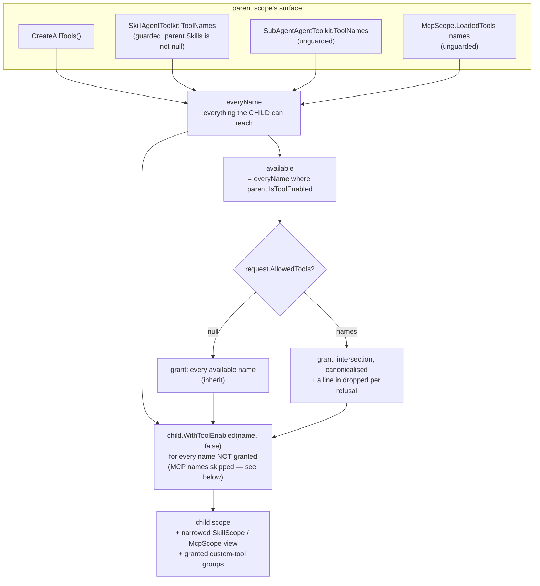

# 设计模式 —— 工作流代理 —— 子代理能力收窄

一次 spawn 把派发者能力的一份切片交给子代理，整个不变量是一句话：**子代理的能力是父代理自己的，或更少 —— 绝不多于**。真正值得设计的不是规则本身，而是它的*载体*。三个轴中有两个无法用工具名列表表达，第三个也只有在工具注册重新分组后才可表达。本页解释每个轴为何以现在的方式承载。

> 源码：`Src/Core/VeloxDev.Core.Extension/Agent/SubAgents/SubAgentScope.cs`（`TrySpawn`）；`Agent/Workflow/WorkflowAgentScope.cs`（授予辅助）；`Agent/Skills/SkillScope.cs`（`GrantableNames` / `CreateNarrowed`）；`Agent/MCP/McpScope.cs`（`GrantableNames` / `CreateGrantedView`）。测试：`SubAgentNarrowingTests`、`SubAgentCapabilityGrantTests`。

## 为什么名字列表不够

技能与 MCP 服务器由**它们自己的上下文提供器**贡献，来自各自的数据层 —— 两者都不在 `WorkflowAgentToolkit.CreateAllTools()` 里。因此工具名列表只能回答“这个工具在不在”，而 `load_skill` 存在与否，与*它能读哪些技能*是两个问题。按名字给子代理关掉一个技能没有意义，关掉加载器又会把整个轴移除而不是收窄它。答案是**视图**：父作用域包装自己的来源 —— 原样，或收窄到请求 —— 并把那个交给子代理。

| 轴 | 载体 | 实现 | 边界在哪 |
|---|---|---|---|
| 工具 | 两个名字列表 | `TrySpawn` 内的 `available`（可授予）与 `everyName`（可达） | 对每个可达但未授予的名字调用 `child.WithToolEnabled(name, false)` |
| 技能 | 收窄来源 | `SkillScope.CreateNarrowed(allowed)` | 过滤位于 `Apply` 的**顶部**，因此之后的 `Refresh()` 无法把限制长回来 |
| MCP 服务器 | 授权视图 | `McpScope.CreateGrantedView(parent, granted, grantedTools)` | `IsGrantedView = true`；`_loadedClients` / `_loadedConfigs` 刻意留空 |
| 自定义工具 | 注册**组** | `WorkflowAgentScope.GrantCustomToolsTo(child, granted)` | 所有工具都未授予的组不贡献任何东西，连指引也不贡献 |

边界是**可执行的，而非声明的**：子代理自己的 `ListSkills` 只枚举被授予的技能，对授予之外的技能调 `load_skill` 会在*子代理内部*失败 —— `SubAgentCapabilityGrantTests.AGrantedSkill_ReachesTheChild_AndADeniedOneDoesNot` 断言的是工具自己的输出，而非视图自己的记账。一个自称已收窄却仍提供一切的视图会通过更弱的断言，却在这条上失败。

> 表中一个断言是从源码*推断*而非测试钉住的：`CreateNarrowed` 在 `Apply` 顶部过滤，因而在之后的 `Refresh()` 后仍然成立。没有测试刷新一个收窄的技能来源 —— 被钉住的是视图在 spawn 时恰好持有授予集（`AGrantedSkill_IsAView_NotAFilterOnTheParent`、`ASkillTheParentSwitchedOff_IsNotGrantable`）。

## 视图必须是单向的

两个授予不同的子代理由同一个父作用域服务，因此对共享来源施加过滤会让第二个子代理拿到第一个的列表。`AGrantedSkill_IsAView_NotAFilterOnTheParent` 一次断言三组集合。

对 MCP 理由更硬：把父作用域的 `McpScope` 交给子代理，也会把 `LoadMcpServers` 与 `UnloadMcpServer` 交出去 —— 也就是对父代理自己当轮挂起所依赖的进程的支配权 —— 而 `WithMcps` 会无条件覆盖宿主在共享 `McpScope` 上设置的一切确认处理器，N 个子代理挂同一作用域会互相覆盖。因此视图**不拥有任何客户端**：释放它无法断开父代理。`AGrantedView_OwesNothingToItsParentThatClosingItCouldTakeAway` 释放视图并断言父代理仍持有两台服务器。

被授予的服务器是*可用且仅此而已*：表面是该服务器自己的工具加 `ListMcpServers` 与 `DescribeMcpServer`，`LoadMcpServers` / `UnloadMcpServer` / `AddMcpServer` 结构性缺席。

## 两个列表，以及为什么必须是两个

两个集合并不冗余，名字属于哪个集合决定它执行规则的哪一侧：

- `available` 是模型**被告知**会得到的：父代理当前启用的工具。这里出现一个名字，就必须真的能在子代理上调用，否则模型会围绕一个它没有的能力做计划。
- `everyName` 是子代理本来**可达**的东西，*不管父代理自己的开关*。关闭循环跑在这个集合上，正是它阻止父代理自己关掉的工具经继承路径到达子代理 —— 子代理持有父代理没有的能力就是一次**扩宽**，而这正是该子系统要防的。`SubAgentNarrowingTests.AToolTheParentHasSwitchedOff_IsNotInherited` 是这条规则最锐利的形式，因为没有人点名那个工具。

因为 `everyName` 是“子代理可达什么”而不是“父代理当前贡献什么”，它的四个来源各带自己的守卫 —— 守卫不同是有原因的。技能名以 `parent.Skills is not null` 为守卫，因为父代理自己的技能来源贡献它们。五个子代理名字**不加守卫**，因为 `child.WithSubAgents(grand)` 是无条件的：每个子代理无论父代理是否挂载子系统都能到达它们。照抄技能那行的守卫正是会重新引入缺陷的错误。

> 那个缺陷值得记录，因为它的症状与规则完全相反。五个名字从 `everyName` 缺失时，省略 `allowedTools` 的 spawn 会让它们保持开启，而**点名**工具的 spawn 会把五个全关掉 —— 于是模型只有在没停下来思考授予什么时才能委派，而一询问就会得到“not available to this agent”，那同样是假的。`SubAgentNarrowingTests.TheSubAgentTools_CanBeNamed_InAWhitelist` 现在钉住两半。MCP 名字因同样的结构原因缺失，且以相反方式失败：点名一个会得到该拒绝，而父代理明明持有它。`SubAgentCapabilityGrantTests.NamingAnMcpTool_IsNotARefusal` 在故障点钉住修复。

留下的通则：**`everyName` 少一个来源，只会产生一个“省略时保留、点名时宣告不存在”的来源。** 增加第四个能力轴意味着检查全部四个来源，而不是三个。

## 每个开关只有一个移除点

MCP 名字是关闭循环**跳过**的唯一来源，原因是名字不是 MCP 工具被开关的地方。它的开关在 `McpScope` 上以 `server/tool` 为键，把裸名字传给 `WorkflowAgentScope.WithToolEnabled` 看起来像移除却什么也没移除。因此该轴在键所在处收窄 —— `CreateGrantedView` 的第三个参数 —— 而 `AWhitelistThatOmitsAnMcpTool_TakesItOffTheChildsSurface` 断言工具真的离开了子代理表面，而不只是授予列表。

## 报告是设计的一半

`dropped` 不是诊断，而是承诺的另一半。一个请求了工具、相信自己持有、并围绕它做了计划的模型，直到运行已经浪费才会发现缺席 —— 因此每次拒绝都报告**撞上了哪堵墙**：该 agent 不可用 / 父代理不在那台服务器上 / 父代理的读或写上限更低 / 父代理不允许节点执行 / 父代理没有该命令的白名单 / 没有授予技能因此技能工具一并消失。`ARequestTheParentCannotHonour_IsDroppedAndReported` 要求被关闭的工具与不存在的工具被**可区分地**报告，否则模型无法分辨两者。

“授予列表与子代理真实表面必须是同一集合”有两个后果：

- 技能与 MCP 拿到的是**收窄视图**而不是列表，正是为了让两者无法漂移；
- 被授予**零个**技能的子代理会失去技能工具（`ListSkills`、`load_skill`、`UnloadSkill`、`read_skill_resource`）—— 它们经继承分支到达，而背后空无一物的 `load_skill` 只会失败。`AnEmptySkillList_GrantsNone_AndTakesTheSkillToolsWithThem` 断言工具消失**并且** `dropped` 行解释了原因。

同一原则最微妙的实例是交互：`RequestSelection` 与 `RequestConfirmation` 只在某个处理器注册于*那个*作用域时才提供，而子作用域是新对象。把这两个名字写进授予列表却不复制宿主的交互配置，会把两个子代理并不拥有、也永远无法调用的名字放进列表 —— 一种模型看得见却用不了的权限，比没有权限更糟，因为它会围绕它做计划。因此 `WorkflowAgentScope.GrantInteractionTo` 把整份权限策略（模式、规则、judge）、模式提示覆盖与两个处理器随工具一起下传（`SubAgentBudgetTests.AChild_InheritsTheHostsInteractionConfiguration`）。**要在常驻提示里加一句关于子代理能力的话，先检查 `GrantInteractionTo` 转移了什么** —— 这个陷阱的文字半边比代码半边多活了一个版本。

## 知识不是权力

三个轴现在共享一个默认：**省略参数即继承父代理当前启用的集合**；空列表表示一个都不授予，与省略是不同的请求。这种对称是刻意的 —— 早先设计有三套不同默认（工具的只读半边、全部技能、零个 MCP 服务器），各有自己的局部理由，而分歧正是让“省略参数是什么意思？”不读源码就答不出来的原因。「覆盖命名列表是唯一的减法」现在是描述全部三个轴的一句话。

> 交叉引用：[建造者](../02_建造者/index.md)、[外观](../03_外观/index.md)、[子代理树与消耗计量](../11_子代理树与消耗计量/index.md)。
