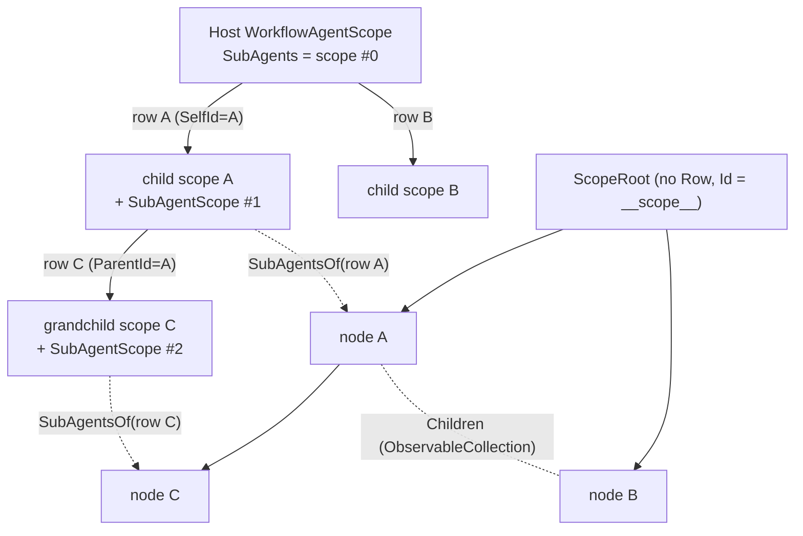
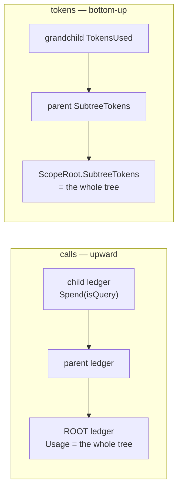

# 设计模式 —— 工作流代理 —— 子代理树与消耗计量

一旦存在 agent 树，有两样东西必须**推导**而不是只存一次：**谁是谁的父**，以及**这棵树花了多少**。前者是刻意保持扁平的数据的投影；后者同时沿两个方向运行 —— 调用沿账本链*向上*汇总，token 沿视图模型树*自底向上*聚合。本页解释两者为何如此，以及树面板依赖的一个并发假设和它不成立的那一处。

> 源码：`Agent/SubAgents/SubAgentScope.cs`、`.../SubAgentTreeViewModel.cs`、`Agent/Workflow/Functions/ToolCallLedger.cs`。测试：`SubAgentHierarchyTests`、`SubAgentMetricsTests`、`SubAgentTreeViewModelTests`。

## 由扁名册投影出的作用域树

每个被派发的子代理获得**自己的** `WorkflowAgentScope`（由 `parent.Tree.AsAgentScope()` 构建）、**自己的** `SubAgentScope` 与自己的对话记录。子系统无条件挂到子代理上 —— 包括在深度上限处 —— 因此唯一阻止孙代理的是 `CanSpawn` 闸门，绝不会是缺少挂载。这使子代理的简报能说出*为什么*不能派发，而不是留下一个它看不见的洞。

名册是**扁平且按作用域的**，这是刻意的隔离机制而非实现捷径：作用域只持有它发出的东西，因此兄弟的句柄在这里不解析 —— 它根本不存在。`SubAgentDispatchTests.AChildSeesItsOwnChildren_AndNobodyElses` 断言偷看兄弟的子代理会得到拒绝。

扁平名册无法靠查找命名父代理，因此链接在 spawn 时写死：spawn 把自己的行 id 记为子作用域的 `SelfId`，该作用域的每个子代理都以它为 `ParentId`。于是树**仅凭行**即可构建，`SubAgentTreeViewModel` 是若干名册的投影，而不是第二个事实源 —— 除重建外从不被就地修改。

由此有两条容易搞错的标识规则：

- **深度是绝对的**，从宿主作用域量起、绝不按层重置：根的子代理是深度 1，孙代理是深度 2。
- **会话状态键按子系统实例**（一个 `Guid`），绝不是 workflow 作用域的 `StateDiscriminator`。判别符从树派生，而父子作用域在同一棵树上 —— 它会在恰好不能碰撞的那一对上碰撞。`SubAgentHierarchyTests.TwoScopes_NeverShareAStateKey` 与 `TwoProvidersOverOneScope_DoShareAKey` 钉住两个方向：两个子系统不得共享，同一子系统的两个提供器必须共享。

## 计量沿两个方向

**调用向上汇总，这正是树安全的原因。** `ToolCallLedger.Spend` 增加本级后调用 `Outer?.Spend(isQuery)`，因此任一级的 `Usage` 都是*其子树*的总数，`Root` 是最顶层账本。子作用域把父账本作为外层账本，这才把“任意深度”变成“受根额度约束”：根的额度是唯一必须耗尽的计数器。两个独立预算会让父代理能给每个子代理各自完整的剩余额度，树的消耗便无界。零回归情形同样关键 —— 根作用域的账本没有 `Outer`，此时每个成员都恰好退化成它取代的三个计数器，因此从未挂载子系统的宿主观察不到变化（`SubAgentBudgetTests.WithoutAnySubAgents_TheAccountingIsTheScopesOwn`）。

重置刻意是**不对称的**。`ResetChain` 清零本级及其*上方*每一级，因此子代理成功重置会重开整个会话，而父代理的重置无法伸进子代理自己的授予。这不是疏忽：授予是关于 spawn 的事实，“继续”的答案是新的子代理，而不是在模型背后悄悄扩宽子额度。`SubAgentBudgetTests.TheParentsReset_ReopensTheTree_WithoutRewritingAGrantAlreadyMade` 与 `ASpentChild_ReportsUpward_RatherThanWaitingToBeUnstuck` 钉住两半。

**Token 自底向上聚合，且只有树能做。** 接缝是 `SubAgentScope.RunAsync` 中的一行：`AgentResponse.Usage` 是 token 数唯一存在的地方 —— 五个管理工具、对话记录与管线事件都没有 token 概念（`CallUsage` 是*调用计数*；两者绝不能混淆）。每行存储**自己的**花销；整棵树的求和由 `RecomputeAggregates` 在节点的子代填充后计算，因此递归按构造自底向上。

两个数字刻意分开：`SubAgentTreeNodeViewModel.TokensUsed` 是节点自己的花销，`SubtreeTokens` 是总数，`ShowSubtreeTokens` 仅在节点既有自己测得的花销、又有花得更多的后代时为真。只报告自己的父节点会隐藏下面的工作；报告总和的父节点会让列无法合计。

三个更小的决定属于同一“绝不伪造数字”原则：

- 不报告用量的提供器让行保持 `null`，而不是 `0`；`HasTokens` 在 UI 中区分“未测量”与“花了零”。
- 被取消或出错的子代理把 token 字段留 `null` —— 那些路径本会读取的响应已不存在，写数字就是发明。
- 作用域自己的花销**不，也无法**由库测量：宿主的对话才是它的来源。`SubAgentTreeNodeViewModel.ScopeTokens` 是宿主填充的字段；未设置时作用域根回退显示子树总数 —— 一个诚实的数字，而不是对宿主的猜测。由于宿主通常在树构建后设置它，其变更钩子会**重算**聚合而不只是通知。

耗时是计算而非存储（`FinishedAt ?? Now - StartedAt`），库**不拥有计时器**：滴答的面板与托管进程生命周期不同，库里的计时器不属于任何一方。`TickElapsed()` 供宿主用已有时钟调用。

## 重建闸门：一个假设，一处不成立

`SubAgentTreeViewModel` 假设重建发生在**一个**线程 —— 创建它的线程 —— 合并队列只在那里*投递*。有 `SynchronizationContext` 时这成立：每个作用域的 `Changed` 处理器投递一次排空。

**没有上下文可投递时**（无头宿主，以及测试套件里的每个测试）**不成立**。重建于是**内联**在触发变化的作用域线程上，两个子代理同时完成就是两个线程同时进入 `Fill` 修改同一个 `ObservableCollection`。这不是罕见的交错，而是扇出的构造方式 —— 它造成的损坏会以无关子代理运行中的异常浮现，而不是在这里。因此有内部 `_rebuildGate`，由合并标志检查、`Rebuild` 与 `Dispose`（唯一第三个同时修改根、扁平列表与监视集的地方）获取。

同一问题的镜像位于库内而非面板。子代理在线程池线程上运行，而父代理的轮次在 UI 线程上挂起，两个作用域图编辑之间**唯一**的串行化是它们都经过同一上下文。设计的答案是把握屏上下文下传给子代理（`child.WithSynchronizationContext(parent.UIContext)`，在 `WithSubAgents` *之前*设置，后者继续向下转发），而不是收回变更权限：子代理仍被串行化到同一个泵上，这一事实以继承而非拒绝表达。记录在案的成本是完全没有上下文的宿主：其子代理现在可以编辑图而没有任何东西串行化它们。`SubAgentNarrowingTests.WithNoUIContext_TheSurfaceIsStillTheParentsOwn` 与 `TheUIContext_ChangesNothingAboutWhatIsGranted` 钉住幸存下来的不变量 —— **无论有没有上下文，授予结果完全相同**；上下文决定调用*在哪*运行，绝不决定子代理*能否*发起。

“面板只是视图”还有两个后果：

- `Dispose` 解除挂接且**不取消任何东西** —— 关闭面板不是对面板所示工作做出的决定。取消归 `SubAgentScope.Cancel` 或作用域自己的释放。
- 计数随节点一起消失，因为释放后 `Rebuild` 会提前返回，留下的总数永远无法刷新到一致。

## 整个设计依赖的执行模型

上述一切假设子代理运行时宿主 UI 线程保持空闲。spawn 发生在被组合宿主编组到该线程的工具体内，因此同步子代理会在整个对话期间占住它 —— 这就是 `SpawnSubAgent` 返回句柄、运行交给线程池的原因，也是工具的形态（即使工作立即完成也是异步的）成为模型在 schema 中读到的契约而非实现细节的原因。`SubAgentDispatchTests.ASpawnReturns_BeforeTheChildHasAnswered` 与 `SeveralChildren_AreInFlightAtOnce` 断言该性质；UI 线程的*自由*本身仍只是理论论证，因为套件里没有替身能证明它。

> 交叉引用：[子代理能力收窄](../10_子代理能力收窄/index.md)、[数据流 · 子代理派发](../../../03_数据流/01_工作流代理/06_子代理派发/index.md)。
