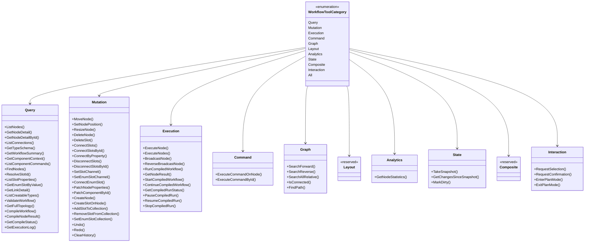

# 工作流代理 —— 设计模式 —— 工具类别层级

`WorkflowToolCategory` 是 `[Flags]` 枚举；每个标志选择 `WorkflowAgentToolkit.CreateAllTools` 构建的一组工具。两个组是**保留且为空**的。下图展示该枚举与它选择的十个分组。

> 源码：`Src/Core/VeloxDev.Core.Extension/Agent/Workflow/Functions/WorkflowToolCategory.cs`（枚举）与 `WorkflowAgentToolkit.CreateAllTools`（分组）。

## 数量

| 标志 | 值 | 工具数 |
|---|---|---|
| `Query` | `1 << 0` | 20 |
| `Mutation` | `1 << 1` | 23 |
| `Execution` | `1 << 2` | 12 |
| `Command` | `1 << 3` | 2 |
| `Graph` | `1 << 4` | 5 |
| `Layout` | `1 << 5` | **0（保留）** |
| `Analytics` | `1 << 6` | 1 |
| `State` | `1 << 7` | 3 |
| `Composite` | `1 << 8` | **0（保留）** |
| `Interaction` | `1 << 9` | 至多 2 |

**66 个无条件内置工具**（20 + 23 + 12 + 2 + 5 + 0 + 1 + 3 + 0）—— `Layout` 与 `Composite` 不贡献。其上还有：

- `RequestSelection` / `RequestConfirmation`（至多 2 个），各自仅在处理器存在时；
- `EnterPlanMode` / `ExitPlanMode`（2 个），仅在确认处理器存在时 —— 在类别掩码之外添加；
- `ResetToolCallLimit`，始终；
- 开发者注册工具与子系统工具。

两个处理器都注册时总数为 **71**。

## 为什么两个组是空的

- **`Layout` 保留。** 多节点对齐逐节点经 `MoveNode` / `SetNodePosition`（各一条 `SetAnchorCommand`）完成，因此捆绑布局工具会位于命令管线旁边，而不是内部。
- **`Composite` 保留。** 每个操作都是单次组件命令步骤，因此框架的撤销/重做栈绝不会被捆绑的多步手势绕过或重复提交。

这些标志仍然存在，让宿主可以传入而不报错，也让枚举记录该决定。

## 为什么 `Interaction` 是条件性的

`Interaction` 只在对应处理器（`WithSelectionHandler` / `WithConfirmationHandler`）注册时才有内容 —— 已无安全级别 —— 因此同一个 `All` 值会因宿主配置产生不同工具数。`EnterPlanMode` / `ExitPlanMode` 在类别旁，受确认处理器闸控。`CreateTools(categories)` 是决定什么到达模型的唯一位置：它在类别标志之上应用逐工具开关，`CreateAllTools`（internal）返回宿主 UI 枚举的未过滤表面。

**预期结果：** `scope.ProvideTools(WorkflowToolCategory.Query)` 恰好返回 20 个 Query 工具（加上自定义/子系统工具与 `ResetToolCallLimit`）；向掩码加入 `Layout` 或 `Composite` 不改变任何东西。
