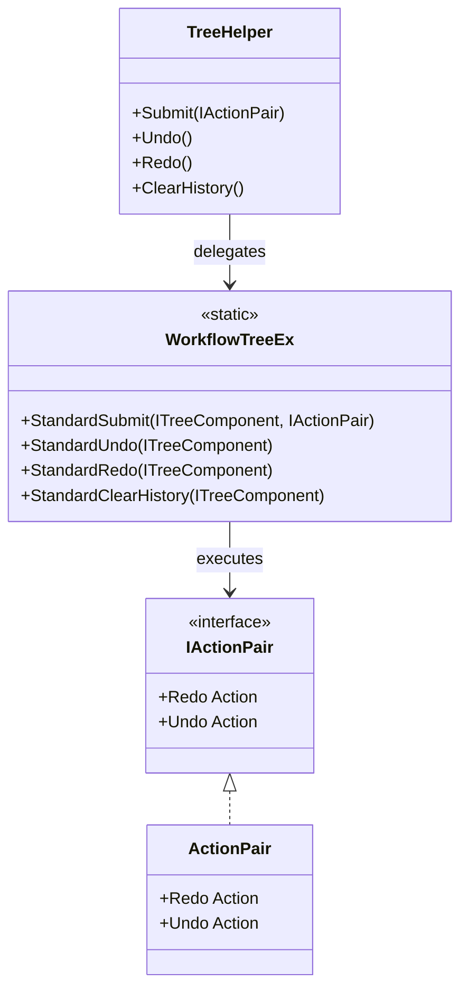
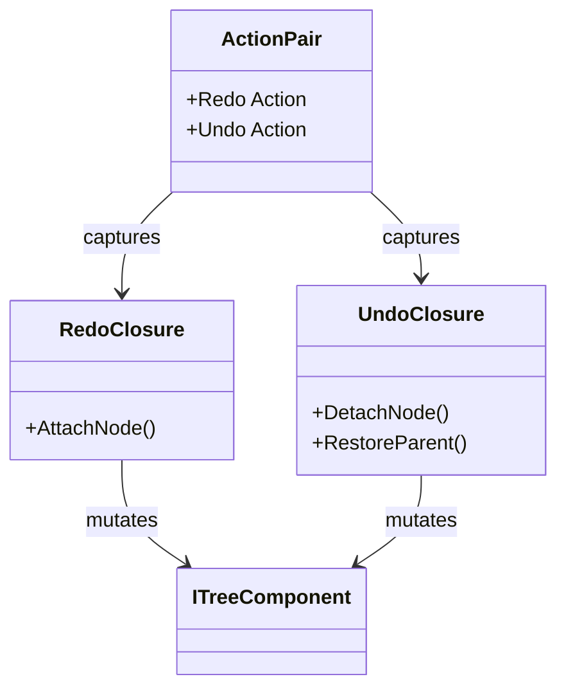
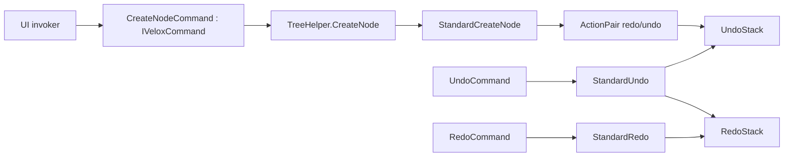

# 工作流编辑与历史中的设计模式

每一次应当可撤销的改动都表示为一个重做动作加一个撤销动作。标准操作立即执行重做部分，并把动作对压入历史；撤销与重做再回放相应的一半。结果是一个命令（Command）模式，其中的命令同时充当自身的备忘录（Memento），而看护者（Caretaker）存放在树旁边而非树之上。

## 命令：一个动作是一对委托

`IActionPair` 刻意保持最小——一个 `Redo` 委托、一个 `Undo` 委托，都是无参 `Action`。需要状态的命令闭包捕获它，因此动作对自包含，也不需要命令基类。

```csharp
public interface IActionPair
{
    public Action Redo { get; }
    public Action Undo { get; }
}

public readonly struct ActionPair(Action redo, Action undo) : IActionPair
{
    public Action Redo { get; } = redo;
    public Action Undo { get; } = undo;
}
```

源码：`Src/Core/VeloxDev.Core/Interfaces/WorkflowSystem/Commands/IActionPair.cs` 第 4-11 行；`Src/Core/VeloxDev.Core/WorkflowSystem/ActionPair.cs` 第 6-12 行。



helper 暴露同样的四个操作并转发给静态标准实现，因此宿主调用 helper 或扩展方法都可以。

源码：`Src/Core/VeloxDev.Core/WorkflowSystem/Templates/Helpers/TreeHelper.cs` 第 398-411 行。

## 备忘录：命令捕获两个状态

框架不为撤销序列化整图快照。相反，每个标准改动构造一个动作对，由闭包捕获它所需的前后状态。以创建节点为例：捕获旧父级与新父级；重做把节点挂到新树，撤销把它移除并恢复旧父级。

```csharp
component.StandardSubmit(new ActionPair(
    () => CreateNodeRedo(component, node, newParent),
    () => CreateNodeUndo(component, node, oldParent)));
```

源码：`Src/Core/VeloxDev.Core/WorkflowSystem/StandardEx/WorkflowTreeEx.cs` 第 38-40 行，两个闭包在第 395-405 行。

这是备忘录模式最轻的形式：发起者的状态编码在命令捕获的变量里，看护者只保存动作对。它避免通用图快照，使撤销代价与操作成比例，而不是与树规模成比例。



## 看护者：两个栈归树的缓存所有

`StandardSubmit` 执行重做部分，然后把动作对压入 `UndoStack`。`StandardUndo` 从 `UndoStack` 弹出，执行撤销部分，再压入 `RedoStack`。`StandardRedo` 做镜像操作。两个栈都是 `ConcurrentStack<IActionPair>`，存放在由 `ConditionalWeakTable` 创建的每树缓存中，因此历史跟随树的生存期，而不成为其公开状态的一部分。

```csharp
var cache = GetCache(component);
if (cache.UndoStack.TryPop(out var pair))
{
    pair.Undo.Invoke();
    cache.RedoStack.Push(pair);
}
```

源码：`Src/Core/VeloxDev.Core/WorkflowSystem/StandardEx/WorkflowTreeEx.cs` 第 352-383 行；栈声明在第 684-685 行。

代码中有两个可见结果：

- 新提交**不会**清空重做栈。标准操作通过 `StandardClearHistory` 显式清空历史；该方法的注释是 Core 里唯一的清空策略。
- 重做或撤销委托抛出的异常会被捕获并写到 `Debug`，因此失败的回放不会破坏栈状态。操作也不会回滚到失败点之前。

源码：`Src/Core/VeloxDev.Core/WorkflowSystem/StandardEx/WorkflowTreeEx.cs` 第 334-391 行。

## 调用者：生成的命令是面向用户的边缘

树接口以 `IVeloxCommand` 属性暴露编辑操作——`CreateNodeCommand`、`SendConnectionCommand`、`ReceiveConnectionCommand`、`SubmitCommand`、`UndoCommand`、`RedoCommand`。生成器写出它们的实现，每个生成的命令转发到 helper。于是命令模式有两层：`VeloxCommand` 是 UI 层调用者，`IActionPair` 是它提交的可撤销单元。

源码：`Src/Core/VeloxDev.Core/Interfaces/WorkflowSystem/Components/ITreeComponent.cs` 第 27-55 行；生成的转发在 `Src/Core/VeloxDev.Core/WorkflowSystem/Templates/ViewModels/TreeDefaultViewModel.cs` 第 36-80 行。



## 模式小结

| 模式 | 在功能中的角色 | 证据 |
| --- | --- | --- |
| 命令 Command | `IActionPair` / `ActionPair`；生成的 `IVeloxCommand` 属性 | `IActionPair.cs`、`TreeDefaultViewModel.cs` |
| 备忘录 Memento | 闭包捕获前后状态 | `WorkflowTreeEx.cs` 第 38-40、395-405 行 |
| 看护者 Caretaker | 每树的 `UndoStack` / `RedoStack` | `WorkflowTreeEx.cs` 第 684-685 行 |
| 调用者 / 门面 Invoker / Facade | `TreeHelper` 转发到 `WorkflowTreeEx` | `TreeHelper.cs` 第 398-411 行 |

编辑操作依赖下一项功能描述的连接规则；一次完成的连接本身也作为动作对提交。参见[连接规则与预览](../02_连接规则与预览/index.md)。
