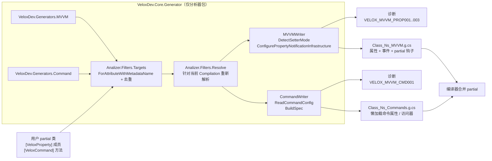

# 设计模式 — MVVM

`mvvm` 功能是**生成器 + 命令运行时**的组合。运行时位于 `Src/Core/VeloxDev.Core/MVVM/**` 与 `Src/Core/VeloxDev.Core/Interfaces/MVVM/**`，命名空间为 `VeloxDev.MVVM`。`Src/Generators/VeloxDev.Core.Generator/**` 下的 Roslyn 源生成器（类 `VeloxDev.Generators.MVVM` 与 `VeloxDev.Generators.Command`，随仅含分析器的包 `VeloxDev.Core.Generator` 发布）把 `[VeloxProperty]` 成员与 `[VeloxCommand]` 方法变成可观察属性与懒加载命令属性。

## 模型类图

```mermaid
classDiagram
    direction LR
    class VeloxPropertyAttribute {
        <<attribute>>
    }
    class VeloxCommandAttribute {
        <<attribute, sealed>>
        +Name string
        +CanValidate bool
        +Semaphore int
    }
    class ICommand {
        <<interface>>
        +Execute(object?) void
        +CanExecute(object?) bool
        +CanExecuteChanged EventHandler
    }
    class IVeloxCommand {
        <<interface>>
        +Created/Enqueued/Dequeued/Started/Completed/Failed/Canceled/Exited CommandEventHandler
        +Lock/Unlock/Notify/Clear/Interrupt/Continue/ChangeSemaphore() void
        +ExecuteAsync(object?) Task
    }
    class IVeloxCommandCompletion {
        <<interface>>
        +ExecuteAndWaitAsync(object?, CancellationToken) Task~CommandCompletion~
    }
    class IVeloxCommandResult {
        <<interface>>
        +ExecuteAsync(object?, CancellationToken) Task~object~
        +Execute(object?, out object?) void
    }
    class IVeloxCommandStatus {
        <<interface>>
        +IsBusy bool
        +ActiveCount int
        +PendingCount int
    }
    class IVeloxCommand~TParam,TResult~ {
        <<interface>>
        +CanExecute(TParam) bool
        +ExecuteAsync(TParam, CancellationToken) Task~TResult~
    }
    class IVeloxCommandEvents~TParam,TResult~ {
        <<interface>>
        +Created/Failed/Exited/... CommandEventHandler~TParam,TResult~
    }
    class CommandPipeline~TParam,TResult~ {
        <<abstract>>
        +EventContext SynchronizationContext?
        +IsBusy bool
        +ActiveCount int
        +PendingCount int
        +HandlerException Action~Exception~$
        +Dispose() void
        #CanExecuteCore(TParam) bool
        #ExecuteAsyncCore(TParam) Task
        #ExecuteAndWaitTypedAsync(TParam, CancellationToken) Task~TResult~
    }
    class VeloxCommand {
        +VeloxCommand(Func~object?,CancellationToken,Task~, Predicate, int)
        +CreateTaskWithResult(...) VeloxCommand$
        +CreateTaskOnlyWithParameter(...) VeloxCommand$
    }
    class VeloxCommand~TParam,TResult~ {
        <<sealed>>
        +VeloxCommand(Func~TParam,CancellationToken,Task~TResult~~, Predicate~TParam~, int)
    }
    class VeloxCommandExtensions {
        <<static>>
        +ExecuteAndWaitAsync(this IVeloxCommand, object?, CancellationToken)
        +IsBusy/ActiveCount/PendingCount(this IVeloxCommand)
    }
    class CommandEventType {
        <<enum>>
        None Created Enqueued Dequeued Started Completed Failed Canceled Exited
    }
    class CommandEventArgs {
        +Parameter object?
        +EventType CommandEventType
        +Exception Exception?
        +With(type, ex) CommandEventArgs
    }
    class CommandEventArgs~TParam,TResult~ {
        <<sealed>>
        +TypedParameter TParam
        +TypedResult TResult
    }
    class CommandOutcome {
        <<enum>>
        Completed Failed Canceled Refused
    }
    class CommandCompletion {
        <<readonly struct>>
        +Outcome CommandOutcome
        +Result object?
        +GetResultOrThrow() object?
    }
    class ObservableCollectionTracker {
        <<static>>
        +EnsureSubscribed(collection, handler)
        +Unsubscribe(collection, handler)
    }
    class ObservableViewModelBase {
        <<abstract>>
        +OnPropertyChanging(string) void
        +OnPropertyChanged(string) void
        +OnCollectionChangedT(...) void
    }
    class UserVM {
        <<partial>>
        +[VeloxProperty] _index, _items, ...
        +[VeloxCommand] Plus, Minus, ...
    }
    class GeneratedVM {
        <<partial MVVM.g.cs + Commands.g.cs>>
        +Index/Items/... properties
        +PlusCommand/MinusCommand/... commands
    }

    ICommand <|-- IVeloxCommand
    IVeloxCommand <|-- IVeloxCommand~TParam,TResult~
    IVeloxCommand <|.. CommandPipeline~TParam,TResult~
    IVeloxCommandCompletion <|.. CommandPipeline~TParam,TResult~
    IVeloxCommandResult <|.. CommandPipeline~TParam,TResult~
    IVeloxCommandStatus <|.. CommandPipeline~TParam,TResult~
    IVeloxCommandEvents~TParam,TResult~ <|.. CommandPipeline~TParam,TResult~
    CommandPipeline~TParam,TResult~ <|-- VeloxCommand
    CommandPipeline~TParam,TResult~ <|-- VeloxCommand~TParam,TResult~
    CommandPipeline~TParam,TResult~ ..> CommandEventType
    CommandPipeline~TParam,TResult~ ..> CommandEventArgs : creates and projects
    CommandPipeline~TParam,TResult~ ..> CommandCompletion : completes the sink with
    CommandEventHandler ..> CommandEventArgs : payload
    VeloxCommandExtensions ..> IVeloxCommandCompletion : casts to
    VeloxCommandExtensions ..> IVeloxCommandStatus : casts to
    GeneratedVM ..> IVeloxCommand : lazy command property
    GeneratedVM ..> ObservableCollectionTracker : EnsureSubscribed
    UserVM ..> GeneratedVM : same partial type
    ObservableViewModelBase <|-- UserVM
```



> 源码：`Src/Core/VeloxDev.Core/MVVM/CommandPipeline{TParam,TResult}.cs`、`MVVM/{VeloxCommand.cs, VeloxCommand{TParam,TResult}.cs, CommandArities.cs, CommandEventArgs.cs, CommandCompletion.cs, ObservableCollectionTracker.cs}`、`Interfaces/MVVM/*.cs`。

## 源生成流水线

两个生成器都是 `IIncrementalGenerator`，共用一个语法提供器（`Src/Generators/VeloxDev.Core.Generator/Base/Analizer.cs`）：

- `TriggerAttributes` 列出可把类带入写入器的特性，包括 `VeloxDev.MVVM.VeloxPropertyAttribute` 与 `VeloxDev.MVVM.VeloxCommandAttribute`；
- `GeneratorTarget` 保存 partial 声明与类型键，刻意**不持有一个 `ISymbol`**；
- `Targets` 为每个触发特性注册一个 `ForAttributeWithMetadataName` 提供器，并按类型键去重；
- `Resolve` 针对当前编译重新解析每个目标。



每个写入器经 `Writers/WriterBase.cs` 实现 `ICodeWriter`（`Initialize`、`CanWrite`、`Write`、`GetFileName`），仅当 `CanWrite()` 为真时为一个类产出一个 `.g.cs` 文件。

## 模式索引

| # | 模式 | 参与者 | 位置 |
| --- | --- | --- | --- |
| 1 | 源生成 | `VeloxDev.Generators.MVVM`、`VeloxDev.Generators.Command`、`Analizer.Filters`、`MVVMWriter`、`CommandWriter` | `Src/Generators/VeloxDev.Core.Generator/**` |
| 2 | 命令模式 | `IVeloxCommand : ICommand`、`CommandPipeline`、`VeloxCommand`、arity 族 | `Interfaces/MVVM/*.cs`、`MVVM/*.cs` |
| 3 | 观察者（INPC + 生命周期事件） | 生成的属性、8 个命令事件 | `Writers/MVVMWriter.cs`、`CommandPipeline{TParam,TResult}.cs` |
| 4 | 模板方法（partial 钩子） | `OnXxxChanging` / `OnXxxChanged`、集合钩子、`CanExecuteXxxCommand` | `Base/Analizer.cs`、`Writers/CommandWriter.cs` |
| 5 | 适配器（宿主框架共存） | `MVVMWriter.DetectSetterMode` | `Writers/MVVMWriter.cs` |
| 6 | 弱引用注册表 | `ObservableCollectionTracker` + `ConditionalWeakTable` | `MVVM/ObservableCollectionTracker.cs` |
| 7 | 接口隔离 + 可选扩展 | `IVeloxCommandCompletion`、`IVeloxCommandResult`、`IVeloxCommandStatus`、`VeloxCommandExtensions` | `Interfaces/MVVM/*.cs`、`VeloxCommandExtensions.cs` |
| 8 | Promise / 可等待结果 | `ExecuteAndWaitAsync`、`CommandCompletion`、内部 sink | `CommandPipeline{TParam,TResult}.cs`、`CommandEventArgs.cs` |
| 9 | 无事件对应物的哨兵 | `CommandOutcome.Refused` | `CommandCompletion.cs` |

## 模式解析

### 1. 源生成（Roslyn 增量生成器）

`Targets` 使用 `ForAttributeWithMetadataName` 并按类型键去重。`Resolve` 针对当前编译重新解析符号，因为在缓存变换中捕获的符号会在别处编辑后过期。

`MVVMWriter` 读取 `[VeloxProperty]` **字段**（`ReadMVVMConfig`）与 **partial 属性**（`ReadAutoProperties`），解析 backing storage 并报告冲突（`VELOX_MVVM_PROP001`–`003`）。`CommandWriter.ReadCommandConfig` 解析 `name` / `canValidate` / `semaphore`，`BuildSpec` 按返回类型与前导形参选择构造方式 —— 非强类型、强类型或 arity 族。

默认 setter 形状由 `MVVMPropertyFactory.GetSetterBodyLines` 产出：

```csharp
// Source: Src/Generators/VeloxDev.Core.Generator/Base/Analizer.cs
if(equalityComparison) return;
var old = this._count;
OnPropertyChanging(nameof(Count));
OnCountChanging(old, value);
this._count = value;
OnCountChanged(old, value);
OnPropertyChanged(nameof(Count));
```

浮点类型按位模式比较，因此 `-0.0` 与 `NaN` 不会被 `Object.Equals` 合并。

`ConfigurePropertyNotificationInfrastructure` 遍历类及其基类：若层次结构中既没有 `PropertyChanging` / `PropertyChanged` 事件，也没有 `OnPropertyChanging` / `OnPropertyChanged(string)` 方法，则生成它们并添加两个接口；若基类已经提供，setter 直接调用继承来的方法。

### 2. 命令模式

`IVeloxCommand : ICommand` 在 `ICommand` 之上增加异步执行、生命周期事件与并发控制。`CommandPipeline<TParam, TResult>` 是唯一引擎：`_stateLock`（`SemaphoreSlim(1,1)`）保护 `_pendingQueue` 与 `_active`，`_maxConcurrency` 限制并行数。`CanExecute` 合并用户谓词与强制锁。

设计所依赖的不变量：**持锁期间不得运行任何用户代码**，因为该锁不可重入。每个事件都在 `Release()` 之后触发。

`ExecuteCore` 要么加入 `_active` 并启动，要么入队并触发 `Enqueued`，要么在强制锁定时取消该项的源、触发 `Canceled`，并以 `CommandOutcome.Refused` 完成 sink。

### 3. 观察者模式

`CommandPipeline` 暴露八个生命周期事件与 `CanExecuteChanged`，并显式实现强类型 `IVeloxCommandEvents<TParam, TResult>`。`ExecuteCoreAsync` 在调用方法体前触发 `Started`，随后按结局触发 `Completed` / `Canceled` / `Failed`；`Exited` 由 `OnExecutionCompletedAsync` 触发。生成的可观察属性遵循经典的 `INotifyPropertyChanging` / `INotifyPropertyChanged` 契约；集合属性还通过 `ObservableCollectionTracker` 订阅 `CollectionChanged`。

抛异常的订阅者被隔离，不会干扰管线：

```csharp
// Source: Src/Core/VeloxDev.Core/MVVM/CommandPipeline{TParam,TResult}.cs
private void Invoke(CommandEventHandler handler, CommandEventArgs args)
{
    try
    {
        handler(args);
    }
    catch (Exception ex)
    {
        ReportHandlerException(ex);
    }
}
```

### 4. 模板方法模式

生成器发出 `partial void` 声明，并在生成骨架的固定位置调用它们。每个属性在赋值前发出 `OnXxxChanging(oldValue, newValue)`，赋值后发出 `OnXxxChanged(oldValue, newValue)`。集合属性另有 `OnItemAddedToXxx` / `OnItemRemovedFromXxx` / `OnItemMovedInXxx` / `OnItemsResetInXxx`，由生成的 `OnXxxCollectionChanged` switch 分发。命令可执行性使用同一手法：`canValidate: true` 生成用户必须实现的 `partial bool CanExecuteXxxCommand(...)`。

### 5. 适配器模式

生成器不强制基类，而是适配被标注类型已经继承的通知基础设施。`DetectSetterMode` 识别 CommunityToolkit.Mvvm、Prism、ReactiveUI 与 Caliburn.Micro，并把生成的 setter 切换到宿主自己的通知器。`ConfigurePropertyNotificationInfrastructure` 同样复用已有基类方法，或只在无人提供时生成事件。

### 6. 弱引用注册表

即使 backing field 被 `= []` 直接赋值，`ObservableCollectionTracker` 也能保持 `CollectionChanged` 订阅。`ConditionalWeakTable<object, Entry>` 以集合身份为键，条目随集合一起被回收。`Entry` 按 `(Method, Target)` 去重：

```csharp
// Source: Src/Core/VeloxDev.Core/MVVM/ObservableCollectionTracker.cs
public bool Equals(Delegate? x, Delegate? y)
{
    if (ReferenceEquals(x, y)) return true;
    if (x is null || y is null) return false;
    return x.Method == y.Method && ReferenceEquals(x.Target, y.Target);
}
```

没有它，每次 getter 访问都会重新订阅方法组产生的新委托。

### 7. 接口隔离与可选扩展

`IVeloxCommand` 发布之后新增的能力 —— 可等待结果、装箱结果通道、忙状态、强类型事件 —— 都位于独立接口上，因此不会破坏已有的手写实现者。`VeloxCommandExtensions` 从生成属性所声明的 `IVeloxCommand` 类型到达它们，并在能力缺失时明确失败：

```csharp
// Source: Src/Core/VeloxDev.Core/MVVM/VeloxCommandExtensions.cs
return command as IVeloxCommandStatus
    ?? throw new NotSupportedException(Unsupported(nameof(IVeloxCommandStatus)));
```

### 8. Promise / 可等待结果

`ExecuteAndWaitAsync` 为每次执行在内部的 `Completion` 槽上挂一个 `TaskCompletionSource<CommandCompletion>`。结局在 `ExecuteCoreAsync` 内计算，而不是从事件回读，因此 `Failed` 结果不依赖是否有人订阅 `Failed`。`Complete` 在每次执行都会经过的 `finally` 中恰好完成 sink 一次。

`CommandEventArgs.With` 刻意**不**携带 sink，因此投影不能完成别人的等待。

### 9. 刻意没有事件对应物的哨兵

`CommandOutcome.Refused` 是事件模型无法表达的唯一结局：

```csharp
// Source: Src/Core/VeloxDev.Core/MVVM/CommandCompletion.cs
/// The call never ran because the command was locked. This one has no matching
/// CommandEventType member: a refused call raises CommandEventType.Canceled and
/// never reaches CommandEventType.Exited.
Refused,
```

事件流是广播，而广播无法回答单个调用方的问题。这正是可等待 API 存在的原因。
