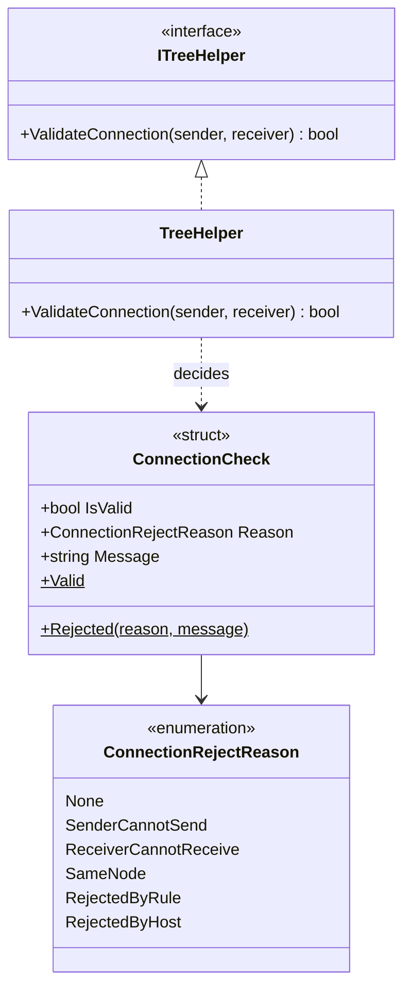
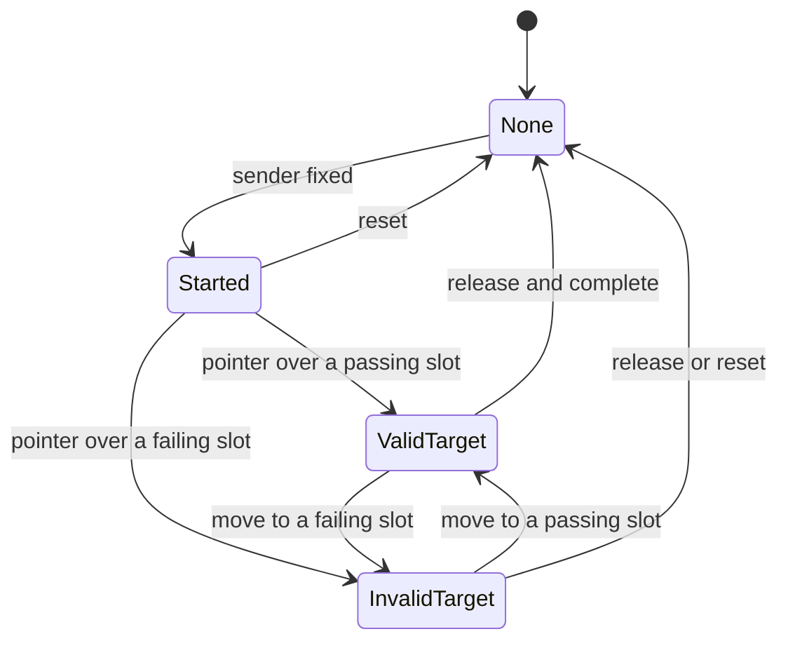

# 连接规则与预览中的设计模式

一条连接在指针释放前要检查，在橡皮筋移动过程中又用同一套规则再检查。实现分离了三件事：框架规则的固定顺序链、宿主提供的领域规则策略，以及描述拖拽阶段的小状态机。观察者无需轮询即可看到状态变化。

## 职责链：框架规则按固定顺序执行

`StandardCheckConnection` 与完成路径都委托给 `EvaluateConnection`。检查有序，每一环都能以特定原因结束评估：发送端能力、接收端能力、同节点拒绝，最后是宿主规则。链由显式控制流而非处理器对象列表实现，但具备链的性质——请求在第一个拒绝的处理器处停止。

```csharp
if (checkSender && !sender.StandardCanBeSender())
    return ConnectionCheck.Rejected(ConnectionRejectReason.SenderCannotSend);

if (!receiver.StandardCanBeReceiver())
    return ConnectionCheck.Rejected(ConnectionRejectReason.ReceiverCannotReceive);

if (ReferenceEquals(sender.Parent, receiver.Parent))
    return ConnectionCheck.Rejected(ConnectionRejectReason.SameNode);

return component.GetHelper().ValidateConnection(sender, receiver)
    ? ConnectionCheck.Valid
    : ConnectionCheck.Rejected(ConnectionRejectReason.RejectedByRule);
```

源码：`Src/Core/VeloxDev.Core/WorkflowSystem/StandardEx/WorkflowTreeEx.cs` 第 216-234 行。

`checkSender` 旗标防止预览与完成两条路径分叉：拖拽开始时发送端已经验过，完成时跳过第一环，不再重估预览已消费的条件。

源码：`Src/Core/VeloxDev.Core/WorkflowSystem/StandardEx/WorkflowTreeEx.cs` 第 202-220 行。

## 策略：领域规则是一个虚方法

链的最后一环是宿主的 `ValidateConnection`。`TreeHelper<T>` 把它声明为 `virtual` 并返回 `true`，使默认成为宽松策略；宿主继承 helper 并重写即可。

```csharp
public virtual bool ValidateConnection(
    ISlotComponent sender,
    ISlotComponent receiver)
    => true;
```

源码：`Src/Core/VeloxDev.Core/WorkflowSystem/Templates/Helpers/TreeHelper.cs` 第 378-381 行。

`ConnectionCheck` 是结果值对象。它是带 `Valid` 与 `Rejected(reason, message)` 的 readonly struct，使判定可比较，也便于预览稍后缓存同一值。



源码：`Src/Core/VeloxDev.Core/Interfaces/WorkflowSystem/Connections/ConnectionCheck.cs` 第 4-68 行。

## 状态：拖拽阶段与插槽旗标

两个枚举描述连接状态。

- `SlotChannel` 是标志枚举，描述各方向的容量（`OneTarget`、`OneSource`、`MultipleTargets`、`MultipleSources`）。
- `SlotState` 是标志枚举，描述实时状态（`StandBy`、`PreviewSender`、`PreviewReceiver`、`Sender`、`Receiver`）。
- `ConnectionPreviewState` 跟踪拖拽：`None`、`Started`、`ValidTarget`、`InvalidTarget`。

源码：`Src/Core/VeloxDev.Core/Interfaces/WorkflowSystem/Enums/SlotChannel.cs` 第 4-35 行；`Src/Core/VeloxDev.Core/Interfaces/WorkflowSystem/Connections/IConnectionPreviewLink.cs` 第 4-17 行。

预览状态是虚拟连线上的可选能力，而不是 `ILinkComponent` 的成员。`IConnectionPreviewLink` 用 `Preview` 与 `SetPreview` 扩展连线契约；`LinkDefaultViewModel` 实现它，自定义虚拟连线也可选择实现。

源码：`Src/Core/VeloxDev.Core/Interfaces/WorkflowSystem/Connections/IConnectionPreviewLink.cs` 第 35-43 行。



## 观察者：预览事件是咨询性的

`WorkflowInput` 拥有拖拽状态，并暴露 `PreviewChanged` 与 `PreviewValidating`。`PreviewValidating` 的订阅者可以收紧通过的判定，但代码明确拒绝让它放宽：框架检查先跑，只有检查通过后才询问宿主钩子。

```csharp
if (slot is not null && check.IsValid)
{
    check = input.RaisePreviewValidating(sender, slot, check);
}
input.SetConnectionPreview(slot, check);
```

源码：`Src/Core/VeloxDev.Core/WorkflowSystem/StandardEx/WorkflowTreeEx.cs` 第 261-267 行；事件声明在 `Src/Core/VeloxDev.Core/WorkflowSystem/GUI/Events/WorkflowInput.cs` 第 102 行。

每次尝试的否决是另一个观察者：`ITreeEvents.Connecting` 只在释放时触发，且可能依赖预览不应消费的状态。`ConnectionCheck` 刻意排除它，这正是 `RejectedByHost` 作为独立原因存在、而不复用 `RejectedByRule` 的原因。

源码：`Src/Core/VeloxDev.Core/Interfaces/WorkflowSystem/Connections/ConnectionCheck.cs` 第 29-40 行。

## 模式小结

| 模式 | 参与者 | 设计结果 |
| --- | --- | --- |
| 职责链 Chain of Responsibility | `EvaluateConnection` 及其有序检查 | 一个拒绝原因，规则顺序不重复 |
| 策略 Strategy | `ITreeHelper.ValidateConnection` 重写 | 领域规则无需分叉框架 |
| 状态 State | `ConnectionPreviewState`、`SlotState`、`SlotChannel` | 视图从值渲染，而非依赖事件 |
| 观察者 Observer | `PreviewChanged`、`PreviewValidating`、`Connecting` | 宿主可不拥有拖拽而否决赛 |

插槽的枚举端口建立在这些状态之上；参见[动态插槽枚举](../03_动态插槽枚举/index.md)。
