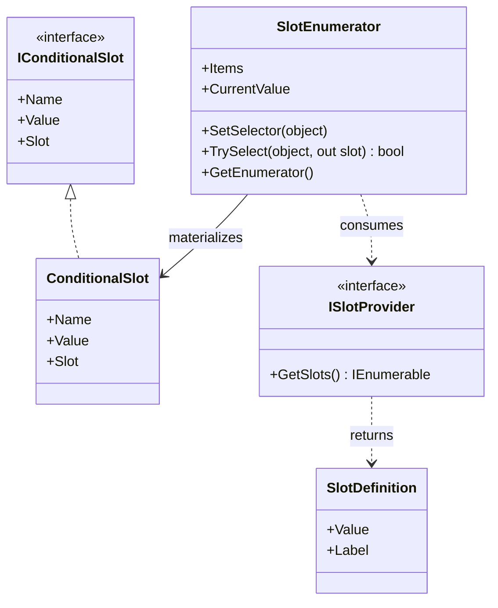
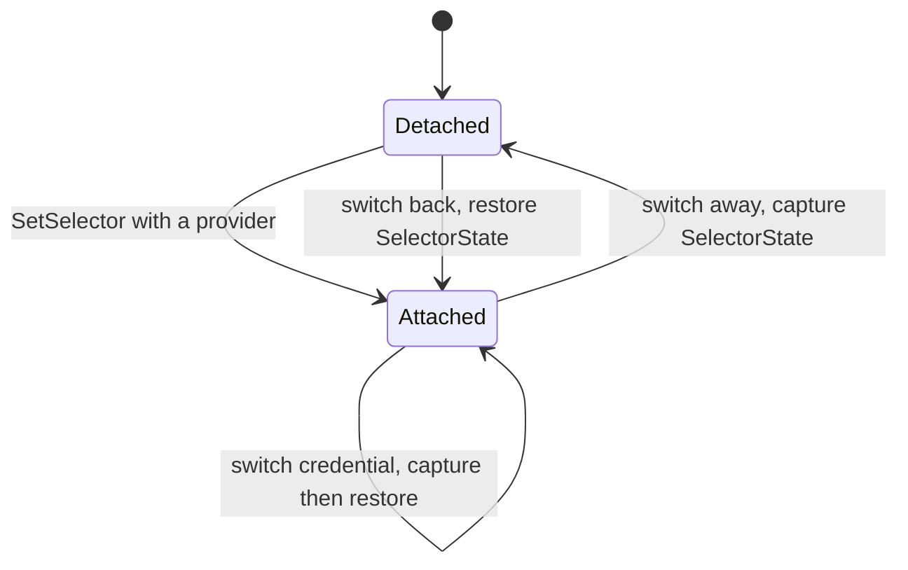

# 动态插槽枚举中的设计模式

节点可以暴露一组取决于选择器的端口——枚举、布尔值，或一个能描述自身插槽的实例。`SlotEnumerator<TSlot>` 持有当前选择器，为每个选择器值物化一个 `ConditionalSlot<TSlot>`，并在选择器变化时切换活动连接集。四种模式支撑该实现：迭代器用于端口面，构建器/工厂用于物化，状态加备忘录用于切换，适配器用于类型擦除视图。

## 迭代器：枚举器就是端口集合

`SlotEnumerator<TSlot>` 实现 `IEnumerable<TSlot>`，并提供返回每项背后插槽的索引器。消费者无需知道端口如何构建即可迭代它们。

```csharp
public partial class SlotEnumerator<TSlot> :
    IConditionalSlotProvider<TSlot>,
    IConditionalSlotProvider,
    System.ComponentModel.INotifyPropertyChanged
{
    public TSlot this[int index] { get { FlushDeferredRemovals(); return Items[index].Slot; } }
    public IEnumerator<TSlot> GetEnumerator() { /* ... */ }
}
```

源码：`Src/Core/VeloxDev.Core/WorkflowSystem/SelectorEx/SlotEnumerator.cs` 第 12-16 行与第 826-832 行。

索引器中的延迟移除刷新很重要：当 UI 控件重新填充时，集合可能暂时落后于选择器，通过索引器读取会在返回插槽前修复这一点。

## 构建器与工厂：选择器值变成插槽

自定义提供者实现 `ISlotProvider.GetSlots()`，返回 `SlotDefinition` 项。枚举器消费这些定义，为每项构建一个 `ConditionalSlot<TSlot>`。定义是简单值（路由键加标签）；工厂工作——构造插槽并接到节点——留在枚举器里。

```csharp
public interface ISlotProvider
{
    IEnumerable<SlotDefinition> GetSlots();
}

public sealed class SlotDefinition(object value, string label = "")
{
    public object Value { get; } = value;
    public string Label { get; } = label;
}
```

源码：`Src/Core/VeloxDev.Core/Interfaces/WorkflowSystem/Providers/ISlotProvider.cs` 第 16-22 行；`Src/Core/VeloxDev.Core/WorkflowSystem/SelectorEx/SlotDefinition.cs` 第 6-12 行。



`SetSelector` 接受已知选择器类型或 `ISlotProvider` 实例，因此同一入口同时覆盖枚举驱动与数据驱动的端口。

源码：`Src/Core/VeloxDev.Core/Interfaces/WorkflowSystem/Providers/IConditionalSlotProvider.cs` 第 29-61 行；实现在 `Src/Core/VeloxDev.Core/WorkflowSystem/SelectorEx/SlotEnumerator.cs` 第 285-424 行。

## 状态与备忘录：切换会记住每份凭据

每个选择器值是一份凭据：离开时捕获活动连接状态，返回时恢复。`SelectorState` 是备忘录——选择器类型、项集合以及曾附着的连线。`CaptureState`、`ApplyDetachedState` 与 `ApplyAttachedState` 是状态迁移，负责摘下旧集合并挂上新集合。

```csharp
private sealed class SelectorState(
    string typeName,
    Type? type,
    IReadOnlyList<ConditionalSlot<TSlot>> items,
    IReadOnlyList<ILinkComponent> links)
{
    public string TypeName { get; } = typeName;
    public Type? Type { get; } = type;
    public IReadOnlyList<ConditionalSlot<TSlot>> Items { get; } = items;
    public IReadOnlyList<ILinkComponent> Links { get; } = links;
}
```

源码：`Src/Core/VeloxDev.Core/WorkflowSystem/SelectorEx/SlotEnumerator.cs` 第 662-672 行；捕获在第 513 行，应用在第 525 与 542 行。



每凭据记忆正是该类维护私有字典的原因：以选择器类型为键保存 `SelectorState`，枚举或提供者返回时不会丢失此前的接线。

源码：`Src/Core/VeloxDev.Core/WorkflowSystem/SelectorEx/SlotEnumerator.cs` 第 376-424 行。

## 适配器：给类型无关调用方一个擦除视图

泛型接口指明 `TSlot`，只持有 object 的调用方无法闭合它。`IConditionalSlotProvider` 是适配器：以类型参数擦除的形式暴露 `Parent`、`SelectorTypeName`、`SelectorType`、`CurrentValue`、`Slots` 与 `TrySelect`。`SlotEnumerator<TSlot>` 显式实现它，现有泛型调用方不受影响。

源码：`Src/Core/VeloxDev.Core/Interfaces/WorkflowSystem/Providers/IConditionalSlotProvider.cs` 第 63-107 行。

节点侧还有第二个适配器。`IConditionalSlotProviders` 让节点按安装顺序发布它安装的枚举器，而不暴露持有它们的具名属性。`NodeHelper<T>` 免费实现该接口。

源码：`Src/Core/VeloxDev.Core/Interfaces/WorkflowSystem/Providers/IConditionalSlotProviders.cs` 第 135-146 行。

## 模式小结

| 模式 | 参与者 | 设计结果 |
| --- | --- | --- |
| 迭代器 Iterator | `SlotEnumerator<TSlot>` | 端口是序列，而非对属性的反射 |
| 构建器 / 工厂 Builder / Factory | `ISlotProvider`、`SlotDefinition`、`ConditionalSlot<TSlot>` | 选择器值在一处变成已接线插槽 |
| 状态 / 备忘录 State / Memento | `SelectorState`、捕获/应用方法 | 每份凭据保留自己的连接 |
| 适配器 Adapter | `IConditionalSlotProvider`、`IConditionalSlotProviders` | 类型无关消费者与节点侧发现 |

声明的端口为编译期路由与汇合提供输入；参见[工作流编译器](../04_工作流编译器/index.md)。
