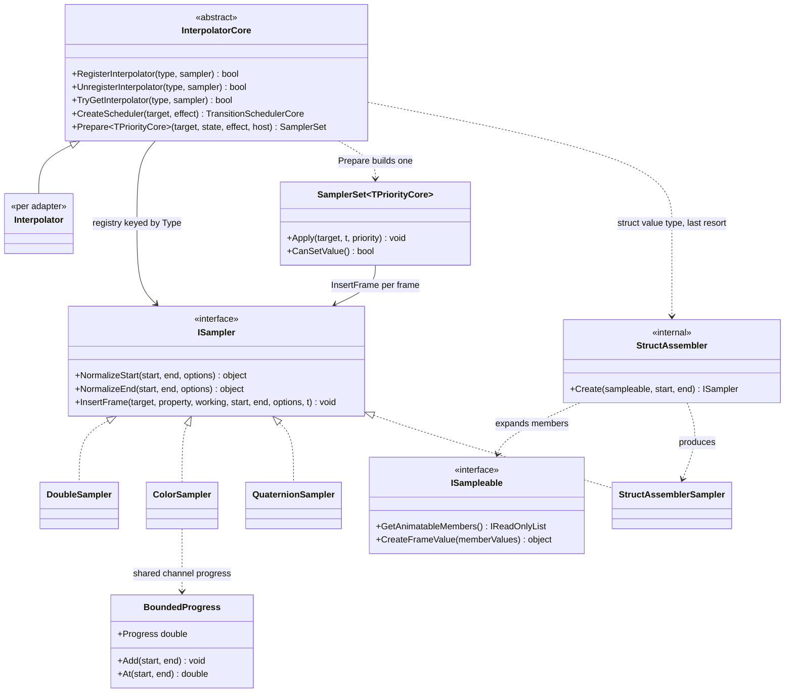

# 设计模式 — 过渡动画：采样器策略

引擎的值插值一侧：一个属性的类型如何映射到知道如何插值它的东西，以及一个没有自己采样器的值类型如何仍被动画。

## 类图

> 源：`Src/Core/VeloxDev.Core/TransitionSystem/Sampling/Interpolator.cs`、`SamplerSet.cs`、`StructAssembler.cs`、`BoundedProgress.cs`、`NativeSamplers/*.cs`、`Interfaces/TransitionSystem/ISampler.cs`、`ISampleable.cs`。

## 模式：策略（`ISampler`）

`ISampler` 是值插值策略。核心在**准备时调用一次** `NormalizeStart` / `NormalizeEnd` 来固定精确端点，然后调用 `InsertFrame(target, property, ref working, start, end, options, t)` 计算中间帧。`t` 到达时已经缓动且未夹取，因此实现把 `t <= 0` / `t >= 1` 当作端点写入（或对数值型而言，当作恰好复现端点的 lerp）。

契约带有三条实现规则，每条都有理由：

- **无状态单例，绝不修改 `start` / `end`** —— 端点与记录它们的过渡声明共享，修改会污染声明。引用类型采样器使用每动画的 `working` 暂存（首个中间帧经 `ref` 惰性创建，之后复用），使常见快速路径每采样零分配。
- **端点是插值器的事，不是循环的事** —— 循环只保证一趟的*最后*一帧恰好 `t = 1`（正向）或 `t = 0`（反向），因此采样器从不需要依赖 `Ease(1)` 恰好为 `1`。
- **`options` 是唯一的逐属性通道** —— 角度采样器（`DoubleSampler`、`QuaternionSampler`）从它读取 `RotationDirection`；其余忽略。

## 模式：注册表 + 解析遍历（`InterpolatorCore`）

注册表是私有的 `ConcurrentDictionary<Type, ISampler>`，只能经 `RegisterInterpolator` / `UnregisterInterpolator` / `TryGetInterpolator` 触达。私有是刻意的：能拿到字典的调用方可以整体替换它 —— 丢掉静态构造函数种下的每个默认项 —— 或清空它。

`RegisterInterpolator` 是原子的最后写入者胜（`AddOrUpdate`）。`TryGetInterpolator` **不是**精确匹配；它分三段解析：

1. 精确类型；
2. 基类，由近及远；
3. 接口，多个匹配时取全名序数最小者。

遍历之所以存在，是因为框架属性常常声明为适配器所注册类型的子类 —— `LinearGradientBrush` 属性对 WPF 注册的 `Brush` —— 只做精确匹配会让它无法动画并被报告为不可采样。接口排最后且显式平局裁决，因为反射自身顺序未定义：两个匹配接口*谁*赢是任意的，但每次都是同一个 —— 这点不是。

遍历**每个属性、每次动画只跑一次**，在 `Prepare` 内 —— 绝不逐帧。这就是全部设计：`SamplerSet` 持有已解析采样器，帧路径完全不做类型解析。

## 模式：三处 Null Object

- WPF 注册**抽象基类** `Effect` 而不是具体 `DropShadowEffect`。注册具体类型会让每条声明为 `Effect` 的路径（WPF 自己的 `UIElement.Effect` 依赖属性就是这样声明的）无法解析并被静默跳过 —— 与上面遍历要吸收的错误同形，只是高一层。
- 类型解析不到任何东西的属性被**跳过并经 `Warn` 上报**，而不是当 `null` 插值。跳过让其他属性保持正确；`Warn` 让跳过可观察。
- `StructAssembler.Create` 在无法装配（成员采样器解析不到、成员值缺失、访问失败）时回答 `null`。`null` 仍是跳过 —— 装配器绝不向 `Prepare` 抛异常。

## 模式：值类型的 Composite 策略（`ISampleable` + `StructAssembler`）

`ISampleable` **不是**采样器，且是**只限值类型**的契约：结构体声明哪些成员可动画（`GetAnimatableMembers`）以及如何从插值后的成员重建值（`CreateFrameValue`）。这种类型若没有注册采样器，就作为整体动画：`StructAssembler.Create` 解析每个成员的采样器与当前值，并产出一个 `StructAssemblerSampler` —— 它用各自采样器插值每个成员并调用 `CreateFrameValue`（编译期构造函数调用，运行时零反射）。

捕获背后的机制值得点名：`StructAssemblerSampler` **不**把成员写回目标（对结构体而言会写进装箱副本）。它给每个成员采样器一个私有 `CaptureProperty : ITransitionProperty`，其 `SetValue` 只记录值，然后从记录数组装配结构体。这就是 Composite 模式 —— 一个自身由 `ISampler` 组合成的 `ISampler`，以私有 `ITransitionProperty` 作为把成员写入挡在真实目标之外的接缝。

引用类型**不被展开**：`Prepare` 只在 `PropertyType.IsValueType` 时伸手取 `ISampleable`，而解析不到东西的引用类型末端会被 `Execute` 事先拒绝（`TransitionPathUnsampleableException`），而不是当作什么都不动画。

## 模式：范围受限通道的分组策略（`BoundedProgress`）

`BoundedProgress` 是一个小的值类型助手，但编码了一个设计决定：共享一个界限的一组通道**按同一个进度**移动，因此过冲无法扭曲值。`ColorSampler` 给 R/G/B 一个 `[0, 255]` 进度并让 alpha 保留完整缓动时间；`SizeSampler` / `SizeFSampler` / `RectangleSampler` / `RectangleFSampler` 给宽/高一个 `[0, +∞)` 进度。`Add` 只会*收紧*，因此加通道的顺序无关，剩余过冲被该组丢弃，而不是让某个通道离开范围。

源：`Src/Core/VeloxDev.Core/TransitionSystem/Sampling/Interpolator.cs`、`SamplerSet.cs`、`StructAssembler.cs`、`BoundedProgress.cs`、`NativeSamplers/{ColorSampler,SizeSampler,RectangleSampler,SizeFSampler,RectangleFSampler}.cs`、`Src/Adapters/VeloxDev.WPF/PlatformAdapters/Interpolator.cs`、`Src/Core/VeloxDev.Core.Test/TransitionSystem/{InterpolatorCoreTests,EaseOvershootTests,SamplerConformanceTests}.cs`、`Examples/Transition/AUTO TEST/Conformance/ClosedForm.cs`。
