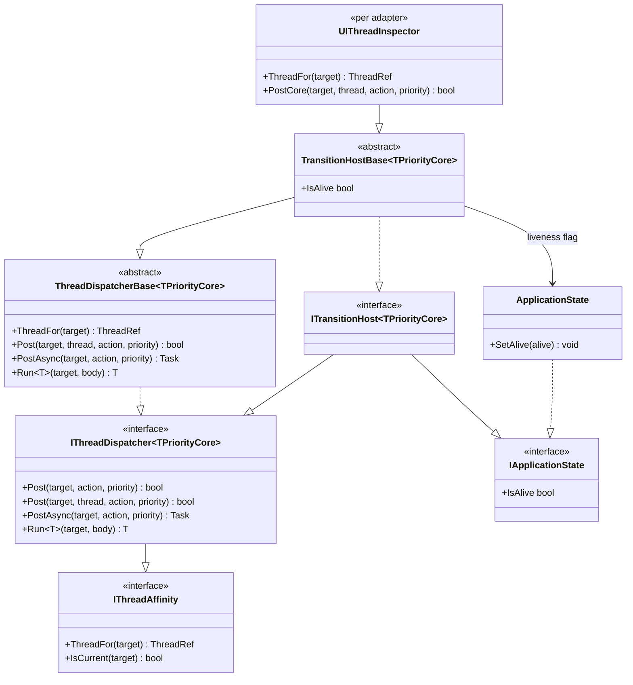

# 设计模式 — 过渡动画：宿主与时间线

让引擎在边缘与平台无关的两个接缝：它向**宿主**索取什么，以及它向**时钟**索取什么。

## 宿主接缝 —— 类图

> 源：`Src/Core/VeloxDev.Core/Interfaces/TransitionSystem/ITransitionHost.cs`、`Src/Core/VeloxDev.Core/Threading/{IThreadDispatcher,ThreadDispatcherBase,ThreadRef,NonPriority}.cs`、`Src/Core/VeloxDev.Core/Lifetime/IApplicationState.cs`、`Src/Core/VeloxDev.Core/TransitionSystem/Runtime/TransitionHostBase.cs`、`Src/Adapters/*/PlatformAdapters/UIThreadInspector.cs`。

### 模式：胖接口之上的组合；派生之上的模板方法

`ITransitionHost<TPriorityCore>` **不新增任何成员**。它组合 `IThreadDispatcher<TPriorityCore>`（后者本身组合 `IThreadAffinity`）与 `IApplicationState`，因此适配器只声明一个接口，而底下两个子系统仍可各自替换 —— 非动画消费者也可以只取时钟或只取存活标志。

其下，`ThreadDispatcherBase<TPriorityCore>` 是**模板方法**：宿主只提供 `ThreadFor`、`IsCurrentThread` 与 `PostCore`，基类一次性实现 `Post`、`PostAsync` 与 `Run<T>`，因此没有宿主能与别的宿主派生出不同行为。骨架中有三处是承重的：

- **调用方已在目标线程上时 `Post` 内联执行。** `Post(target, thread, action, priority)` 是 `IsCurrentFor(target, thread) ? RunInline(action) : PostCore(target, thread, action, priority)` —— 因此常见情形（UI 线程上的 `Execute`）完全不花派发。
- **`PostAsync` 只在动作被接受时等待。** 完成源是 `TaskCompletionSource`；静默丢弃动作的宿主永远不会完成它，因此基类返回 `false` 而不是永远等待。这是每次动画唯一的一次 `await` —— `Awake` —— 且必须在 `Prepare` 读取目标之前完成。
- **`InternalPriority` 有默认值而非必需，但携带优先级的宿主必须重写它。** 对没有优先级的宿主，`default(NonPriority)` 就是全部答案；而 `default(DispatcherPriority)` 是 `Inactive`，会把一次阻塞 `Run<T>` 排到所有普通消息之后。

### 模式：为「无线程」使用 Null Object（`ThreadRef.None`）

`ThreadRef` 包装宿主用来标识线程的任何东西（`Dispatcher`、`DispatcherQueue`、`IDispatcher`、`SynchronizationContext`），并给「没有线程拥有它」一个**名字**，而不是每个调用方都要强制转换的 `null`。`ThreadFor` 从不抛异常 —— 宿主答不上来就返回 `None`，代价只是该目标失去 UI 线程帧节拍器。从会抛异常的宿主抵达写路径，逐帧与动画失败无法区分，因此接口声明那里任何成员都不得抛异常。

## 节拍接缝 —— `FramePacerCore`

`FramePacerCore` 是决定*下一帧何时发生*的**模板方法**，而采样循环决定*这一帧走了多远*。分开正是重点：时间轴是计时权威，唤醒只是提醒，因此晚醒只会画出更靠后的一帧，而不是错误的一帧。

| 骨架成员 | 基类拥有的固定行为 |
|---|---|
| `Schedule(continuation, interval, token)` | 先发布续体（`Volatile.Write`）再武装 —— 顺序如此，已过期的定时器才不会在续体挂上之前 tick。挂起的续体被**替换**，不排队（一个循环拥有一个 pacer）。 |
| `Arm(interval)` | 子类钩子：启动或重新武装宿主的等待。 |
| `Disarm()` | 子类钩子：结束等待。必须容忍未武装状态且不得分配 —— 每帧调用一次。 |
| `Fire()` | 先 disarm，再恰好调用一次挂起的续体（`Interlocked.Exchange`）。顺序重要：重复等待不得在循环武装下一帧之前再次完成。 |
| `Dispose()` | disarm 后**放行**（调用）任何挂起的续体。等待一个永不调用续体的循环会永久搁浅，无异常、无帧。 |

基类存在是为了让两种失败不可能发生：调用续体两次的 pacer 会双倍采样；从不调用它的 pacer 会让循环永久停摆。两者从宿主侧都看不见，也都不值得逐平台重新推导。宿主重写这对钩子而不是实现接口：WPF/Avalonia/Jalium 等 `DispatcherTimer`，WinUI 等不重复的 `DispatcherQueueTimer`，MAUI 等重复的 `IDispatcherTimer`，WinForms 每帧投递到目标控件，Razor 保留默认。每个重写在无答案时返回 `null` —— 没有可命名的线程，或对 WinForms 而言目标不在当前线程。

默认等待是 `Abstractions.ReusableTimerWait` —— 整个循环一个 `Timer`、每次动画一个取消注册，取代 `await Task.Delay(interval, token)` 每次等待的 `DelayPromise` 加每次等待的注册回调。

## 时钟接缝 —— `VeloxDev.Timing`

引擎从 `ITimeSource` 读时间，绝不从框架时钟读，这个设计决定有三个后果：

- **暂停是扣除而非跳过。** 暂停时干脆不前进的源让扣除成为构造性的。旧设计对着墙钟计量、另用一个标志说「别算」，于是产生了恢复后的 delta 尖峰；这里两个时钟是同一个。
- **运行可以停泊。** `IsAdvancing` 被表述为**不变量**（为 true 意味着位置在动），而不是关于 `IsPaused` 与 `Rate` 的公式，因为停止喂食的宿主会冻结位置却不暂停任何东西。停泊信号绑定到该谓词，因此停泊消费者零唤醒，也不会在 `while (!IsAdvancing)` 上自旋。
- **时间是共享的。** 多个消费者锚定到同一条绝对时间轴；每消费者的趟是它之上的一个*锚点*（`TransitionRun.PassAnchor`），不是重置，因此在一个消费者上开始一趟不会移动其他任何消费者。

`TimerCore`（注册表）与 `InterpolatorCore`（采样器注册表）被刻意塑造成同一形状：私有字典、公开的 register/unregister/try-get 三件套、原子最后写入者胜、调用方永远看不到的键。两者都是为了让平台**在契约之下**替换实现，且都不交出字典。

源：`Src/Core/VeloxDev.Core/Interfaces/TransitionSystem/ITransitionHost.cs`、`Src/Core/VeloxDev.Core/Threading/*.cs`、`Src/Core/VeloxDev.Core/Lifetime/IApplicationState.cs`、`Src/Core/VeloxDev.Core/TransitionSystem/Runtime/{TransitionHostBase,FramePacerCore,ReusableTimerWait,TransitionInterpreter,TransitionRun}.cs`、`Src/Core/VeloxDev.Core/Timing/*.cs`、`Src/Core/VeloxDev.Core/Interfaces/Timing/*.cs`、`Src/Adapters/*/PlatformAdapters/{UIThreadInspector,TransitionInterpreter}.cs`。
