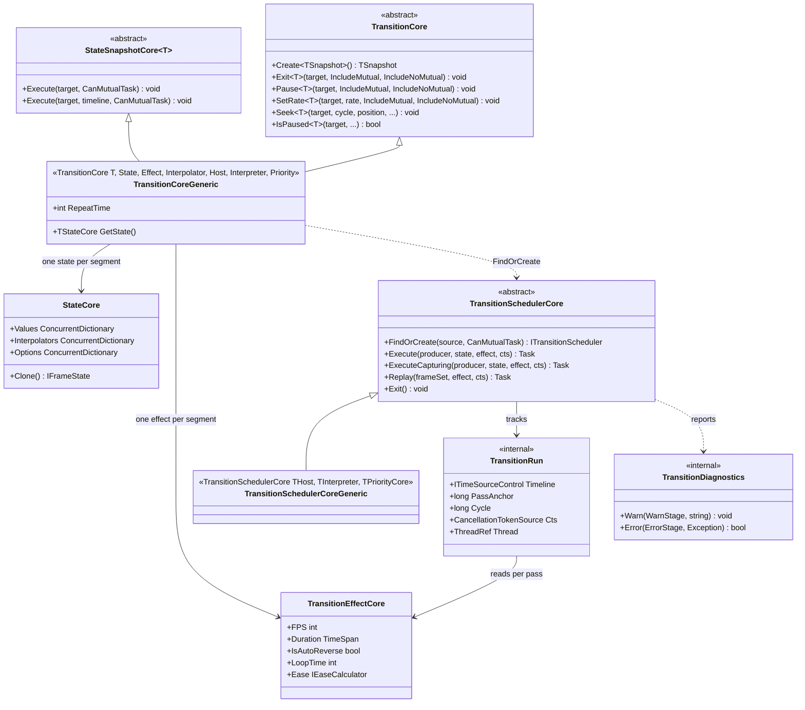

# 设计模式 — 过渡动画：构建器与调度器

声明一侧（一个同时是分段链的构建器）与执行一侧（每目标一个调度器，以及让后续控制调用能找到运行的注册表）。

## 类图 —— 构建器、链、调度器

> 源：`Src/Core/VeloxDev.Core/TransitionSystem/{Effects/Transition,Effects/TransitionEffect,Runtime/TransitionDiagnostics,Runtime/TransitionRun,Runtime/TransitionScheduler,State/State,State/StateSnapshot}.cs`。

## 模式：同时是 Composite 的流式构建器

`Transition<T>.Create()` 返回一个同时是静态入口、构建器与执行器的对象。`.Property(expr, value, options)` 与 `.Effect(...)` 各返回同一个构建器，因此单个流式表达式*读起来*像配置。

它实际构建的是**分段列表**：`.Await(span)`、`.Then()` 与 `.AwaitThen(span)`（`StateSnapshotCore` 上的 `TransitionCoreEx` 扩展）分配**下一**段并经 `next` 字段链接，因此一个构建器表达式描述一条有序链 —— 每个链接携带自己的 `State`、`Effect`、`Interpolator` 与前置延迟。`Execute` 随后遍历该链。这就是 Composite 模式：链与单个段由同一条代码路径消费，因为「容器」只是指向下一段的链接。

让分段成为数据而非行为带来两个性质：

- **构建好的链按构造可复用且近似线程安全** —— `CoreExecute` 在运行前克隆每段的 effect（`effect.Clone()`），因此一个静态 `Animation0` 可以在任意多个目标上反复执行，demo 正是这样做的。
- **`RepeatTime` 是逐段整数，不是包装对象。** `Repeat(count)` 在调用它的段上写 `RepeatTime`，`CoreExecute` 经 `repeats[]` 展开循环 —— 因此循环不需要新类型，「这个循环包住哪些段」仅由链顺序回答（一段的循环包裹从首段*到该段*的链）。

## 模式：按目标弱键的注册表

`TransitionSchedulerCore` 维护两张静态表与一张私有锁表：

| 表 | 类型 | 为什么是这种形状 |
|---|---|---|
| `MutualSchedulers` | `ConditionalWeakTable<object, ITransitionSchedulerCore>` | 每目标一个**互斥**调度器，随目标回收。`GetValue` 原子安装 —— `TryGetValue` 后再 `Add` 的一对会竞争，输家的 `Add` 抛异常。 |
| `NoMutualSchedulers` | `ConditionalWeakTable<object, ConcurrentDictionary<ITransitionSchedulerCore, byte>>` | 目标上**当前**的并发调度器，作为集合。动画从多个线程同时注册 / 注销（后台 `Task.Run`、UI 线程点击），无同步的普通 `List` 会丢条目 —— 那会让 `Exit` 漏掉调度器并留下仍在跑的动画。 |
| `TargetLocks`（私有） | `ConditionalWeakTable<object, SemaphoreSlim>` | 串行化一个目标的**控制面** —— 进入（创建 token、注册动画）对离开（取消一切活着的）。只在同步记账期间持有，绝不跨动画主体，因此不会与帧要去的 UI 线程死锁，同一目标上的非互斥动画也仍可并发。 |

两张调度器表的区别是设计陈述而非实现细节：互斥表是*目标生命周期内的缓存*（因此 `TryGetMutualScheduler` 回答「这个目标是否跑过互斥动画」），而非互斥表是*活状态*（运行结束时移除条目）—— 这就是 `AUTO TEST` 套件读 `TryGetNoMutualScheduler` 的**数组长度**而不是布尔值的原因。

## 模式：两阶段运行，让重复重放而不是重读

`Execute` 与 `ExecuteCapturing` 共享主体；`ExecuteCapturing` 只是交回它准备的 `SamplerSet`，而 `Replay(frameSet, effect)` 用*同一套帧集*再跑一个段。`Repeat` 是这对成员的唯一调用方，理由是关于正确性而非优化：

- 准备一个段会读取**目标当前值**作为起点，因此重新准备重复段会从上一次迭代停下处起步 —— 端点不同于起点的链会倒退；
- 某段写着更早分段都没碰过的属性时会一趟比一趟漂。

重放让每次迭代完全相同并钉住端点。它刻意**不**重新触发的是 `Awake`：`Awake` 是把目标放进该段起始状态的钩子，而重放的定义就是完全不依赖目标状态。`Start`、`Update`、`LateUpdate`、`Completed` 与诊断会触发，因此重放和任何其他趟一样可观察。

## 模式：生命周期用观察者，诊断用独立通道

`TransitionEffectCore` 暴露九个由 `WeakDelegate` 支撑的事件。七个是生命周期（`Awaked`、`Start`、`Update`、`LateUpdate`、`Canceled`、`Completed`、`Finally`）；两个是**诊断**（`Warn`、`Error`），存在的原因是引擎的失败模式是沉默：从 UI 线程上的采样器逃逸的异常没有调用方接住，而抛异常的回调绝不能带垮宿主进程。

`TransitionDiagnostics` 是内部中介：

- 它是**运行范围**的对象（每次 `Prepare` / 每个循环创建），因此「每个阶段至多上报一次」是按运行 —— 逐帧条件上报一次后安静；
- 它把 `Warn` / `Error` 经 effect 的事件*与* `Debug.WriteLine` 路由，因此即使没有处理器，运行也会报告；
- 每次上报构造一个带类型实参（`Warn` 用 `TransitionEventArgs<WarnStage, string>`，`Error` 用 `TransitionEventArgs<ErrorStage, Exception>`），并在触发前把运行的 `Loop` / `Cycle` 抄上去，因此诊断处理器看到运行位置；
- 它尊重 `TransitionEventArgs.Handled`：置位的处理器要求终止运行，`TransitionDiagnostics` 翻转运行自己的 `Handled` 标志。

这也是采样循环把每个回调与每次 `apply` 包进 `Report` / `ReportMarshaling` 的原因：重点不是吞掉异常，而是把它转成一次报告加运行的**正常**取消路径，让 `Canceled` 与 `Finally` 仍触发、循环自己的资源仍释放。`InvokeError` 刻意不调用 `Debug.Fail` —— 那会在无交互宿主里终止进程，恰恰是这条通道要防的事。

源：`Src/Core/VeloxDev.Core/TransitionSystem/{Effects/Transition,Effects/TransitionEffect,Runtime/TransitionDiagnostics,Runtime/TransitionRun,Runtime/TransitionScheduler,State/State,State/StateSnapshot}.cs`、`Src/Core/VeloxDev.Core/TransitionSystem/Effects/TransitionEx.cs`、`Src/Core/VeloxDev.Core.Test/TransitionSystem/{ChainRepeatTests,TransitionSchedulerExitTests,NoMutualSchedulerRegistryTests,TransitionDiagnosticsTests}.cs`、`Examples/Transition/WPF/Demo/MainWindow.xaml.cs`。
