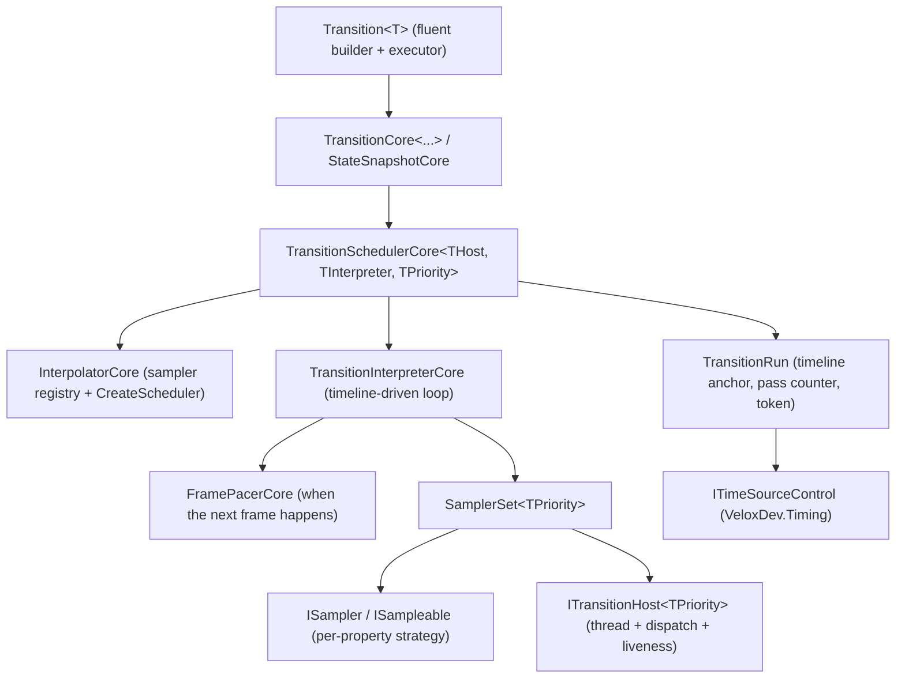

# 设计模式 — 过渡动画

过渡动画是一个与框架无关的动画引擎。核心位于 `Src/Core/VeloxDev.Core/TransitionSystem/**`（抽象 / 泛型「core」类型在 `VeloxDev.TransitionSystem.Abstractions` 命名空间，引擎契约在 `Src/Core/VeloxDev.Core/Interfaces/TransitionSystem/**`，原生采样器在 `TransitionSystem/NativeSamplers/**`），并建立在两个 Core 子系统之上：时钟（`VeloxDev.Timing`）与宿主接缝（`VeloxDev.Threading` / `VeloxDev.Lifetime`）。它感知 UI 线程，但不引用任何具体 UI 栈。每个 UI 框架经 `Src/Adapters/VeloxDev.*/PlatformAdapters` 下的平台适配器包触达（WPF、Avalonia、WinUI、MAUI、WinForms、Razor、Jalium），每个平台由 `Examples/Transition/**` 下的 demo 演练。

核心是**单一泛型家族**：宿主的调度器优先级作为类型形参传递（`DispatcherPriority`、`DispatcherQueuePriority` 等），没有优先级的宿主用标记结构体 `NonPriority` 填充。WPF/Avalonia/Jalium/WinUI 传各自优先级类型；MAUI/WinForms/Razor 传 `NonPriority`。

## 顶层形状

## 子页

- [采样器策略](00_采样器策略/index.md) —— 值插值策略集：`ISampler`、`InterpolatorCore` 注册表（及其解析顺序）、`ISampleable` + `StructAssembler`，以及 `BoundedProgress`。
- [宿主与时间线](01_宿主与时间线/index.md) —— 宿主接缝（`ITransitionHost` / `IThreadDispatcher` / `TransitionHostBase`）、`FramePacerCore` 的模板方法，以及其后的 `VeloxDev.Timing` 时钟。
- [构建器与调度器](02_构建器与调度器/index.md) —— 流式构建器 + 分段链、Composite 时间线、调度器的注册表，以及 `Repeat` 的 `ExecuteCapturing` / `Replay` 对。

## 模式总览

| 模式 | 出现位置 | 作用 |
|---|---|---|
| 流式构建器 + 链 | `Transition<T>` / `TransitionCore<…>.next` | 描述目标状态 + 分段计时，而不用可变配置对象 |
| Composite | `next` 链；`Repeat` | 组合多段间轴，支持嵌套循环 |
| 注册表 | `InterpolatorCore` 的 `RegisterInterpolator` / `TryGetInterpolator` | 运行时把属性类型映射到 `ISampler`；先最近基类、再按名排序的接口 |
| 策略 | `IEaseCalculator`/`Eases`、`ISampler`、`ISampleable` | 替换缓动、按类型插值与结构体装配而不改引擎 |
| 模板方法 / 策略 | `TransitionCore<…>`、`TransitionSchedulerCore<…>`、`TransitionInterpreterCore<…>`、`ThreadDispatcherBase<…>` | 固定骨架；适配器与宿主经泛型提供平台细节 |
| 适配器 | 各平台 `PlatformAdapters/*`；`TransitionHostBase<…>` | 把引擎桥接到一个 UI 框架的类型、dispatcher 与定时器 |
| 带诚实 `null` 的抽象工厂 | `InterpolatorCore.CreateScheduler` | 给只持有 `object` 的调用方平台调度器组合 |
| 调度器注册表 + 弱缓存 | `TransitionSchedulerCore.MutualSchedulers` / `NoMutualSchedulers` | 每目标一个串行动画；不泄漏 |
| 观察者 | `TransitionEffectCore` 事件 + `WeakDelegate` | 不轮询地观察生命周期（与诊断） |
| 停泊 / 唤醒（无 monitor 的 monitor） | `ITimeSource.WaitWhileStalledAsync` + `ITimeSourceControl.Wake` | 停泊消费者零唤醒；定位或停止仍能触达它 |
| Null Object | `ThreadRef.None`、`NonPriority`、`null` `FramePacerCore` | 「无线程」「无优先级」「无宿主节拍器」是值，不是失败 |

源：`Src/Core/VeloxDev.Core/TransitionSystem/**/*.cs`、`Src/Core/VeloxDev.Core/Timing/*.cs`、`Src/Core/VeloxDev.Core/Threading/*.cs`、`Src/Core/VeloxDev.Core/Interfaces/TransitionSystem/*.cs`、`Src/Core/VeloxDev.Core.Test/TransitionSystem/*.cs`、`Src/Adapters/VeloxDev.{WPF,Avalonia,WinUI,MAUI,WinForms,Razor,Jalium}/PlatformAdapters/*.cs`、`Examples/Transition/WPF/Demo/MainWindow.xaml.cs`、`Examples/Transition/AUTO TEST/**`。

相关分析：[数据流 — 过渡动画](../../03_数据流/03_过渡动画/index.md) · [复杂度 — 过渡动画](../../04_复杂度/03_过渡动画/index.md)
