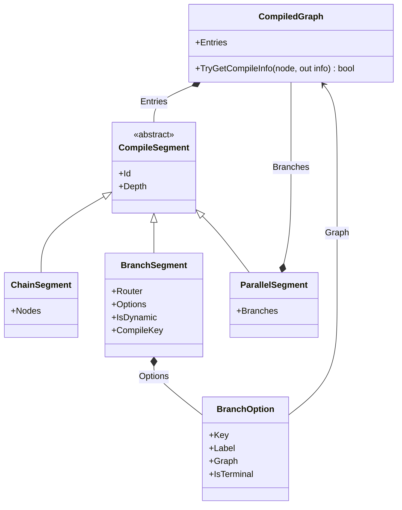
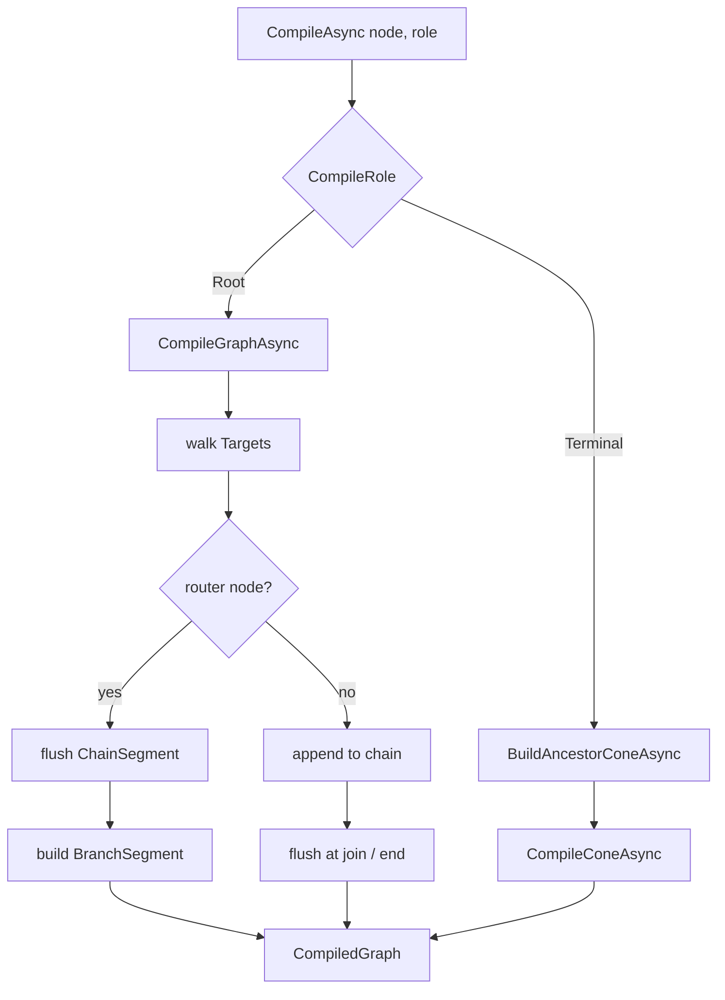
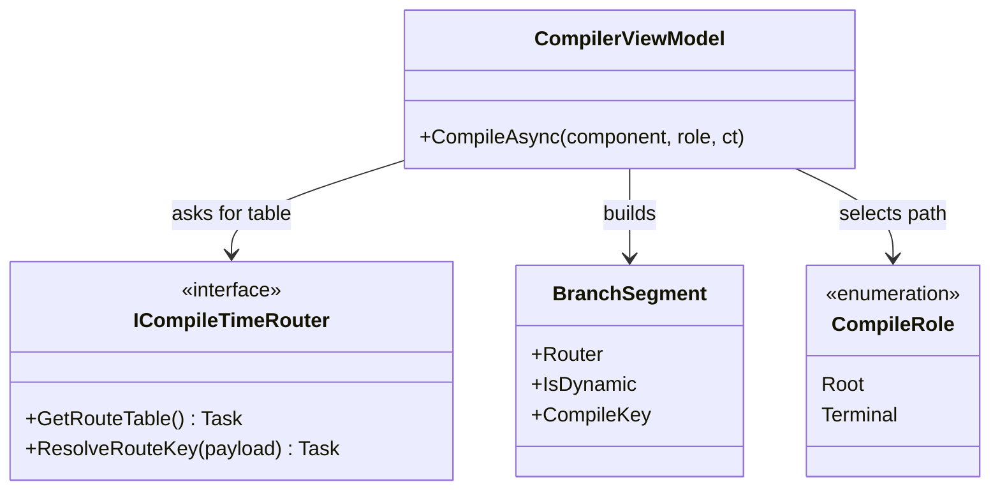

# 工作流编译器中的设计模式

编译器把可变的实时图转换为不可变的执行模型。它遍历图一次，通过路由器契约决定分支结构，并发出嵌套分段。设计上是构建器（Builder）产出组合（Composite），路由处留有策略（Strategy）接缝，模型本身则便于运行时解释。

## 组合：编译图是分段树

`CompiledGraph` 持有有序的 `CompileSegment` 集合。`CompileSegment` 是抽象类，三种具体形式为 `ChainSegment`（线性节点段）、`BranchSegment`（一个路由器加若干选项）与 `ParallelSegment`（扇出组）。分支选项持有子 `CompiledGraph`，并行段也持有子图，因此产物可任意深度嵌套。



源码：`Src/Core/VeloxDev.Core/WorkflowSystem/CompilerEx/Compile/Model/CompiledGraph.cs` 第 19-27 行；`.../CompileSegment.cs` 第 10-14 行；`.../ChainSegment.cs` 第 25-28 行；`.../BranchSegment.cs` 第 43-63 行；`.../ParallelSegment.cs` 第 75-79 行；`.../BranchOption.cs` 第 91-109 行。

编译图还拥有每个节点的编译身份。`CompileBindings` 把节点映射到 `NodeCompileInfo`，运行时从图里读回该身份，而不是询问节点。这正是未实现 `ICompileTimeAware` 的节点仍能参与汇合与重定向的原因。

源码：`Src/Core/VeloxDev.Core/WorkflowSystem/CompilerEx/Compile/Model/CompiledGraph.cs` 第 14-27 行。

## 构建器：一次线性遍历装配产物

`CompileAsync` 是唯一入口。它按 `CompileRole` 选择构建路径，调用 `CompileGraphAsync`，并存储结果。构建状态（`CompileState`）携带访问集、用于序号的计数器、可选的锥形限制以及汇合输入映射。

```csharp
CompiledGraph graph = role switch
{
    CompileRole.Root => await CompileGraphAsync(node, new CompileState(), ct).ConfigureAwait(false),
    CompileRole.Terminal => await CompileConeAsync(
        node, await BuildAncestorConeAsync(node, ct).ConfigureAwait(false), ct).ConfigureAwait(false),
    _ => throw new ArgumentOutOfRangeException(nameof(role), role, null),
};
```

源码：`Src/Core/VeloxDev.Core/WorkflowSystem/CompilerEx/Compile/CompilerViewModel.cs` 第 38-59 行；构建状态在第 475-495 行。

遍历把线性节点累积在列表里；每当遇到路由器、汇合边界或子树结束，就把列表刷成一个 `ChainSegment`。刷新操作让产物保持结构，而不是一张扁平节点表。

源码：`Src/Core/VeloxDev.Core/WorkflowSystem/CompilerEx/Compile/CompilerViewModel.cs` 第 45-140 行与第 258-268 行。



## 策略：路由是节点提供的契约

分支形状不是编译器硬编码的。实现 `ICompileTimeRouter` 的节点提供两个操作：`GetRouteTable()` 在编译期返回键到目标的映射，`ResolveRouteKey(payload)` 在运行期返回键。编译器索取路由表并翻译成分支选项；运行时稍后索取键。

```csharp
public interface ICompileTimeRouter
{
    Task<IReadOnlyDictionary<object, IReadOnlyList<INodeComponent>>> GetRouteTable();
    Task<object?> ResolveRouteKey(object? payload);
}
```

源码：`Src/Core/VeloxDev.Core/WorkflowSystem/CompilerEx/Compile/Contracts/ICompileTimeRouter.cs` 第 14-21 行。

`RouterCompileMode` 记录路由器可实现的两种策略：`Static` 在编译期只返回当前选中的分支，`Dynamic` 返回全部分支并把选择留给运行时。编译器不强制该模式；它观察 `ResolveRouteKey(null)` 是否返回键（静态）还是 `null`（动态），并把 `IsDynamic` 记录到分段上。

源码：`Src/Core/VeloxDev.Core/WorkflowSystem/CompilerEx/Compile/Contracts/RouterCompileMode.cs` 第 33-40 行；判定在 `CompilerViewModel.cs` 第 71-72 行。



## 面向解释的模型：数据而非行为

编译模型几乎不携带行为。分段暴露属性；`BranchSegment` 与 `BranchOption` 只在从文档还原时规整键（`[OnDeserialized]`）。执行决策在运行时，由运行时按分段类型切换。产物保持惰性，才能被序列化并在扇出之间安全共享。

源码：`Src/Core/VeloxDev.Core/WorkflowSystem/CompilerEx/Compile/Model/BranchSegment.cs` 第 56-63 行；`.../BranchOption.cs` 第 98-109 行。

## 模式小结

| 模式 | 参与者 | 设计结果 |
| --- | --- | --- |
| 组合 Composite | `CompiledGraph`、`CompileSegment`、`BranchOption` | 可统一遍历的嵌套执行模型 |
| 构建器 Builder | `CompilerViewModel`、`CompileState` | 一趟遍历，不可变产物 |
| 策略 Strategy | `ICompileTimeRouter`、`CompileRole` | 节点自持路由，两种编译方向 |
| 解释器（模型侧）Interpreter | 分段类型 | 运行时持有行为，产物可序列化 |

解释该模型的运行时在下一项功能分析；参见[工作流运行时](../05_工作流运行时/index.md)。
