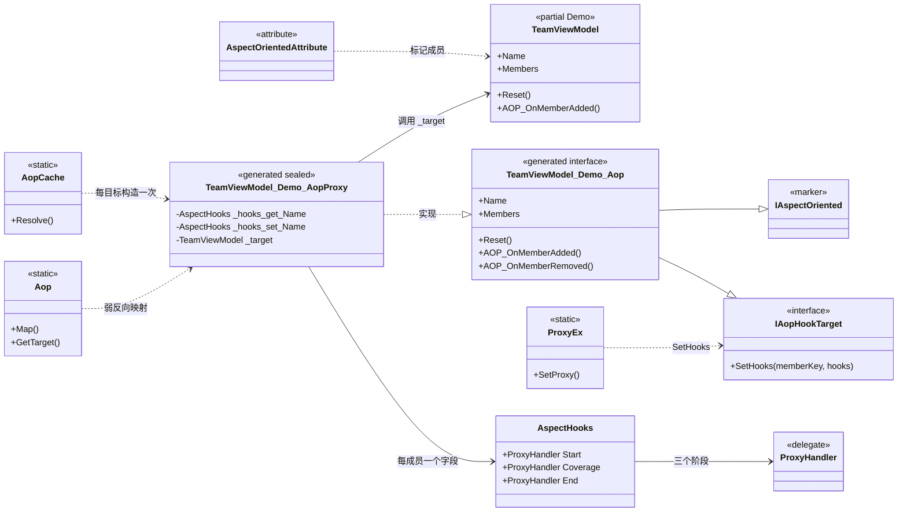

# 设计模式 — AOP

AOP 功能分为两层，而这个分层本身就是设计：

- **编译期** —— `AopSurface` 把镜像接口和 `sealed` 代理类发射进消费方程序集；`AopProxy` 发射带缓存的 `Aop()` 扩展。
- **运行期** —— `ProxyEx.SetProxy` 把一组 `AspectHooks` 写入代理的字段；代理的成员体按 `start` → 方法体或 `coverage` → `end` 执行。

没有 `DispatchProxy`，也没有 `Reflection.Emit`：所谓“动态”代理就是普通的生成 C#，因此它在裁剪与 NativeAOT 下仍是同一个类型。

## 类图



> 类型取自 WPF Demo（`Examples/AOP/WPF/Demo`），其中 `Demo.TeamViewModel` 是目标。接口与代理名来自 `Base/AopNames.cs`。

## 1. 代理 —— 生成的静态代理

经典的代理模式，只是搬到了编译期。生成的类把每个镜像成员转发给 `_target`：

```csharp
// 由 AopSurface.WriteProxy 发射；这是 AopFixture 生成文件中的形态
public int Add(int a, int b)
{
    var h = _hooks_Add;
    if (h is null)
    {
        return _target.Add(a, b);

    }
    // 钩子管线 ...
}
```

与旧的运行期设计对照：旧设计通过 `Reflection.Emit` 创建 `DispatchProxy`，并按 `MethodInfo` 分发。测试 `TheProxyIsGeneratedIntoTheConsumersOwnAssembly` 钉住了这一差别：

```csharp
Assert.AreSame(
    typeof(AopFixture).Assembly,
    proxy.GetType().Assembly,
    "the proxy must be emitted at compile time, not created by Reflection.Emit at runtime");
```

## 2. 责任链 / 拦截器 —— 三个阶段

每组 `AspectHooks` 是一条固定的三节链。阶段契约（`AspectHooks.cs`）明确规定了各自结果的去向：

- `Start` 最先运行；其返回值成为下一阶段的 `previous`。
- `Coverage` 非空时**替换**成员体；否则成员体运行。
- `End` 观察最终结果；其自身返回值被丢弃。

代理接线（`AopSurface.WriteProxy` 的方法分支）：

```csharp
var args = new object?[] { a, b };
var r0 = h.Start?.Invoke(args, null);
object? r1;
if (h.Coverage is null)
{
    r1 = _target.Add(a, b);
}
else
{
    r1 = h.Coverage.Invoke(args, r0);
}

h.End?.Invoke(args, r1);
return (int)r1!;
```

钩子组由 `IAopHookTarget.SetHooks` 整组安装，因此链无法只替换一半 —— 这是 `AspectHooks` 文档中写明的刻意约束。

## 3. 工厂 + 享元 —— `AopCache.Resolve`

生成的扩展是工厂，缓存是享元身份映射：

```csharp
// 由 AopWriter.WriteExtension 为 AopFixture 发射
public static global::VeloxDev.AopInterfaces.AopFixture_VeloxDev_Core_Test_AspectOriented_Aop Aop(this global::VeloxDev.Core.Test.AspectOriented.AopFixture instance)
    => global::VeloxDev.AspectOriented.AopCache.Resolve<
        global::VeloxDev.Core.Test.AspectOriented.AopFixture,
        global::VeloxDev.AopInterfaces.AopFixture_VeloxDev_Core_Test_AspectOriented_Aop>(
        instance,
        static x =>
        {
            var p = new global::VeloxDev.AopInterfaces.AopFixture_VeloxDev_Core_Test_AspectOriented_AopProxy(x);
            global::VeloxDev.AspectOriented.Aop.Map(p, x);
            return p;
        });
```

`AopCache.Entry<TClass, TInterface>` 通过泛型特化为每一对 `(目标类型, 接口)` 提供独立的 `ConditionalWeakTable`，享元存储因此不需要生成缓存代码。`AopProxyTests.OneProxyPerInstance_AndADifferentOnePerTarget` 钉住了“每实例一个代理”。

## 4. 注册表 —— 弱反向映射

`Aop` 是弱意义上的注册表：它把代理映射到目标供 `GetTarget` 使用，但键是弱引用，所以注册表永远不会为代理生根。

```csharp
// Src/Core/VeloxDev.Core/AspectOriented/Aop.cs
public static void Map(object proxy, object target)
    => _proxyToTarget.Add(proxy, target);

public static TTarget? GetTarget<TTarget>(IAspectOriented proxy) where TTarget : class
    => _proxyToTarget.TryGetValue(proxy, out var t) ? (TTarget)t : null;
```

与 `AopCache` 的弱键配合，代理与目标会作为一对被回收 —— `AProxyIsCollectableOnceItsTargetIs` 断言了这一点。旧设计中的强静态注册表无法通过该测试。

## 5. 标记接口与分类

`IAspectOriented` 是空标记，被每个生成接口实现，并作为 `SetProxy` 与 `Resolve` 的约束。`IAopHookTarget` 是它带成员的兄弟：只存在于生成接口上，由代理显式实现，因此 `SetProxy` 能区分真正的代理与手写的标记实现，并拒绝后者。

`ProxyMembers` 把一次注册分类为 getter、setter 或方法；生成器据此产出 `get_*` / `set_*` / 裸名 的 `switch`。

## 模式汇总

| 模式 | 参与者 | 作用 |
|---|---|---|
| 代理 | `{Interface}Proxy`、`{Interface}` | 转发到目标的替身 |
| 责任链 / 拦截器 | `AspectHooks`、`ProxyHandler` | 前 / 替换 / 后 三个阶段 |
| 工厂 | 生成的 `Aop()` 扩展、`AopCache.Resolve` | 首次使用时创建代理 |
| 享元 | `AopCache.Entry<TClass,TInterface>` | 每个目标实例一个代理 |
| 注册表（弱） | `Aop` | 反向查找且不为对象生根 |
| 标记接口 | `IAspectOriented`、`IAopHookTarget` | 约束与安装面 |

> 源码：`Src/Core/VeloxDev.Core/AspectOriented/{AspectHooks,ProxyEx,Aop,AopCache,AspectOrientedAttribute}.cs`、`Src/Core/VeloxDev.Core/Interfaces/AspectOriented/IAspectOriented.cs`、`Src/Generators/VeloxDev.Core.Generator/{AopSurface,AopProxy}.cs`、`Writers/AopWriter.cs`、`Src/Core/VeloxDev.Core.Test/AspectOriented/AopProxyTests.cs`。
