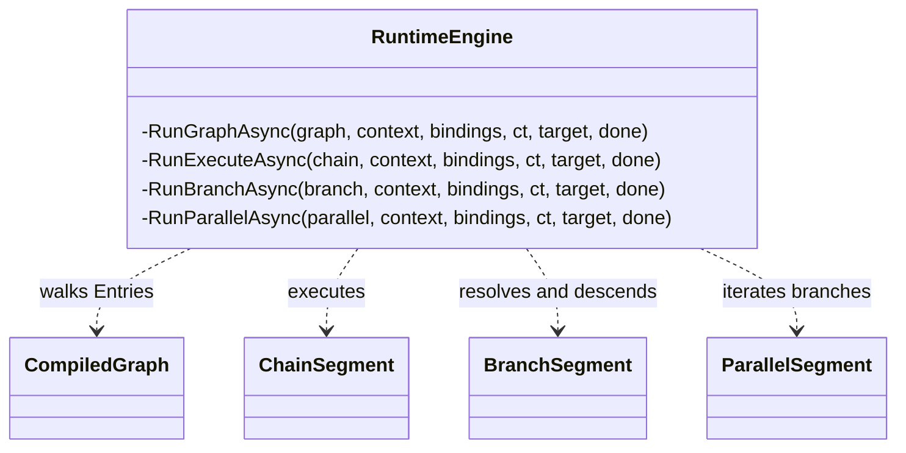
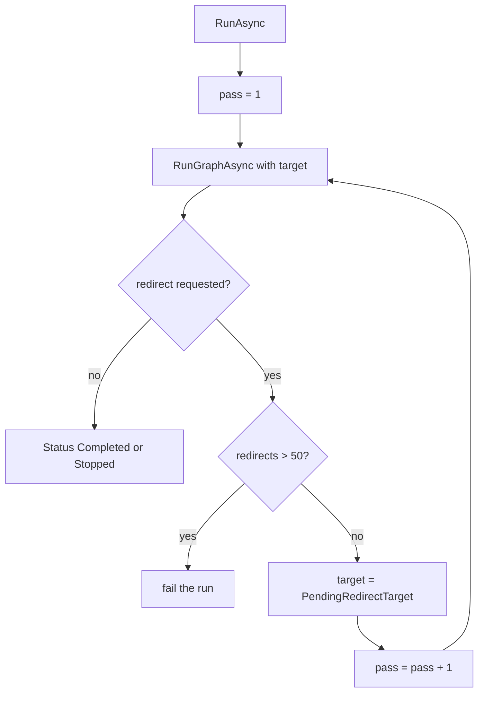

# 解释器与执行管线

引擎是解释器：编译模型是惰性数据，`RunGraphAsync` 按分段运行时类型分派到知道如何执行它的例程。外层 `RunAsync` 循环把重定向转成整图重跑，并在多次重跑间保持会话状态一致。

## 分段分派

`RunGraphAsync` 遍历图的条目并按具体分段切换。链按顺序运行节点，分支解析路由键并下降到一个选项的子图，并行组依次运行每个子图。这种可重入形态与组合模型完全对应。

```csharp
switch (entry)
{
    case ChainSegment exec:
        terminated = await RunExecuteAsync(exec, context, bindings, ct, redirectTarget, done);
        break;
    case BranchSegment branch:
        terminated = await RunBranchAsync(branch, context, bindings, ct, redirectTarget, done);
        break;
    case ParallelSegment parallel:
        terminated = await RunParallelAsync(parallel, context, bindings, ct, redirectTarget, done);
        break;
}
```

源码：`Src/Core/VeloxDev.Core/WorkflowSystem/CompilerEx/Runtime/RuntimeEngine.cs` 第 145-190 行。



`ParallelSegment` 按设计顺序执行。类注释给出理由：共享的 `IRuntimeContext` 黑板不是线程安全的，真正的并行会破坏汇合聚合。

源码：`Src/Core/VeloxDev.Core/WorkflowSystem/CompilerEx/Compile/Model/ParallelSegment.cs` 第 70-79 行。

## 重定向是重跑，不是 goto

失败或被显式重定向的驱动不会从任意点继续。该趟在请求节点处结束，并把 `PendingRedirectTarget` 设为某个编译序号。随后 `RunAsync` 递增趟次并再次调用 `RunGraphAsync`；序号低于目标的节点被跳过，图从目标起继续驱动。

```csharp
var terminated = await RunGraphAsync(graph, context, bindings, ct, redirectTarget, redirects == 0 ? done : null);
if (!terminated && context.PendingRedirectTarget is { } next)
{
    redirects++;
    if (redirects > MaxRedirects) { /* stop the run */ }
    redirectTarget = next;
    continue;
}
```

源码：`Src/Core/VeloxDev.Core/WorkflowSystem/CompilerEx/Runtime/RuntimeEngine.cs` 第 56-90 行；上限 `MaxRedirects = 50` 在第 59 行。



产物注册表每次 `RunAsync` 只清空一次，而非每趟清空。早先趟次的陈旧产物在汇合收集输入时按趟次戳过滤，因此重定向不会把旧数据悄悄喂进合并节点。

源码：`Src/Core/VeloxDev.Core/WorkflowSystem/CompilerEx/Runtime/RuntimeEngine.cs` 第 75-85 行；`.../Contracts/IRuntimeContext.cs` 第 132-146 行。

## 中介者：一个会话携带运行时状态

`IRuntimeContext` 是引擎与节点之间的中介者。它继承 `ITaskContext`，因此引擎可以把会话本身作为任务上下文传入 `INodeHelper.ReceiveAsync`。它携带运行标识、序号、日志、当前分段与节点索引、分支键、尝试次数、状态、目标跟踪、重定向目标以及共享变量存储。

源码：`Src/Core/VeloxDev.Core/WorkflowSystem/CompilerEx/Runtime/Contracts/IRuntimeContext.cs` 第 12-146 行。

节点通过同一对象写回：`Log`、`Error`、`Warn`、`ErrorAsync`、`WarnAsync`、`Set` 与 `TryGet` 都是会话成员。这正是中介者模式的意义——节点不持有引擎或接收器的引用；它向上下文报告，由引擎判定报告的含义。

```csharp
context.Error("...");      // log, stop the flow, no sink record
await context.ErrorAsync("...");  // log and await the host's error sink
context.Set("key", value); // shared variable for later nodes
```

源码：`Src/Core/VeloxDev.Core/WorkflowSystem/CompilerEx/Runtime/Contracts/IRuntimeContext.cs` 第 88-130 行。

## 汇合聚合

拥有多个编译输入的节点不会收到裸载荷。引擎把每个上游产物注册到上下文，汇合点用 `CollectGroupedInputs` 收集，只保留当前趟次的产物或重定向目标之前契约保留前缀的产物。过滤后的字典以 `GroupData` 注入。

源码：`Src/Core/VeloxDev.Core/WorkflowSystem/CompilerEx/Runtime/Contracts/IRuntimeContext.cs` 第 132-146 行；组模型在 `.../Model/GroupData.cs`。

## 模式小结

| 模式 | 参与者 | 设计结果 |
| --- | --- | --- |
| 解释器 Interpreter | `RuntimeEngine` 对 `ChainSegment` / `BranchSegment` / `ParallelSegment` | 模型惰性，执行决策集中在一处 |
| 中介者 Mediator | `IRuntimeContext` / `RuntimeContext` | 节点无需认识引擎即可报告 |
| 重跑式控制流 | `RunAsync` 重定向循环 | 重定向复用同一条已校验执行路径 |

环绕该管线的策略契约见[策略与检查点](../01_策略与检查点/index.md)。
