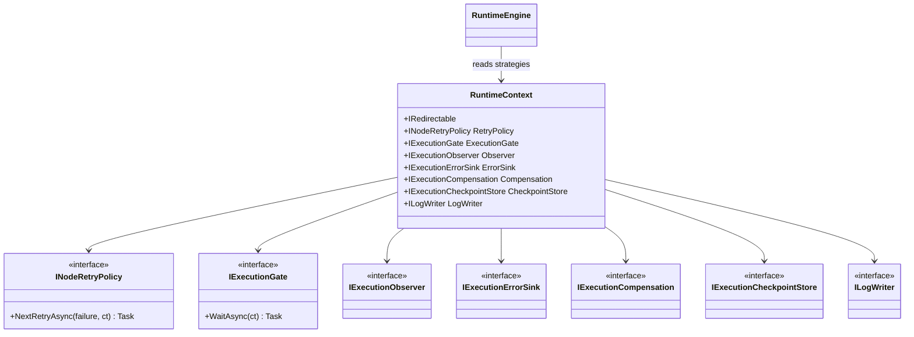
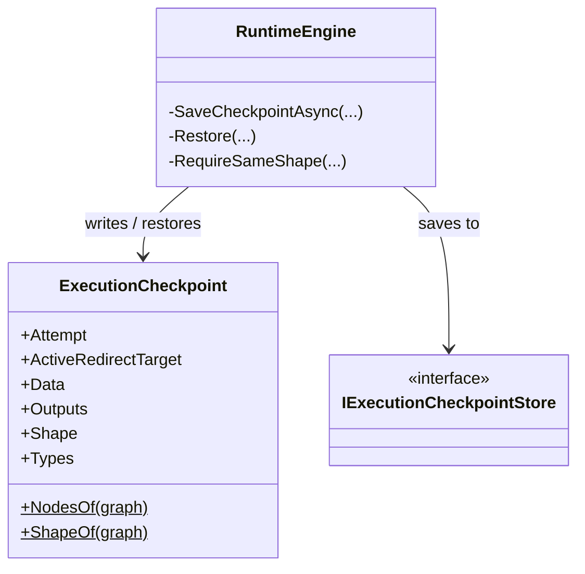

# 策略与检查点

运行时为宿主可能替换的每种关注点定义窄契约。引擎从 `RuntimeContext` 读取实例，并在管线中的固定时点调用。与这些策略并列，`ExecutionCheckpoint` 是一个备忘录，使后续运行无需重新驱动已完成节点即可恢复。

## 策略契约

| 关注点 | 契约 | 默认实现 | 调用时机 |
| --- | --- | --- | --- |
| 重试 | `INodeRetryPolicy` | `ExponentialBackoffRetry` | 节点抛出异常后 |
| 重定向 | `IRedirectable` | 无——由节点实现 | 驱动报告错误后 |
| 暂停 | `IExecutionGate` | `ManualExecutionGate` | 每个节点之前 |
| 观察 | `IExecutionObserver` | `DelegateExecutionObserver` | 运行开始/结束与节点迁移 |
| 报告错误 | `IExecutionErrorSink` | `DelegateExecutionErrorSink` | `ErrorAsync` / `WarnAsync` |
| 补偿 | `IExecutionCompensation` | `DelegateExecutionCompensation` | 运行结束时 |
| 检查点 | `IExecutionCheckpointStore` | `InMemoryCheckpointStore` | 节点成功后 |
| 日志 | `ILogWriter` | `TextWriterLogWriter` | 产生日志行时 |

源码：`Src/Core/VeloxDev.Core/WorkflowSystem/CompilerEx/Runtime/Contracts/`（`INodeRetryPolicy.cs` 第 40 行、`IRedirectable.cs` 第 22 行、`IExecutionGate.cs` 第 28 行、`IExecutionObserver.cs` 第 68 行、`IExecutionErrorSink.cs` 第 78 行、`IExecutionCompensation.cs` 第 40 行、`IExecutionCheckpointStore.cs` 第 29 行、`ILogWriter.cs` 第 29 行）；默认实现在 `.../Model/`。

契约刻意小。`INodeRetryPolicy` 只有一个方法，返回延迟或 `null`；`IExecutionGate` 只有一个可等待点；`IRedirectable` 只有一个方法，返回上游节点或拒绝。

```csharp
public interface INodeRetryPolicy
{
    Task<TimeSpan?> NextRetryAsync(NodeFailure failure, CancellationToken cancellationToken);
}

public interface IExecutionGate
{
    Task WaitAsync(CancellationToken cancellationToken);
}
```

源码：`Src/Core/VeloxDev.Core/WorkflowSystem/CompilerEx/Runtime/Contracts/INodeRetryPolicy.cs` 第 40-45 行；`.../IExecutionGate.cs` 第 28-37 行。



每种观察型契约都有委托适配器，宿主可传 lambda 而不必写类。这是策略模式最廉价的形式：引擎依赖接口，默认实现只是捕获的委托。

源码：`Src/Core/VeloxDev.Core/WorkflowSystem/CompilerEx/Runtime/Model/ExecutionObservers.cs` 第 9-12 行；`.../ErrorSinks.cs` 第 9-12 行；`.../Compensations.cs` 第 11-14 行；`.../ExecutionGates.cs` 第 9-12 行。

## 重试不是重定向

两种恢复策略刻意区分。只有抛出的异常才进入重试；调用 `Error` 的节点是在发出有意的控制流请求，永不重试。策略的 `RetryNumber` 是它自己的计数器，与 `IRuntimeContext.Attempt` 分离；后者统计对图的遍历趟数，并为产物注册表盖戳。

源码：`Src/Core/VeloxDev.Core/WorkflowSystem/CompilerEx/Runtime/Contracts/INodeRetryPolicy.cs` 第 1-49 行。

## 备忘录：`ExecutionCheckpoint`

`ExecutionCheckpoint` 保存趟次、活动重定向目标、链式载荷、已完成节点的产物（以稳定节点键索引）以及图形状。形状是恢复时校验的指纹；在不同图上的检查点会在触碰会话之前被拒绝。

```csharp
public sealed class ExecutionCheckpoint
{
    public int Attempt { get; set; }
    public int? ActiveRedirectTarget { get; set; }
    public object? Data { get; set; }
    public Dictionary<string, object?> Outputs { get; set; } = [];
    public List<string> Shape { get; set; } = [];
    public List<string> Types { get; set; } = [];
}
```

源码：`Src/Core/VeloxDev.Core/WorkflowSystem/CompilerEx/Runtime/Model/ExecutionCheckpoints.cs` 第 27-53 行。



引擎在清空产物注册表之后恢复检查点，然后用检查点自身的尝试次数运行该趟，而不是递增，这样恢复的产物仍带有汇合过滤器期望的戳记。

源码：`Src/Core/VeloxDev.Core/WorkflowSystem/CompilerEx/Runtime/RuntimeEngine.cs` 第 44-47 行与第 60-69 行。

## 模式小结

| 模式 | 参与者 | 设计结果 |
| --- | --- | --- |
| 策略 Strategy | `RuntimeContext` 上的八个运行时契约 | 每种失败/观察策略都可替换 |
| 备忘录 Memento | `ExecutionCheckpoint` | 恢复时无需重驱动已完成节点 |
| 守卫 / 形状校验 | `RequireSameShape` | 外来检查点被拒绝而非猜测 |

回到运行时概览：[工作流运行时](../index.md)。
