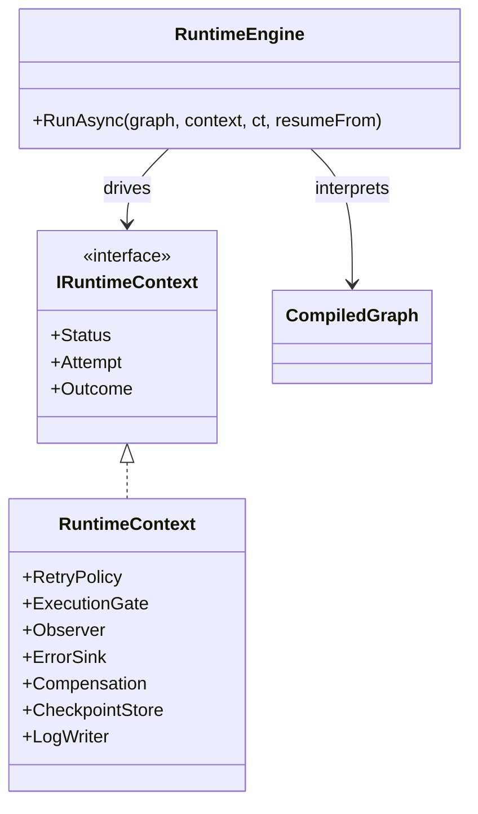

# 工作流运行时中的设计模式

运行时把 `CompiledGraph` 驱动到结束。结构上，它是对三种分段的解释器（Interpreter），周围环绕可替换的策略：重试、重定向、暂停、错误报告、补偿、检查点与日志。

该功能较大，按两项职责拆分：

- [解释器与执行管线](00_解释器与执行管线/index.md) —— `RunAsync` 循环、分段分派、以重跑实现的重定向，以及共享会话上下文。
- [策略与检查点](01_策略与检查点/index.md) —— 韧性契约、默认实现，以及 `ExecutionCheckpoint` 备忘录。

## 组合形态

`RuntimeEngine` 是密封类，只有一个公开入口 `RunAsync`。功能中的其他部分要么是宿主可提供的契约，要么是某个契约的默认实现。`RuntimeContext` 是可变会话，携带状态并持有策略实例。

源码：`Src/Core/VeloxDev.Core/WorkflowSystem/CompilerEx/Runtime/RuntimeEngine.cs` 第 37-56 行；`.../Contracts/IRuntimeContext.cs` 第 12 行；`.../Model/RuntimeContext.cs` 第 16-205 行。

这种切分让引擎控制流保持可读：解释器那一半决定执行去向，策略那一半决定到达后失败、暂停或日志如何处理。
