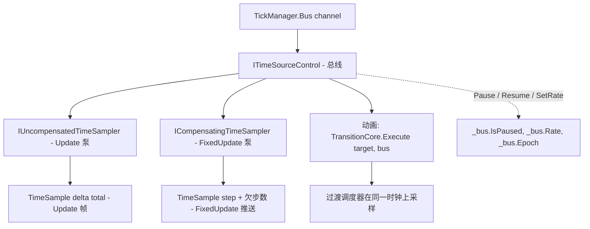

# 共享传输 —— 每个通道一个时钟

每个通道恰好拥有一个 `ITimeSourceControl`，在通道构造时创建，之后永不替换。暂停、恢复、速率与 epoch 都活在这个对象上而不是通道字段里，`TickManager.Bus` 把它公开出去。结果是：帧循环与锚定在同一传输上的动画不可能对「现在是什么时间」产生分歧。

| 元素 | 类型 | 源码 |
|---|---|---|
| 传输 | `LoopChannel._bus` — `TimerCore.CreateTimeSource<ITimeSourceControl>()` | `TickManager.cs` 118 |
| 无补偿采样器（Update） | `IUncompensatedTimeSampler _updateSampler` | `TickManager.cs` 121 |
| 补偿采样器（FixedUpdate） | `ICompensatingTimeSampler _fixedSampler` | `TickManager.cs` 124 |
| 公开访问器 | `TickManager.Bus(channel)` | `TickManager.cs` 1146-1147 |
| 消费者契约 | `ITimeSourceControl` / `ITimeSource` | `Src/Core/VeloxDev.Core/Interfaces/Timing/` |



## 为什么速率不是通道字段

`SetTimeScale` 是转发到传输的一行代码：

```csharp
// Src/Core/VeloxDev.Core/TimeLine/TickManager.cs（第 242 行）
public void SetTimeScale(float timeScale) => _bus.SetRate(timeScale);
```

速率逐字生效：不钳制，负速率以 `ArgumentOutOfRangeException` 拒绝而不是丢弃。`TickableBusTests.ANegativeTimeScaleIsRejectedRatherThanClamped` 是这条规则的可执行陈述。

速率活在时钟而非通道里，带来两个后果：

- **它同时乘到两个消费者上。** `TickableBusTests.TheChannelsRateScalesTheAnimationButNotTheFrameCadence` 设为 `4f`，并断言 `TickManager.TimeScale(channel) == 4f` 且 `bus.Rate == 4f` —— 一个值，从两处读取，因为只有一个值。
- **它不缩放帧节拍。** 目标帧率约束的是*采样节奏*，按墙钟测量（`FrameRateControlSync` 备注，`TickManager.cs` 第 840 行），所以速率减半不会让帧数减半。

## 为什么两条泵都 park 而不是轮询

暂停现在是传输的属性，泵等待传输的信号：

```csharp
// Src/Core/VeloxDev.Core/TimeLine/TickManager.cs（第 522-526 行，UpdateLoop 内）
if (!_bus.IsAdvancing)
{
    _bus.WaitWhileStalledAsync(token).GetAwaiter().GetResult();
    continue;
}
```

谓词是 `IsAdvancing`，不是 `IsPaused`，这个区别是刻意的。速率为 `0` 会冻结时钟却*不*暂停它，只测 `IsPaused` 的循环会对着永不移动的时钟空转。`ITimeSource` 把 `IsAdvancing` 记录为不变量而非公式：*为真意味着位置将会移动*。

这个设计有一个代价，代码显式支付。对 park 住的泵，「该线程最近活跃过吗」必然为假。因此 `IsUpdateThreadAlive` 对它做了限定：

```csharp
// Src/Core/VeloxDev.Core/TimeLine/TickManager.cs（第 195-196 行）
public bool IsUpdateThreadAlive => _isRunning && _isUpdateThreadActive &&
    (!_bus.IsAdvancing || IsRecentActivity(Interlocked.Read(ref _updateThreadLastActivityTimestamp)));
```

`TickableBusTests.PausingAChannelStopsItsFramesAndResumingRestartsThem` 断言两个查询跨暂停保持 `true`，并注明 park 住的循环是活的，不是死的。

## 恢复的是传输，不是循环

`Start` 与 `StopAsync` 都调用 `_bus.Resume()`：

```csharp
// Src/Core/VeloxDev.Core/TimeLine/TickManager.cs（第 295 行，Start 内）
// 启动要清掉上一个生命周期留下的暂停，与旧实现的 _isPaused = false 对齐。不清的话，
// 一个「暂停中被停掉」的渠道重启后会立刻 park，再也跑不起来。
_bus.Resume();
```

传输是通道长期拥有的对象，所以「停止清掉暂停」必须手动完成 —— 旧设计在创建线程时重置实例字段免费得到它。`TickableBusTests.StartingAChannelClearsAPauseLeftOverFromTheLastLifecycle` 正好覆盖这个回归。

同一个调用还重新锚定采样器：

```csharp
// Src/Core/VeloxDev.Core/TimeLine/TickManager.cs（第 290-291 行）
_updateSampler.Reset();
_fixedSampler.Reset();
```

这就是重启后立刻送达的一帧只带一个帧间隔、而不是整段停机时间的原因（`TickableBusTests.RestartingAChannelRePrimesItsClocks`）。

注意 `Resume()` **不能**解除什么：速率为 `0`。冻结的时钟之后，`Resume` 清掉暂停标志，但通道仍然 park，因为 `IsAdvancing` 仍为假。bus 的规则在 `LoopChannel.Resume` 中刻意没有被抹平（第 393-398 行）。

## 消费者一侧

`TickableBusTests.PausingAChannelStopsItsFramesAndTheAnimationAnchoredToIt` 是整个设计的验收测试，值得当作规格来读：

```csharp
var bus = TickManager.Bus(channel);
Assert.IsNotNull(bus, "a started channel must expose its transport");

var target = new Target();
TestTransition.Create()
    .Property(t => t.Value, 1d)
    .Effect(new TransitionEffectCore { Duration = TimeSpan.FromSeconds(30), FPS = 60 })
    .Execute(target, bus!); // 锚到渠道的同一条 transport
```

然后一次 `TickManager.Pause(channel)`，并断言帧计数与动画值都没有移动。这就是「接线同时接住动画和帧循环」的可执行定义。

> 源码：`Src/Core/VeloxDev.Core/TimeLine/TickManager.cs` 第 118、121、124、195-199、242、290-295、341、386-404、522-526、1146-1147 行；`Src/Core/VeloxDev.Core/Interfaces/Timing/ITimeSource.cs`；`Src/Core/VeloxDev.Core.Test/TimeLine/TickableBusTests.cs` 第 112-243 行。
