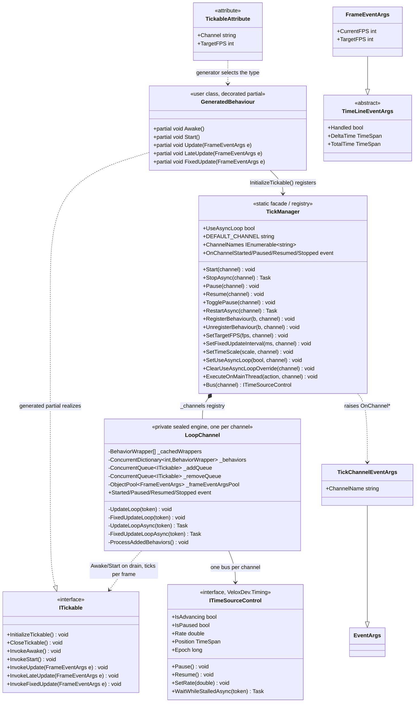

# 设计模式 — Tickable

`VeloxDev.TimeLine` 为标了 `[Tickable]` 的类提供帧驱动生命周期。静态 `TickManager` 同时扮演门面、通道注册表与可观察者：它为每个通道拥有一个具名 `LoopChannel` 引擎，并把该通道的状态迁移重新发布到进程范围。Roslyn 源生成器把特性变成 `ITickable` 实现，其入口转发到用户的 `partial void` 钩子 —— 引擎固定循环骨架，用户提供可变步骤（模板方法）。两条泵都 park 在共享时间源上而不是轮询标志，于是一次 `Pause()` 能同时停住帧循环与动画（面向共享时钟的适配器）。热路径参数类型是池化的。

本页是概览：类图与模式清单。每种模式有独立子页。

> 源码：`Src/Core/VeloxDev.Core/TimeLine/TickManager.cs`（`TickManager` 区域 1050-1156，`LoopChannel` 101-998）、`Src/Core/VeloxDev.Core/Interfaces/Tickable/ITickable.cs`、`Src/Generators/VeloxDev.Core.Generator/Writers/TickWriter.cs`、`Src/Core/VeloxDev.Core/Interfaces/Timing/ITimeSourceControl.cs`、`Examples/Tickable/WPF/Demo/MainWindow.Hooks.cs`。

## 模式清单

| # | 模式 | 位置 | 子页 |
|---|---|---|---|
| 1 | **模板方法** —— 循环骨架固定，钩子是可变的步骤 | `LoopChannel.UpdateLoop` / `FixedUpdateLoop` + 生成器的 `Invoke*` 桥 | [模板方法](00_模板方法/index.md) |
| 2 | **适配器 / 共享传输** —— 两条泵与任何锚定动画都驱动同一个 `ITimeSourceControl` | `LoopChannel._bus`、`TickManager.Bus` | [共享时钟](01_共享时钟/index.md) |
| 3 | **发布-订阅 / 门面 + 注册表** —— 静态门面覆盖惰性通道字典，把按通道事件重新发布到进程范围 | `GetOrCreateChannel`、四个 `OnChannel*` 事件 | [发布订阅](02_发布订阅/index.md) |
| 4 | **对象池** —— 每通道三个固定容量池，外加一个按变更复制的排序快照 | `ObjectPool<T>`、`_frameEventArgsPool`、`_cachedWrappers` | [对象池](03_对象池/index.md) |

四种模式之下还有两个支撑决定，值得点名，因为它们塑造了代码：

- **延迟命令队列。** 注册、注销与目标帧率变更不由调用方直接施加；它们入队到通道，由泵在 `ProcessMainThreadOperations` 中应用。这让每个修改器都线程安全，而无需在行为字典外持锁 —— 命令模式用于状态变更。
- **写时复制派发数组。** `_cachedWrappers` 是普通数组，在 `volatile` 字段下整体替换，所以派发循环读到稳定快照，无锁、每帧零分配。
