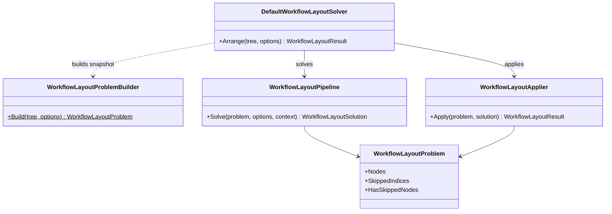
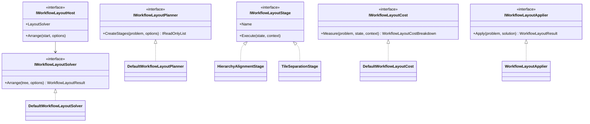

# 工作流自动布局中的设计模式

自动布局分离三个问题：图此刻长什么样、位置如何计算、结果如何写回。实现分别用快照构建器、由策略选择的阶段组合、运行阶段的管线，以及一次可撤销的命令来回答。

## 构建器：问题是一个不可变快照

求解过程从不解引用活动节点。`WorkflowLayoutProblemBuilder` 把当前几何、连线、固定旗标与遍历范围复制进 `WorkflowLayoutProblem`；管线与代价度量只依赖该快照和解出的数组。

```csharp
var problem = WorkflowLayoutProblemBuilder.Build(tree, options);
var pipeline = new WorkflowLayoutPipeline(_planner, _cost);
var solution = pipeline.Solve(problem, options);
return new WorkflowLayoutApplier(tree).Apply(problem, solution);
```

源码：`Src/Core/VeloxDev.Core/WorkflowSystem/Layout/DefaultWorkflowLayoutSolver.cs` 第 127-135 行。



求解守卫是显式的：`WorkflowLayoutPipeline.Solve` 对空问题抛异常、重置诊断，并且从不改动模型状态。

源码：`Src/Core/VeloxDev.Core/WorkflowSystem/Layout/WorkflowLayoutPipeline.cs` 第 32-43 行。

## 管线：阶段按序执行，固定节点随后恢复

阶段读取问题，只写入 `WorkflowLayoutState` 中归它所有的坐标数组。管线向规划器索取有序阶段，在每个阶段前检查取消，然后恢复固定位置，使行为不端的阶段无法移动它们。

```csharp
var state = new WorkflowLayoutState(problem, options);
var stages = _planner.CreateStages(problem, options);

foreach (var stage in stages)
{
    context.CancellationToken.ThrowIfCancellationRequested();
    stage.Execute(state, context);
}

RestorePinnedPositions(state);
```

源码：`Src/Core/VeloxDev.Core/WorkflowSystem/Layout/WorkflowLayoutPipeline.cs` 第 43-52 行。


默认规划器组合两个阶段：层级对齐把每个节点放到父级中心线上，瓦片分离修复剩余冲突。分离阶段通过构造函数接收位置策略，因此更严格的策略无需改动阶段即可替换容差行为。

源码：`Src/Core/VeloxDev.Core/WorkflowSystem/Layout/DefaultWorkflowLayoutPlanner.cs` 第 146-167 行；`.../HierarchyAlignmentStage.cs`；`.../TileSeparationStage.cs`。

## 策略：五个可替换接缝

`IWorkflowLayoutSolver` 是整体方案接缝。其内部注入四个更小的接缝：规划器（阶段组合）、阶段（一个阶段）、代价（质量度量）与施加器（写回）。第五个策略 `IWorkflowLayoutPositionPolicy` 由分离阶段消费。



源码：契约在 `Src/Core/VeloxDev.Core/Interfaces/WorkflowSystem/Layout/IWorkflowLayoutSolver.cs` 第 12-44 行、`.../IWorkflowLayoutStage.cs` 第 56-64 行、`.../IWorkflowLayoutPlanner.cs` 第 74-80 行、`.../IWorkflowLayoutCost.cs` 第 93-101 行、`.../IWorkflowLayoutApplier.cs` 第 114-120 行。

宿主是树的 helper，一键入口通过节点的父级解析它。未实现 `IWorkflowLayoutHost` 的树回退到默认求解器，因此注册是可选的而非必需的。

源码：`Src/Core/VeloxDev.Core/WorkflowSystem/Layout/WorkflowLayoutEx.cs` 第 180-232 行。

## 命令：一次应用，一次撤销

施加器是唯一触碰模型的部分，它在求解之后、调用线程上运行。每个改变的锚点作为一个 `IActionPair` 提交，因此一次撤销即可恢复整套布局。应用时还会把每个节点与快照复核，跳过期间已移动的节点而不是覆盖它们。

源码：`Src/Core/VeloxDev.Core/WorkflowSystem/Layout/WorkflowLayoutApplier.cs`；契约理由见 `.../IWorkflowLayoutApplier.cs` 第 105-113 行。

## 模式小结

| 模式 | 参与者 | 设计结果 |
| --- | --- | --- |
| 构建器 Builder | `WorkflowLayoutProblemBuilder`、`WorkflowLayoutProblem` | 求解无法改动活动图 |
| 管线 Pipeline | `WorkflowLayoutPipeline`、`IWorkflowLayoutStage` | 阶段隔离且可重排 |
| 策略 Strategy | 求解器、规划器、阶段、代价、施加器、策略 | 任一层可替换而不影响调用方 |
| 命令 Command | `WorkflowLayoutApplier` + `IActionPair` | 整套布局一次撤销 |

快照保留了下一项功能进行输入路由所依赖的连接结构；参见[画布输入与导航](../07_画布输入与导航/index.md)。
