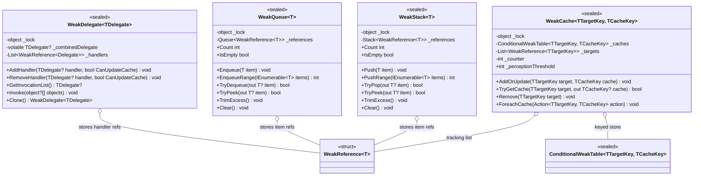

# 设计模式 — 弱引用类型

`VeloxDev.WeakTypes` 的四个类型（`WeakDelegate<TDelegate>`、`WeakQueue<T>`、`WeakStack<T>`、`WeakCache<TTargetKey, TCacheKey>`）实现了**弱引用**家族的习惯用法。它们不保存载荷的强引用，而是保存 `WeakReference<T>`——缓存则使用 `ConditionalWeakTable`——因此容器本身不会让订阅者、入队/入栈条目或缓存键常驻。清理是**惰性**的（访问时剪除死引用），而不是由后台线程完成。四个类型都是 `sealed`、泛型，并由每实例监视器保护；`WeakDelegate` 还提供无锁读取快速通道。证据：源码 `Src/Core/VeloxDev.Core/WeakTypes/*.cs` 与 MSTest 套件 `Src/Core/VeloxDev.Core.Test/WeakTypes/*.cs`。



| 类型 | 模式 |
|---|---|
| `WeakDelegate<TDelegate>` | 弱引用（订阅者）；**弱事件**多播，用作 C# `event` 的底层存储 |
| `WeakQueue<T>` | 弱引用（条目）；惰性驱逐（访问时清扫） |
| `WeakStack<T>` | 弱引用（条目）；惰性驱逐（访问时清扫） |
| `WeakCache<TTargetKey, TCacheKey>` | **Ephemeron 缓存**（条目寿命绑定目标键）；周期性自适应清扫 |

## 1. 弱引用语义

每个类型都存弱引用，因此容器从不保活其载荷。泛型约束：`WeakQueue<T>` / `WeakStack<T>` 要求 `where T : class`，`WeakCache<...>` 要求键与值都是 `class`，`WeakDelegate<TDelegate>` 要求 `where TDelegate : Delegate`。

```csharp
// Src/Core/VeloxDev.Core/WeakTypes/WeakQueue.cs (lines 39-47)
public void Enqueue(T item)
{
    if (item == null) throw new ArgumentNullException(nameof(item));

    lock (_lock)
    {
        _references.Enqueue(new WeakReference<T>(item));
    }
}
```

| 类型 | 存储 | 什么变得可回收 | 所存对象的角色 |
|---|---|---|---|
| `WeakDelegate<TDelegate>` | `List<WeakReference<Delegate>>` | 订阅者委托（仅在组合缓存围绕它们重建之前保持弱） | 多播订阅者 |
| `WeakQueue<T>` | `Queue<WeakReference<T>>` | 入队条目 | 条目载荷，FIFO |
| `WeakStack<T>` | `Stack<WeakReference<T>>` | 入栈条目 | 条目载荷，LIFO |
| `WeakCache<TTargetKey,TCacheKey>` | `ConditionalWeakTable` + `List<WeakReference<TTargetKey>>` | 目标键；其值随它消亡 | `TTargetKey` = 决定寿命的键；`TCacheKey` = 寿命绑定到键的载荷 |

`WeakCache` 使用两种角色不同的结构。`ConditionalWeakTable` 是查找的**事实源**：它弱持有目标键（ephemeron），并*仅在键存活时*强持有值，因此 `TryGetCache` 读取真实表，已回收的键直接未命中。`_targets` 这个 `WeakReference<TTargetKey>` 列表只用于**枚举**存活条目（`ForeachCache`），并让清扫列表在 `AddOrUpdate` / `Remove` 之间不出现重复——它从不参与查找。

## 2. 访问时清扫——条目何时被回收

死引用在成员被触碰时惰性剪除，而不是由专用线程处理。

| 类型 | 包装条目何时被移除 |
|---|---|
| `WeakQueue<T>` / `WeakStack<T>` | `TryDequeue` / `TryPop` / `TryPeek` 扫描队首/栈顶时丢弃死引用；`Count`、`GetEnumerator`、`TrimExcess` 对整个结构调用 `Prune()` |
| `WeakDelegate<TDelegate>` | `CleanupCollectedHandlers()`（每次 `RebuildCache()` 调用——即带缓存更新的 `AddHandler`/`RemoveHandler`、缓存为 null 时的 `GetInvocationList`，以及 `Clone`） |
| `WeakCache<TTargetKey,TCacheKey>` | 目标键被回收时 CWT 条目自动消失；记账条目是 `WeakReference`，由插入计数器超过 `_perceptionThreshold` 时的 `AddOrUpdate`、以及 `ForeachCache` / `Remove` 清扫 |

```csharp
// Src/Core/VeloxDev.Core/WeakTypes/WeakQueue.cs (lines 137-148)
private void Prune()
{
    var activeReferences = _references
        .Where(r => r.TryGetTarget(out _))
        .ToList();

    _references.Clear();
    foreach (var reference in activeReferences)
    {
        _references.Enqueue(reference);
    }
}
```

有两个细节值得注意。第一，`WeakStack.Prune` 在重新压栈前还会反转存活引用（`Src/Core/VeloxDev.Core/WeakTypes/WeakStack.cs`，第 137-149 行；`Reverse()` 在第 142 行），因此压缩后 LIFO 顺序不变。第二，回收是*两阶段*的：一旦没有其它强引用持有对象，GC 就清除 `WeakReference` 的目标，但空包装条目会留在底层容器中，直到某次清扫触及它——因此队列/栈在两次清扫之间会持有垃圾槽位，数量有界并在访问时清理。

## 3. 弱事件用法与唯一的强引用

`WeakDelegate` 支撑着过渡引擎的事件：`TransitionEffectCore` 把七个生命周期事件各声明为 `WeakDelegate<EventHandler<TransitionEventArgs>>` 字段，两个诊断事件声明为 `WeakDelegate<EventHandler<TransitionEventArgs<WarnStage, string>>>`（`Warn`）与 `WeakDelegate<EventHandler<TransitionEventArgs<ErrorStage, Exception>>>`（`Error`），并让 C# `event` 访问器经由它们路由。

```csharp
// Src/Core/VeloxDev.Core/TransitionSystem/Effects/TransitionEffect.cs (lines 81-85)
public virtual event EventHandler<TransitionEventArgs> Awaked
{
    add => _awaked.AddHandler(value);
    remove => _awaked.RemoveHandler(value);
}
```

调用走组合委托，`TransitionEffectCore` 以**类型化**（无反射）方式调用它（`Src/Core/VeloxDev.Core/TransitionSystem/Effects/TransitionEffect.cs`，第 136-139 行）：

```csharp
public virtual void InvokeAwake(object sender, TransitionEventArgs e)
{
    _awaked.GetInvocationList()?.Invoke(sender, e);
}
```

重要注意事项：`_combinedDelegate` 是**强引用**。使用默认 `CanUpdateCache: true` 的 `AddHandler` 会立即重建缓存，因此当前已添加的每个处理器都会被该缓存 root，直到下一次重建把它排除。只有以 `CanUpdateCache: false` 添加的处理器（只存入 `_handlers`、从不进入强缓存）才是真正弱的——仍处于订阅状态却可回收。死的包装条目最终会在下次重建（`Clone`、下一次 `AddHandler`/`RemoveHandler`，或缓存未命中的 `GetInvocationList`）时由 `CleanupCollectedHandlers()` 从 `_handlers` 剪除。这以“延迟释放未退订的订阅者”换取热路径的无锁读取，也是文档把委托缓存描述为“强引用，但按需重建并剪除”的原因。

| 权衡 | 分析 |
|---|---|
| 惰性清理 | 每次变更摊销 O(1)；偶发清扫为 O(n)——可接受，因为只有真正遇到死引用时才清扫 |
| `WeakDelegate` 组合缓存 | 强缓存带来无锁读取快速通道，但在下次重建前会 root 已订阅处理器；`CanUpdateCache: false` 可按处理器退出，获得真正弱的订阅 |
| `WeakCache` 记账列表 | `_targets` 只是弱引用，从不 root 键，因此查找保持 ephemeron 正确性，同时仍可枚举 |

> 源码引用：`Src/Core/VeloxDev.Core/WeakTypes/{WeakDelegate,WeakQueue,WeakStack,WeakCache}.cs`；用法见 `Src/Core/VeloxDev.Core/TransitionSystem/Effects/TransitionEffect.cs`；行为由 `Src/Core/VeloxDev.Core.Test/WeakTypes/*.cs` 验证。
