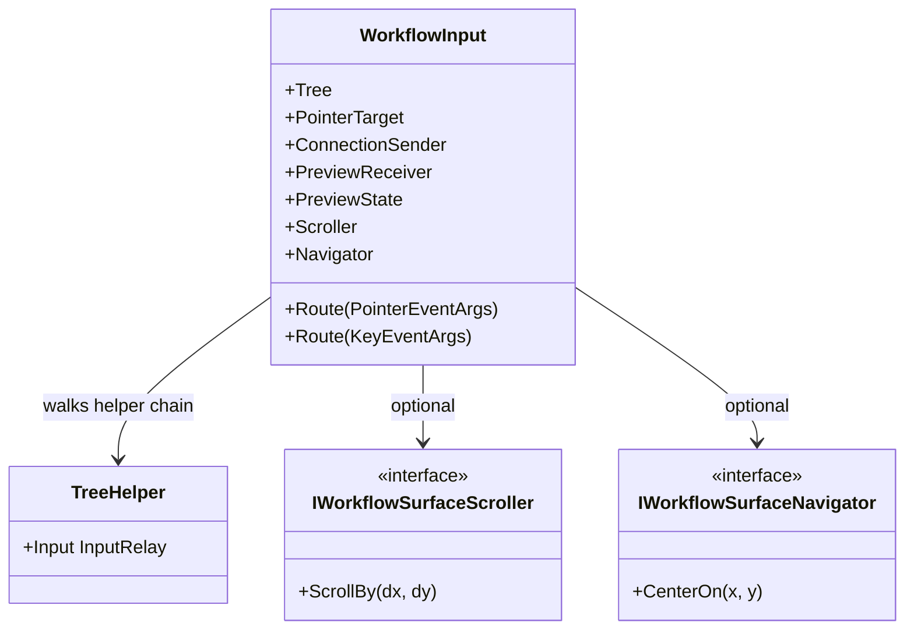
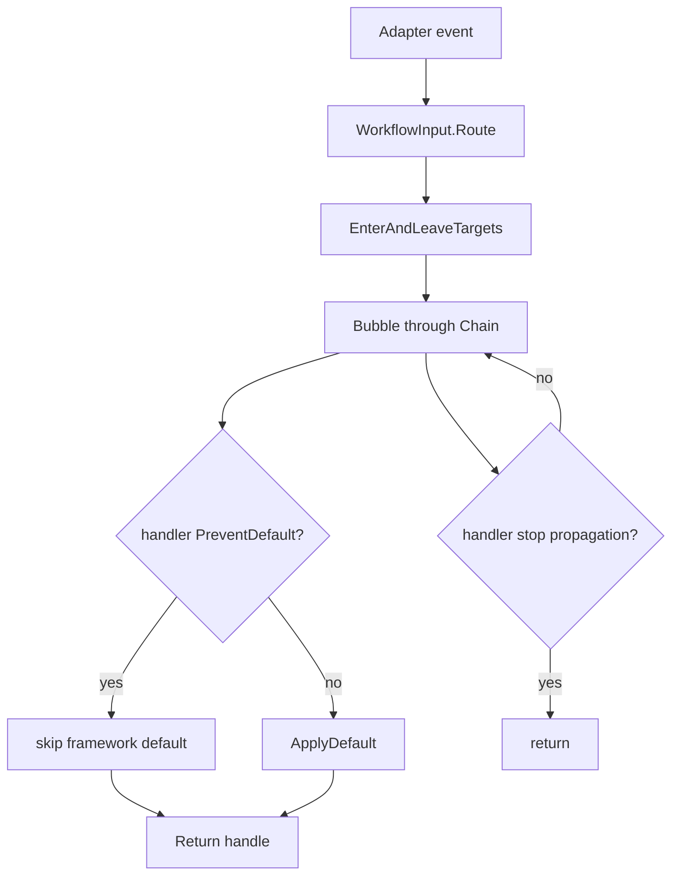

# 画布输入与导航中的设计模式

指针与键盘输入经由唯一组件 `WorkflowInput` 进入，它沿图的 helper 链路由事件，然后应用框架自身的默认反应。导航拆成两个窄契约——相对滚动器与绝对定位器——由适配器实现。因此该功能结合了中介者、冒泡式职责链、观察者面以及平台滚动的策略接缝。

## 中介者：`WorkflowInput` 是唯一路由点

每棵树有一个 `WorkflowInput` 实例，通过 `ConditionalWeakTable` 懒创建。它拥有当前指针目标、连接发送端、预览接收端与预览状态，并暴露指针与键盘事件的 `Route` 重载。适配器把平台事件翻译成框架事件类型后调用 `Route`；它们不决定谁听见。

```csharp
var layer = (e.Source as Visual)?.ZIndex ?? 0;
var anchor = WorkflowSurfaceMath.ToCanvasLocalAnchor(point.X, point.Y, layer, viewModel.Layout);
var input = WorkflowInput.For(viewModel);
var target = ResolveTarget(e.Source, viewModel, anchor.Horizontal, anchor.Vertical, input.HitRadius);

var handle = new WorkflowEventHandle();
input.Route(args(anchor, target, handle));
```

源码：`Src/Adapters/VeloxDev.Avalonia/WorkflowSystem/AttachedBehaviors/WorkflowSurfaceBehavior.cs` 第 316-322 行。

源码：`Src/Core/VeloxDev.Core/WorkflowSystem/GUI/Events/WorkflowInput.cs` 第 31-56 行、第 257-297 行。



组件没有往自身契约增加输入成员。它通过 helper 暴露中继，因此树、节点、插槽或连线都能参与，而 `IWorkflowComponent` 无需扩张。

源码：`Src/Core/VeloxDev.Core/WorkflowSystem/Templates/Helpers/TreeHelper.cs` 第 40 行；`.../NodeHelper.cs` 第 19 行。

## 职责链：事件沿 helper 冒泡

`Chain` 把组件转成应听到事件的有序 helper 列表：节点 helper、插槽 helper、连线 helper、树 helper。`Bubble` 遍历该列表，把事件交给各中继，并在处理器要求抑制继续传播时停止。

```csharp
private IEnumerable<IWorkflowHelper> Chain(IWorkflowComponent? target)
{
    switch (target)
    {
        // resolve node / slot / link / tree and yield their helpers in route order
    }
}
```

源码：`Src/Core/VeloxDev.Core/WorkflowSystem/GUI/Events/WorkflowInput.cs` 第 358-380 行；冒泡在第 320-356 行。

`WorkflowEventHandle` 是控制令牌：`PreventDefault` 抑制框架自身反应，另一个旗标阻止事件继续上浮。触发方法返回该句柄，因此处理器用一个对象同时表达两个决定。

源码：`Src/Core/VeloxDev.Core/WorkflowSystem/GUI/Events/WorkflowEventHandle.cs`；用法见 `.../WorkflowInput.cs` 第 320-356 行。



## 观察者：每个 helper 一个中继，类型化事件

每个 helper 拥有一个 `InputRelay`。中继声明八个输入事件，并按运行时类型把单个参数对象分派到恰好一个事件，因此触发逻辑只存在一份，而不是在每个 helper 实现里重复。订阅者把中继视为 sender，从而知道自己正在听路由中的哪个元素。

```csharp
internal void Raise(PointerEventArgs e)
{
    switch (e)
    {
        case PointerEnteredEventArgs entered: PointerEntered?.Invoke(this, entered); break;
        case PointerExitedEventArgs exited: PointerExited?.Invoke(this, exited); break;
        // ... moved, pressed, released, wheel
    }
}
```

源码：`Src/Core/VeloxDev.Core/WorkflowSystem/GUI/Events/Input/InputRelay.cs` 第 15-62 行。

节点、插槽与树的生命周期事件形状相同，但由静态辅助类中继。`WorkflowEventRelay.Attach` 把宿主的事件接收器接到 helper 的事件，并返回一个可退订的 `IDisposable`，因此宿主摘下视图时也摘下手处理器。

源码：`Src/Core/VeloxDev.Core/WorkflowSystem/GUI/Events/WorkflowEventRelay.cs` 第 18-52 行。

## 策略与适配器：无需平台分支的导航

`IWorkflowSurfaceScroller.ScrollBy` 接收滚轮增量而非滚动偏移，`IWorkflowSurfaceNavigator.CenterOn` 接收画布局部点。`SurfaceScrollerCore` 在适配器提供的窄接口 `ISurfaceScrollHost` 之上实现两者。算术——每轴符号、零增量规则、越界扩展——只写一次；适配器只读写自己的平台滚动容器。

```csharp
public sealed class SurfaceScrollerCore : IWorkflowSurfaceScroller, IWorkflowSurfaceNavigator
{
    private readonly ISurfaceScrollHost host;
    public void ScrollBy(double wheelDeltaX, double wheelDeltaY) { /* ... */ }
    public void CenterOn(double localX, double localY) { /* ... */ }
}
```

源码：`Src/Core/VeloxDev.Core/WorkflowSystem/GUI/Surface/SurfaceScrollerCore.cs` 第 108-180 行；契约在 `Src/Core/VeloxDev.Core/WorkflowSystem/GUI/Events/IWorkflowSurfaceScroller.cs` 第 38-51 行与 `.../IWorkflowSurfaceNavigator.cs` 第 74-82 行。

每个适配器通过附加属性注册行为。例如 WPF 表面行为是 `DependencyObject`，用附加注册属性接收滚动视图、画布与网格装饰器；Avalonia 行为在 `AvaloniaProperty` 上承担同一角色。这是适配器那一半：平台对象被适配到 Core 契约，七个实现不会渗进 Core。

源码：`Src/Adapters/VeloxDev.WPF/WorkflowSystem/AttachedBehaviors/WorkflowSurfaceBehavior.cs` 第 16-77 行；`Src/Adapters/VeloxDev.Avalonia/WorkflowSystem/AttachedBehaviors/WorkflowSurfaceBehavior.cs` 第 22-74 行。

## 几何作为共享门面

`WorkflowSurfaceMath` 是坐标转换与钳制的静态门面。其方法显式接收 `CanvasLayout` 而非读取模型状态，这既让算术可测试，也让滚动器与网格装饰器共享同一套滚动/内容偏移定义。

源码：`Src/Core/VeloxDev.Core/WorkflowSystem/GUI/Math/WorkflowSurfaceMath.cs` 第 14-44 行。

## 模式小结

| 模式 | 参与者 | 设计结果 |
| --- | --- | --- |
| 中介者 Mediator | `WorkflowInput` | 输入状态与路由的唯一所有者 |
| 职责链 Chain of Responsibility | helper 之上的 `Chain` / `Bubble` | Core 中无需控件层级即可冒泡 |
| 观察者 Observer | `InputRelay`、`WorkflowEventRelay` | 类型化事件，一份触发实现 |
| 策略 / 适配器 Strategy / Adapter | `IWorkflowSurfaceScroller`、`IWorkflowSurfaceNavigator`、`ISurfaceScrollHost`、附加行为 | 七个平台，一套算术 |

这些手势移动的可见集合由下一项功能管理；参见[视图托管与虚拟化](../08_视图托管与虚拟化/index.md)。
