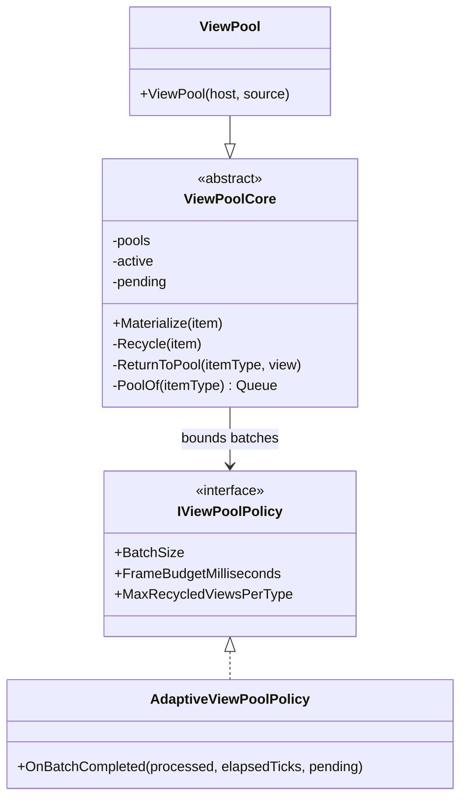
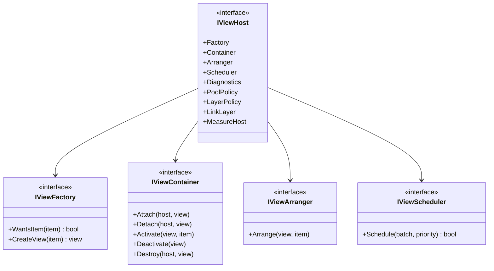
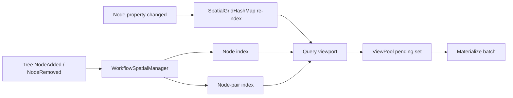

# 视图托管与虚拟化中的设计模式

只有工作流的可见部分需要平台视图。`ViewPool` 为每个可见条目物化一个视图，条目离开时按运行时类型回收，并分批调度物化，以免大视口独占 UI 线程。三种模式支撑它：对象池、抽象工厂式的平台层组合，以及由观察者驱动的空间索引。

## 对象池：视图按条目类型分类回收

`ViewPoolCore` 维护三个集合：按类型分组的空闲视图队列字典、活动条目到视图的绑定字典，以及等待物化的待处理集合。`Recycle` 返回的视图不会消失；它回到对应运行时类型的队列，在下次 `Materialize` 时再次发出。

```csharp
private readonly Dictionary<Type, Queue<TView>> pools = [];
private readonly Dictionary<object, TView> active = new(ViewReferenceComparer<object>.Instance);
private readonly Queue<object> pending = new();
```

源码：`Src/Core/VeloxDev.Core/WorkflowSystem/ViewHosting/ViewPool.cs` 第 29-47 行；物化在第 319 行，回收在第 380 行，归还池在第 396 行。



策略决定一批可创建多少视图，以及每种类型可保留多少回收视图。`AdaptiveViewPoolPolicy` 依据平滑吞吐量估计调整批大小，在大量条目待处理时使用更大的时间预算，普通滚动时使用更小的预算。

源码：`Src/Core/VeloxDev.Core/WorkflowSystem/ViewHosting/ViewPool.cs` 第 274-318 行；`.../AdaptiveViewPoolPolicy.cs` 第 25-110 行；`.../ViewPoolOptions.cs` 第 21-112 行。

## 组合式抽象工厂：`IViewHost` 聚合平台层

池从不直接调用平台 API。它向一个 `IViewHost` 索取工厂、容器、排列器、调度器、诊断、池策略、层策略、连线层与测量宿主。每层各有契约，平台可独立提供；把它们聚合起来，使池的依赖只有一个对象。



源码：`Src/Core/VeloxDev.Core/Interfaces/WorkflowSystem/ViewHosting/IViewHost.cs` 第 22-53 行；各契约在同一目录。

这是组合形式的抽象工厂：`IViewHost` 是工厂族，每个 getter 是一件产品。池依赖工厂族，而不是七个临时搭配的平台对象。

源码：`Src/Core/VeloxDev.Core/Interfaces/WorkflowSystem/ViewHosting/IViewHost.cs` 第 11-21 行。

## 观察者与空间索引：可见集合是推导出来的

`SpatialGridHashMap<T>` 把条目索引进固定大小的网格（`Dictionary<CellKey, HashSet<T>>`）并回答视口查询。它订阅每个条目的 `INotifyPropertyChanged`，因此节点移动后自行重建索引，调用方无需重新插入。重入守卫与待重跑旗标防止操作中途触发的属性变化破坏字典。

```csharp
public class SpatialGridHashMap<T>(double cellSize) : ISpatialMap<T>
{
    private readonly Dictionary<CellKey, HashSet<T>> _grid = [];
    private readonly Dictionary<T, Viewport> _trackedItems = [];
    private void OnItemPropertyChanged(object? sender, PropertyChangedEventArgs e) { /* re-index */ }
}
```

源码：`Src/Core/VeloxDev.Core/WorkflowSystem/GUI/Virtualization/SpatialGridHashMap.cs` 第 11-25 行与第 158-218 行；查询在第 98-131 行。

`WorkflowSpatialManager` 组合两个索引——节点索引与代表连线的节点对索引——并订阅树的增删事件。端点尚未建索引的连线进入待处理集合，端点到达后重试。

源码：`Src/Core/VeloxDev.Core/WorkflowSystem/GUI/Virtualization/WorkflowSpatialManager.cs` 第 8-27 行、第 245-281 行。



池消费该索引产生的可见集合，不自行决定可见性。这种分离使池可复用于没有空间索引的表面，只要提供源集合即可。

源码：`Src/Core/VeloxDev.Core/Interfaces/WorkflowSystem/Spatial/ISpatialMap.cs` 第 12-43 行；`Src/Core/VeloxDev.Core/WorkflowSystem/ViewHosting/ViewPool.cs` 第 125-230 行。

## 模式小结

| 模式 | 参与者 | 设计结果 |
| --- | --- | --- |
| 对象池 Object Pool | `ViewPoolCore`、按类型队列 | 按运行时类型回收，按类型设上限 |
| 抽象工厂（组合式）Abstract Factory | `IViewHost` 及其八层 | 平台差异收于一个对象之后 |
| 策略 Strategy | `IViewPoolPolicy`、`AdaptiveViewPoolPolicy` | 批大小在运行时调节 |
| 观察者 + 空间索引 Observer + index | `SpatialGridHashMap`、`WorkflowSpatialManager` | 可见集合由模型变化推导 |

小地图通过另一条管线渲染同一张图；参见[小地图](../09_小地图/index.md)。
