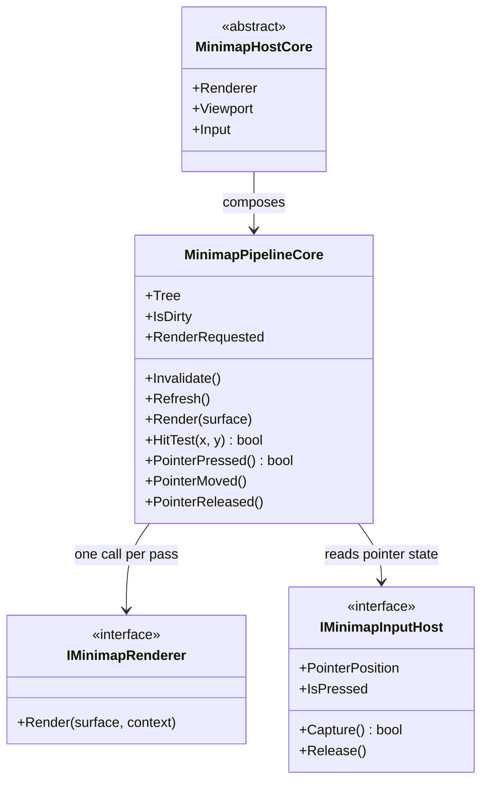
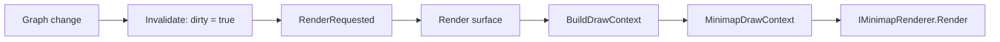

# 小地图中的设计模式

小地图是一条由观察者喂数据的渲染管线。`MinimapPipelineCore` 订阅树的节点与连线，维护脏标记，在映射坐标中计算绘制上下文，并请平台渲染器绘制。指针交互遵循同样的切分：核心拥有拖拽逻辑，平台输入宿主提供指针状态与捕获。

## 观察者：核心监听图

管线订阅树的增删事件，以及每个节点和连线的属性通知。变化把管线标脏并触发 `RenderRequested`；宿主在该信号上重绘，而不是轮询。退订与订阅严格镜像，因此核心保留显式的 `SubscribedNodeCount` 与 `SubscribedLinkCount` 诊断。

```csharp
public event EventHandler? RenderRequested;
public bool IsDirty => dirty;
private void SubscribeToTree() { /* node/link add, remove, change */ }
private void UnsubscribeFromTree() { /* mirror */ }
```

源码：`Src/Core/VeloxDev.Core/WorkflowSystem/Minimap/MinimapPipelineCore.cs` 第 61-93 行、第 133-163 行、第 413-439 行。



源码：`Src/Core/VeloxDev.Core/WorkflowSystem/Minimap/MinimapPipelineCore.cs` 第 14-61 行。

## 管线：先几何，后绘制

`BuildDrawContext` 完成全部坐标映射：内容边界、摆放后的小地图矩形、每个节点缩略图的映射矩形，以及视口指示器。随后 `Render` 用该上下文调用一次 `IMinimapRenderer.Render`。渲染器对工作流一无所知；它把矩形与颜色翻译成平台图元。

```csharp
public void Render(TSurface surface) { /* build context, call renderer */ }
private MinimapDrawContext? BuildDrawContext() { /* map nodes/links/viewport */ }
```

源码：`Src/Core/VeloxDev.Core/WorkflowSystem/Minimap/MinimapPipelineCore.cs` 第 188-207 行、第 294-377 行；上下文模型在 `Src/Core/VeloxDev.Core/Interfaces/WorkflowSystem/Surface/MinimapDrawContext.cs` 第 1-99 行。



## 策略：渲染器与输入宿主是平台接缝

`IMinimapRenderer<TSurface>` 只有一个方法。`IMinimapInputHost` 提供指针位置、按下/捕获状态、钳制矩形以及捕获/释放。替换任一只改变平台，不影响管线中的拖拽状态机。

源码：`Src/Core/VeloxDev.Core/Interfaces/WorkflowSystem/Surface/IMinimapRenderer.cs` 第 55-64 行；`.../IMinimapInputHost.cs` 第 72-95 行。

拖拽导航是核心内的状态机：按下命中交互矩形并捕获，移动导航表面，释放结束拖拽，捕获丢失则重置。摆放小地图的同一组映射辅助函数也把拖拽转换回滚动偏移，因此缩略图与手势不会各说各话。

源码：`Src/Core/VeloxDev.Core/WorkflowSystem/Minimap/MinimapPipelineCore.cs` 第 208-271 行、第 378-412 行。

## 数据契约：适配器推送，装饰器读取

叠加层接口派生自 `IWorkflowGridDecorator`，因为小地图同样需要滚动与内容偏移。表面行为在每趟绘制前推送这些成员；小地图不去访问平台的滚动视图。

源码：`Src/Core/VeloxDev.Core/Interfaces/WorkflowSystem/Surface/IWorkflowMinimapOverlay.cs` 第 15-46 行；`.../IWorkflowGridDecorator.cs` 第 12-33 行。

`MinimapMetrics` 携带可用区域、宽、高与最小尺寸，因此摆放是值计算，而不是一串适配器分支。

源码：`Src/Core/VeloxDev.Core/Interfaces/WorkflowSystem/Surface/MinimapMetrics.cs` 第 1-58 行。

## 模式小结

| 模式 | 参与者 | 设计结果 |
| --- | --- | --- |
| 观察者 Observer | `MinimapPipelineCore`、`RenderRequested`、脏标记 | 图变化即重绘，无需轮询 |
| 管线 Pipeline | `BuildDrawContext` → `IMinimapRenderer.Render` | 几何与绘制分离 |
| 策略 Strategy | `IMinimapRenderer`、`IMinimapInputHost` | 平台部件可替换 |
| 数据契约 | `IWorkflowMinimapOverlay`、`IWorkflowGridDecorator` | 适配器推送偏移，Core 不读取 |

网格与标尺使用同一推送契约；参见[网格装饰器与标尺](../10_网格装饰器与标尺/index.md)。
