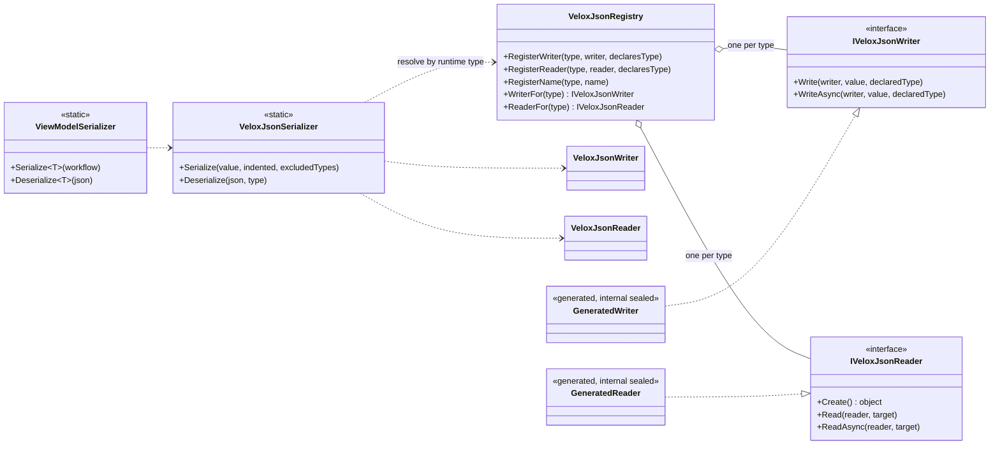

# 设计模式 — 序列化

归档引擎存在的目的，是让一条性质成立：**文档里只可能出现编译器见过的类型**。其余设计都是这条性质的推论。

它分两层构建：

- **编译期** —— `VeloxDev.Core.Generator` 遍历编译单元，决定哪些类型**在**闭世界里，并为每个类型把一对 `internal sealed` 读写器写进生成的 `_VeloxJson.g.cs`，同时生成一个 `[ModuleInitializer]` 负责注册。
- **运行期** —— `VeloxJsonSerializer` 在 `VeloxJsonRegistry` 里查类型，然后调用查到的写者或读者。热路径上**没有任何反射**，也没有兜底：没有条目的类型会以 `MissingWriter` / `MissingReader` 的说明失败，而不是写成一个空壳。

在这两层之上，该功能组合了 **Registry**、**Strategy**（生成的一对读写器藏在两个接口后）、**Marker Attribute**（`[Archivable]` 打开一个可达性遍历本来发现不了的类型）与 **Immutable Snapshot**（每次注册都发布一份新副本，所以读取永不加锁）。

> 源码：`Src/Core/VeloxDev.Core/Serialization/`（引擎）、`Src/Generators/VeloxDev.Core.Generator/VeloxJson.cs` 与 `Writers/VeloxJsonCodeWriter.cs`（生成器）。

## 类图

## 闭世界

四条路把一个类型放进去，生成器只凭源码判断（`Base/VeloxJsonModel.cs:588-614`）：

| 进入方式 | 生成器看什么 |
|---|---|
| 组件接口 | `IWorkflowTreeViewModel` / `IWorkflowNodeViewModel` / `IWorkflowSlotViewModel` / `IWorkflowLinkViewModel` |
| 组件特性 | `[WorkflowBuilder.*]` |
| 可观察字段 | 一个 `[VeloxProperty]` 字段 —— 由 MVVM 生成器提升 |
| 标记 | `[Archivable]`，可选地点名额外根 |

随后，可达性沿**成员的声明类型**闭合 —— 属性或字段的声明类型、集合的元素类型、字典的键类型 —— 一次一跳（`:621-630`），闭合循环在 `:425-470`。它还沿另外三条轴放宽：派生类、字典的键与值、以及作为根的开放泛型上的约束（`:361-405`）。

值得直说的一条后果：生成器从不为抽象类或接口发出条目，所以 `ReaderFor` 对它们返回 `null`。多态之所以成立，是因为**具体**类型会作为判别符写进文档，读侧再把那个名字解析回注册表。

## 两个入口，一套引擎

| 入口 | 约束 | 服务哪条路 |
|---|---|---|
| `ViewModelSerializer.Serialize<T>` / `.Deserialize<T>` | `where T : INotifyPropertyChanged` | `[VeloxProperty]` 那条路 —— 视图模型 |
| `VeloxJsonSerializer.Serialize(object, …)` / `.Deserialize<T>` | `where T : class` | `[Archivable]` 那条路 —— 普通文档 |

`ViewModelSerializer` 本身不含任何引擎逻辑；它只是 `VeloxJsonSerializer` 之上一个按视图模型形状裁剪的薄门面 —— 这也正是 `CheckpointEx` 能对非视图模型类型使用下层入口的原因。

## 注册表归属 —— 唯一一条有理由的规则

注册要解决一张全局表解决不了的歧义：**非泛型**类型只有一个声明程序集，而**封闭泛型**可能同时被声明它的程序集和关闭它的程序集各发一次。

规则是：*声明方永远赢；消费方只能补空缺*（`VeloxJsonRegistry.cs:195,215`）。它由 **生成器说出**的 `declaresType` 标志执行，而不是让注册表去推断（`Writers/VeloxJsonCodeWriter.cs:503-507`）—— 推断必须猜，猜错会静默地把一个程序集的读写器换成另一个的。

`RegisterName` 与 `RegisterContainerFactory` 刻意**没有**这道守卫。

## 这里**不是**什么模式

这里没有惰性类型解析，没有约定优于配置，也没有一个带长串开关的序列化设置对象。`SerializationOptions` 只有三个成员，唯一的逐成员控制是 `[Archive(...)]` 加上 BCL 的 `[JsonIgnore]`。这是有意的取舍：闭世界已经回答了「什么会被写出去」，在它之上再加一套配置 API，只会成为同一件事的第二种、更弱的说法。
