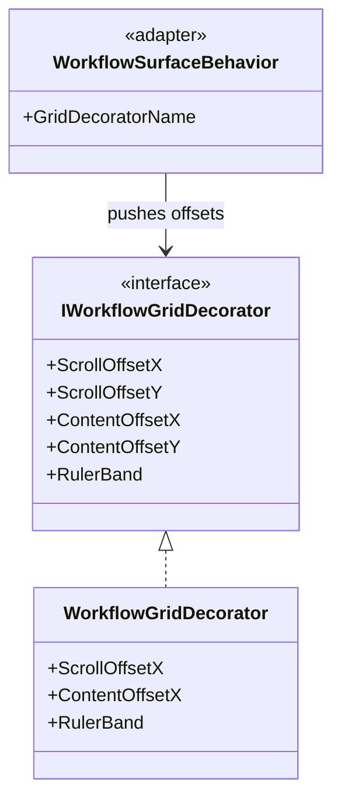
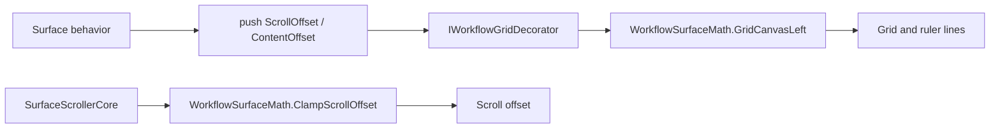

# 网格装饰器与标尺中的设计模式

网格及其悬浮标尺由平台装饰器绘制，而非 Core。Core 拥有的是让装饰器与被平移、缩放和越界滚动的画布保持对齐的数据契约，以及网格与滚动器共用的坐标算术。设计是推送式适配器契约加一个共享门面。

## 适配器：装饰器接收偏移，而不是主动获取

`IWorkflowGridDecorator` 是数据交换契约。表面行为在每趟绘制前把滚动偏移与画布内容偏移推送进装饰器。装饰器从不访问平台的 `ScrollViewer`，因此同一契约可用于 WPF `DrawingVisual`、Avalonia 控件、Razor 组件或 WinForms 绘制器。

```csharp
public interface IWorkflowGridDecorator
{
    double ScrollOffsetX { get; set; }
    double ScrollOffsetY { get; set; }
    double ContentOffsetX { get; set; }
    double ContentOffsetY { get; set; }
    double RulerBand { get; }
}
```

源码：`Src/Core/VeloxDev.Core/Interfaces/WorkflowSystem/Surface/IWorkflowGridDecorator.cs` 第 12-33 行。



WPF 适配器把挂载点声明为附加属性（`GridDecoratorName`）并解析具名元素；Razor 适配器直接提供一个实现该契约的组件。两者都是同一 Core 接口的适配器。

源码：`Src/Adapters/VeloxDev.WPF/WorkflowSystem/AttachedBehaviors/WorkflowSurfaceBehavior.cs` 第 77-78 行与第 444 行；`Src/Adapters/VeloxDev.Razor/WorkflowSystem/AttachedBehaviors/WorkflowGridDecorator.razor.cs` 第 14 行。

## 门面：网格、滚动与小地图共用一套算术

`WorkflowSurfaceMath` 是共享门面。网格用 `GridCanvasLeft`/`GridCanvasTop` 摆放首条线，用 `GridX`/`GridY` 步进线条，用 `GridFirstLine` 对齐首条主线。滚动器用 `ClampScrollOffset` 与 `ClampValue`，小地图用 `Minimap*` 系列。每个方法显式接收几何参数；没有一个读取模型状态。

```csharp
public static double GridCanvasLeft(double scrollOffset, double contentOffset);
public static double GridX(double localValue, double localLeft, double contentRectX);
public static double ClampScrollOffset(
    double desired, double max, CanvasLayout layout, bool horizontal, double extendRatio);
```

源码：`Src/Core/VeloxDev.Core/WorkflowSystem/GUI/Math/WorkflowSurfaceMath.cs` 第 112-224 行。



## 标尺带属于虚拟化契约

`RulerBand` 不是装饰元数据。适配器表面每趟读取它并转发给 `WorkflowSpatialEx.SetVirtualizeInset`，使空间虚拟化不会剔除仍显示在悬浮标尺带下方的节点。契约注释明确点名该消费者，这正是标尺厚度不会与剔除逻辑脱节的原因。

源码：`Src/Core/VeloxDev.Core/Interfaces/WorkflowSystem/Surface/IWorkflowGridDecorator.cs` 第 26-32 行。

## 模式小结

| 模式 | 参与者 | 设计结果 |
| --- | --- | --- |
| 适配器（推送契约）Adapter | `IWorkflowGridDecorator`、`WorkflowSurfaceBehavior`、`WorkflowGridDecorator` | 平台无关网格，Core 不查找滚动视图 |
| 门面 Facade | `WorkflowSurfaceMath` | 网格、滚动、小地图算术的唯一定义 |
| 共享不变量 | `RulerBand` → `SetVirtualizeInset` | 剔除尊重标尺叠加层 |

下一项功能把目光从画布转向驱动视图模型的生成代码；参见[MVVM视图模型生成](../11_MVVM视图模型生成/index.md)。
