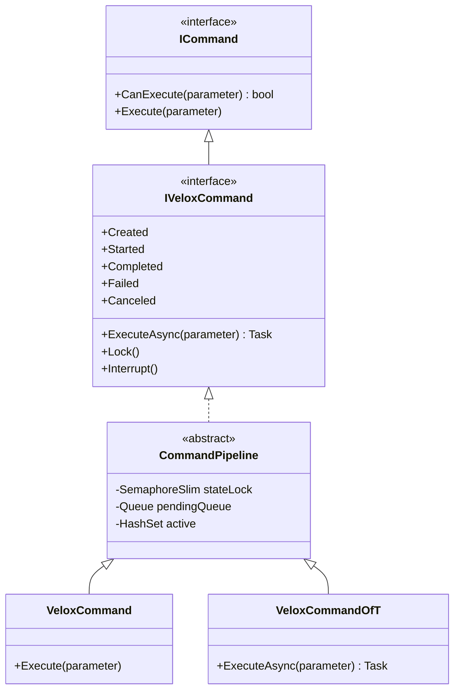
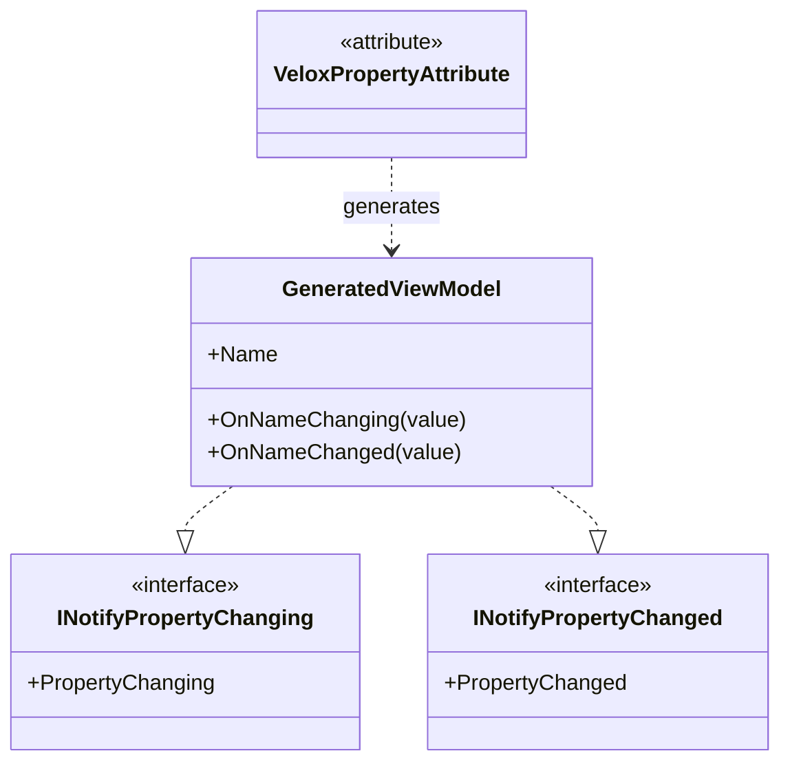

# MVVM视图模型生成中的设计模式

两个属性驱动整个功能：字段上的 `[VeloxProperty]` 生成可观察属性，方法上的 `[VeloxCommand]` 生成 `IVeloxCommand`。生成器写出 partial 成员；运行时命令管线提供执行、并发与事件行为。涉及的模式是命令、观察者与模板方法，生成是粘合剂。

## 命令：`IVeloxCommand` 是管线而非委托

`IVeloxCommand` 扩展 `ICommand`，加入生命周期事件、锁定/解锁、中断/继续、信号量控制与异步形式。`CommandPipeline<TParam, TResult>` 是共享实现：它持有信号量、待处理队列与活动集合，并在每次执行前后触发 `Created`、`Enqueued`、`Started`、`Completed`、`Failed`、`Canceled` 与 `Exited`。

```csharp
public abstract class CommandPipeline<TParam, TResult> :
    IVeloxCommand, IVeloxCommandCompletion, IVeloxCommandStatus, IVeloxCommandResult,
    IVeloxCommandEvents<TParam, TResult>, IDisposable
{
    private readonly SemaphoreSlim _stateLock = new(1, 1);
    private readonly Queue<CommandEventArgs<TParam, TResult>> _pendingQueue = new();
    private readonly HashSet<CommandEventArgs<TParam, TResult>> _active = [];
}
```

源码：`Src/Core/VeloxDev.Core/MVVM/CommandPipeline{TParam,TResult}.cs` 第 30-83 行；事件面在 `Src/Core/VeloxDev.Core/Interfaces/MVVM/IVeloxCommand.cs` 第 6-75 行。



源码：`Src/Core/VeloxDev.Core/MVVM/VeloxCommand.cs`；`Src/Core/VeloxDev.Core/MVVM/VeloxCommand{TParam,TResult}.cs`。

属性是声明面：`VeloxCommandAttribute(name, canValidate, semaphore)` 让命令从方法名派生名称、选择加入生成的 `CanExecute` partial，并设置并发上限。

源码：`Src/Core/VeloxDev.Core/MVVM/VeloxCommandAttribute.cs` 第 47-60 行。

## 观察者：生成的属性发出两个通知

`[VeloxProperty]` 字段变成 partial 属性，其 setter 在写入前触发 `OnPropertyChanging`、写入后触发 `OnPropertyChanged`。生成的 partial 钩子——`On{Name}Changing` 与 `On{Name}Changed`——让宿主加入行为而不修改生成的 setter。



源码：`Src/Core/VeloxDev.Core/MVVM/VeloxPropertyAttribute.cs` 第 26-30 行；生成在 `Src/Generators/VeloxDev.Core.Generator/Writers/MVVMWriter.cs` 第 112-150 行。

集合属性多一层观察者。`ObservableCollectionTracker` 对每个处理器只订阅一次集合并把增删/移动/重置通知分派给生成的 `OnItemAddedTo...` 型 partial，使用方法目标比较器避免同一处理器重复订阅。

源码：`Src/Core/VeloxDev.Core/MVVM/ObservableCollectionTracker.cs` 第 15-60 行、第 100-115 行。

## 模板方法：生成器写骨架

`MVVMWriter` 读取携带 `[VeloxProperty]` 的字段，判定 setter 模式（存在兼容基类时用框架 `SetProperty`，否则显式调用 `OnPropertyChanging`/`OnPropertyChanged`），并为每个字段发出 partial 属性。`CommandWriter` 读取 `[VeloxCommand]` 方法，按配置的形状与构造发出懒创建的命令属性。

源码：`Src/Generators/VeloxDev.Core.Generator/Writers/MVVMWriter.cs` 第 40-78 行；`Src/Generators/VeloxDev.Core.Generator/Writers/CommandWriter.cs` 第 12-110 行。

生成命令的体转发到属性指定的方法，因此开发者写工作，生成器写管线。可选的 `CanExecute` partial 与信号量是模板钩子：生成的管线调用它们，开发者负责填充。

```csharp
[VeloxCommand(canValidate: true)]
private Task Minus(object? sender, CancellationToken ct)
{
    Index--;
    Greeting = $"current index: {Index}";
    return Task.CompletedTask;
}

private partial bool CanExecuteMinusCommand(object? sender)
{
    return _index > 0;
}
```

源码：`Examples/MVVM/Avalonia/Demo/ViewModels/MainWindowViewModel.cs` 第 77-89 行。属性生成 `MinusCommand`；手写的 `CanExecuteMinusCommand` partial 就是生成命令调用的钩子。

## 策略：校验器与分派

命令管线把用户的谓词当作策略（`_canExecute`），可选校验器走同一条执行路径。这使得一种命令类型即可服务同步方法、`Task` 方法、`ValueTask` 方法与带参数方法，而无需按形状子类化。

源码：`Src/Core/VeloxDev.Core/MVVM/CommandPipeline{TParam,TResult}.cs` 第 64-80 行、第 403-440 行。

## 模式小结

| 模式 | 参与者 | 设计结果 |
| --- | --- | --- |
| 命令 Command | `IVeloxCommand`、`CommandPipeline`、生成的 `{Name}Command` | 一种运行时管线覆盖所有命令形状 |
| 观察者 Observer | 生成的 setter、`ObservableCollectionTracker` | 变化通知与集合钩子 |
| 模板方法 Template Method | `[VeloxProperty]` / `[VeloxCommand]` partial | 生成器写骨架，开发者填钩子 |
| 策略 Strategy | `CanExecute` 谓词、校验器 | 校验可按命令替换 |

这里的命令是声明式的；下一项功能把同样的生成技术用于动画声明；参见[过渡动画](../12_过渡动画/index.md)。
