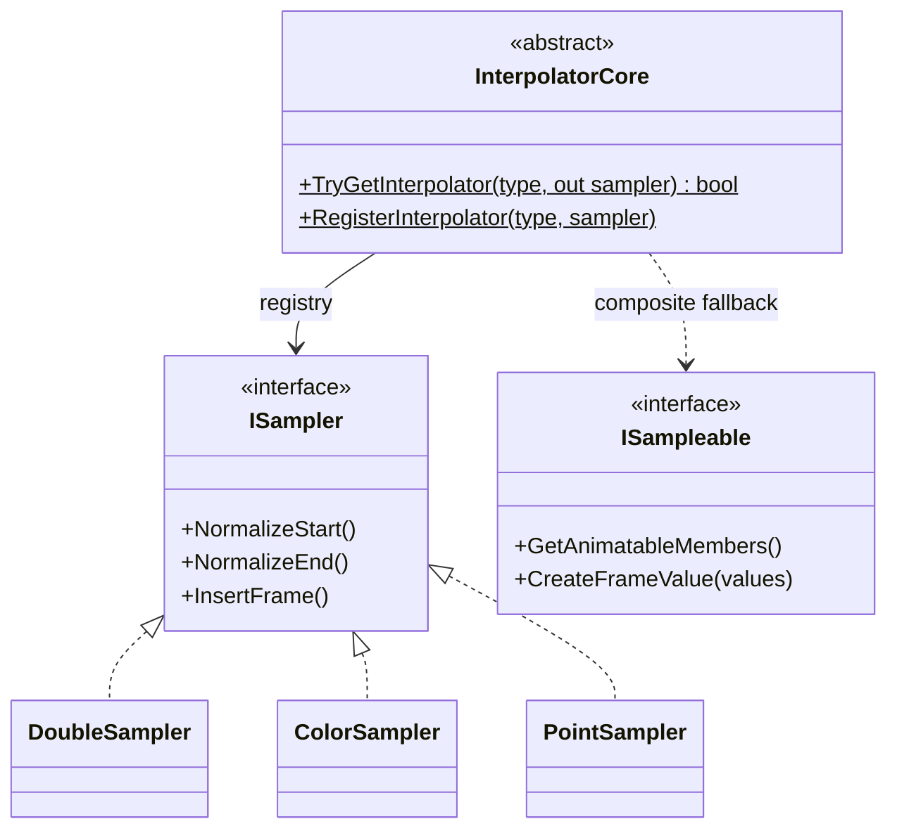
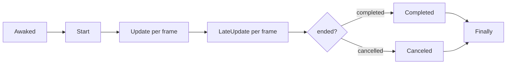

# 策略与采样

两个策略族让动画通用：采样器把归一化进度转成属性写入，缓动函数在写入前重塑进度。进程级注册表按属性类型选择采样器，效果基类提供宿主挂接的生命周期模板。

## 策略：按属性类型的 `ISampler`

`ISampler` 有三个操作：归一化起始值、归一化结束值、插入中间帧。采样器接收属性、目标、起止值、选项对象与缓动后的进度 `t`。它可以保留复用的临时对象，因此可避免每帧分配，但并不强制。

```csharp
public interface ISampler
{
    object? NormalizeStart(object? start, object? end, object? options);
    object? NormalizeEnd(object? start, object? end, object? options);
    void InsertFrame(object target, ITransitionProperty property, ref object? working,
        object? start, object? end, object? options, double t);
}
```

源码：`Src/Core/VeloxDev.Core/Interfaces/TransitionSystem/ISampler.cs` 第 11-38 行。

随附采样器覆盖适配器会动画的基元与几何类型：`double`、`float`、`int`、`long`、`Point`、`PointF`、`Size`、`SizeF`、`Color`、`Rectangle`、`RectangleF`、`Vector2/3/4` 与 `Quaternion`。

源码：`Src/Core/VeloxDev.Core/TransitionSystem/NativeSamplers/`；注册在 `.../Sampling/Interpolator.cs` 第 13-28 行。

没有注册采样器的结构体走 `ISampleable` 路径：其声明成员逐个插值，结构体每帧重建。该接口是复合值策略，也避免引用类型被隐式拆解。

源码：`Src/Core/VeloxDev.Core/Interfaces/TransitionSystem/ISampleable.cs` 第 41-66 行。

## 注册表：`InterpolatorCore` 把类型映射到采样器

`InterpolatorCore` 既是进程级注册表，也是适配器派生的基类。其静态构造函数注册原生采样器；`TryGetInterpolator` 解析类型，包括声明为已注册类型子类的框架属性。

```csharp
public static bool TryGetInterpolator(Type type, out ISampler? sampler)
```

源码：`Src/Core/VeloxDev.Core/TransitionSystem/Sampling/Interpolator.cs` 第 9-51 行、第 94 行。



源码：`Src/Core/VeloxDev.Core/TransitionSystem/NativeSamplers/DoubleSampler.cs`、`.../ColorSampler.cs`、`.../PointSampler.cs`。

## 策略：缓动是函数对象

`IEaseCalculator` 只有一个方法 `Ease(t)`。`Eases` 以静态属性暴露内置族——十个族（Sine、Quad、Cubic、Quart、Quint、Expo、Circ、Back、Elastic、Bounce），每族有 `In`、`Out`、`InOut` 成员——每次访问返回新的计算器实例。

```csharp
public interface IEaseCalculator
{
    double Ease(double t);
}

public static class Eases
{
    public static IEaseCalculator Default => new EaseDefault();
    public static class Sine
    {
        public static IEaseCalculator In => new EaseInSine();
        public static IEaseCalculator Out => new EaseOutSine();
        public static IEaseCalculator InOut => new EaseInOutSine();
    }
}
```

源码：`Src/Core/VeloxDev.Core/Interfaces/TransitionSystem/IEaseCalculator.cs` 第 4-9 行；`Src/Core/VeloxDev.Core/TransitionSystem/Effects/Eases.cs` 第 4-28 行。

曲线的形状就是信息，因此正弦族被画出来而不是列表格。`In` 起步慢，`Out` 起步快，`InOut` 对称；线性基线显示缓动改变了什么。

```plot
{
  "title": "Eases.Sine",
  "grid": true,
  "xAxis": { "domain": [0, 1] },
  "yAxis": { "domain": [0, 1] },
  "data": [
    { "fn": "x", "color": "#888888", "skipTip": true },
    { "fn": "1 - cos(x*PI/2)", "color": "#4a9eff", "title": "In" },
    { "fn": "sin(x*PI/2)", "color": "#a78bfa", "title": "Out" },
    { "fn": "-(cos(PI*x)-1)/2", "color": "#f472b6", "title": "InOut" }
  ]
}
```

## 模板方法：效果基类驱动回调

`TransitionEffectCore` 是效果模板。它以虚属性暴露可调项（`Duration`、`FPS`、`IsAutoReverse`、`LoopTime`、`Ease`），并固定生命周期：`Awaked`、`Start`、`Update`、`LateUpdate`、`Canceled`、`Completed`、`Finally`、`Warn`、`Error`。解释器在对应时点调用 `Invoke...` 方法，因此宿主重写属性或订阅事件即可，无需重写循环。

源码：`Src/Core/VeloxDev.Core/TransitionSystem/Effects/TransitionEffect.cs` 第 39-186 行。



## 模式小结

| 模式 | 参与者 | 设计结果 |
| --- | --- | --- |
| 策略 Strategy | `ISampler`、`ISampleable`、`IEaseCalculator` | 动画对属性类型与曲线通用 |
| 注册表 Registry | `InterpolatorCore` | 类型到采样器的查找，适配器可扩展 |
| 函数对象 | `Eases` 各族 | 曲线由组合选择，而非 switch |
| 模板方法 Template Method | `TransitionEffectCore` | 固定生命周期，可重写可调项 |

声明的时线如何串联分段见[流式时间线](../01_流式时间线/index.md)。
