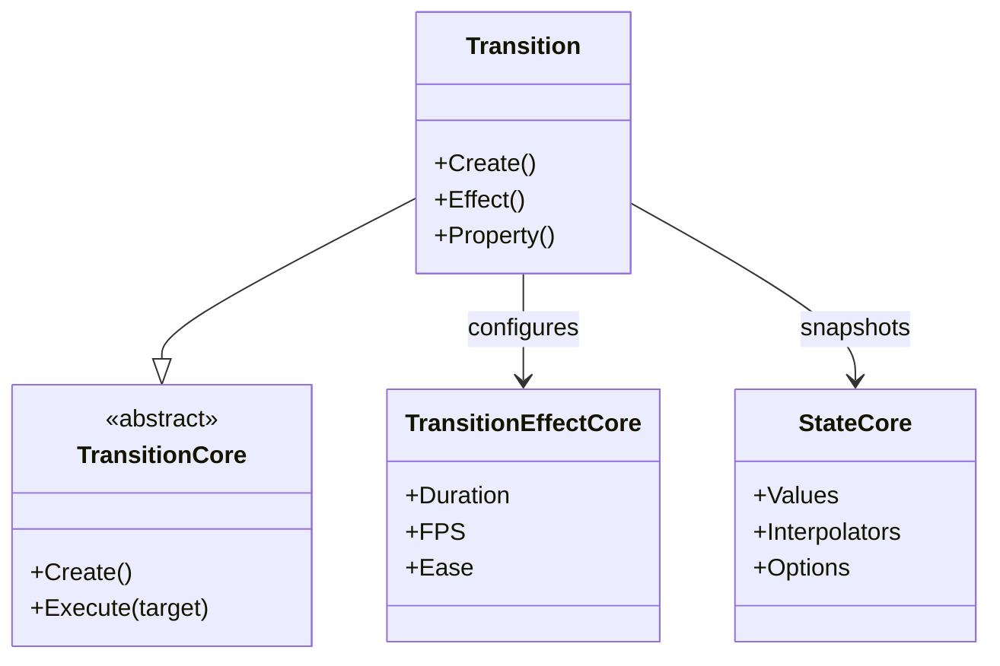
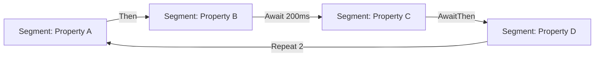

# 流式时间线

过渡以链式声明：为目标创建快照，附加效果，添加一个或多个属性，然后用 `Await`/`Then`/`AwaitThen` 分隔分段并设定重复。链是构建器，分段列表是组合，调度器把它解释为共享时间线上的采样循环。

## 构建器：`Transition<T>` 累积声明

每个适配器在自己的效果类型上定义 `Transition<T>`。`Create()` 返回新构建器；`Effect(...)` 设置效果；`Property(...)` 添加一个属性及其目标值。按值类型展开的 `Property` 重载存在，是因为表达式树在编译期选择采样器与写入策略。

```csharp
public class Transition<T> : TransitionCore<
    T,
    State,
    TransitionEffect,
    Interpolator,
    UIThreadInspector,
    TransitionInterpreter,
    DispatcherPriority>
    where T : class
{
    public static Transition<T> Create() => TransitionCore.Create<Transition<T>>();
}
```

源码：`Src/Adapters/VeloxDev.WPF/TransitionSystem/Transition.cs` 第 15-45 行。



构建器自身不持有平台状态；目标、效果与声明的属性被传入 `TransitionCore.Execute`，由它为目标解析调度器。

源码：`Src/Core/VeloxDev.Core/TransitionSystem/Effects/Transition.cs` 第 259-305 行。

## 组合与链：分段是节点，`Then` 追加

`TransitionCoreEx` 在已声明分段上暴露四个扩展方法。`Await(time)` 插入暂停，`Then()` 在当前段后立即开始下一段，`AwaitThen(time)` 组合两者，`Repeat(count)` 标记该段循环还需运行多少次。由于每个调用返回同一构建器，调用方写出链。

```csharp
public static T Await<T>(this T snapshot, TimeSpan timeSpan)
    where T : StateSnapshotCore, new()
{
    snapshot.CoreAwait<T>(timeSpan);
    return snapshot;
}

public static T Then<T>(this T snapshot)
    where T : StateSnapshotCore, new()
{
    return snapshot.CoreThen<T>();
}
```

源码：`Src/Core/VeloxDev.Core/TransitionSystem/Effects/TransitionEx.cs` 第 10-21 行；`AwaitThen` 与 `Repeat` 在同一类中紧随其后。



`Repeat` 写在它所配置的节点之后，核心把它记录为该节点的 `RepeatTime`。文档示例是跨段累积：三段各带 `Repeat(1)` 时按 `1, 1, 2, 1, 1, 2, 3, ...` 运行，因为每段的循环嵌套在前一段之内。

源码：`Src/Core/VeloxDev.Core/TransitionSystem/Effects/Transition.cs` 第 280-290 行、第 422-465 行。

## 解释器：每段一个采样循环

`TransitionInterpreterCore` 是帧循环的模板。其 `Execute` 重载构造帧应用委托——一个面向有调度优先级的宿主，一个面向无优先级路径——并传入 `ExecuteSamplingLoopAsync`。循环推进时间线、计算缓动进度、应用采样器集合、触发效果回调，并按声明的段循环重复。

源码：`Src/Core/VeloxDev.Core/TransitionSystem/Runtime/TransitionInterpreter.cs` 第 6-53 行及其后的采样循环。

调度器按目标排队运行。`TransitionSchedulerCore<T, ...>` 为目标创建或查找调度器，针对状态与效果执行生产者，并支持用已准备的帧集合重放某段。`Exit` 取消它拥有的运行。

源码：`Src/Core/VeloxDev.Core/TransitionSystem/Runtime/TransitionScheduler.cs` 第 9-63 行、第 100-197 行。

## 状态：每目标一份快照，每目标一个调度器

`StateCore` 是每目标的帧状态。它按表达式或 `ITransitionProperty` 存储目标值、每个属性选中的采样器以及每属性选项。调度器注册表是 `ConditionalWeakTable<object, ITransitionSchedulerCore>`，因此调度器与目标同寿，无需清理列表。

源码：`Src/Core/VeloxDev.Core/TransitionSystem/State/State.cs` 第 8-30 行；`Src/Core/VeloxDev.Core/TransitionSystem/Runtime/TransitionScheduler.cs` 第 229-248 行。

## 时间线传输

`TransitionCore` 以静态方法暴露传输操作：`Pause`、`Resume`、`SetRate`、`Seek`、`Cycle`、`Position`、`IsPaused`、`Rate` 与 `Exit`。每个操作收集目标的调度器（可选包含互斥与非互斥运行），并按情况作用于第一个运行或全部运行。

源码：`Src/Core/VeloxDev.Core/TransitionSystem/Effects/Transition.cs` 第 30-239 行。

这就是主题切换能通过一条传输暂停或定位一整组动画目标的原因：切换把所有目标的运行锚定到同一时间线。

源码：`Src/Core/VeloxDev.Core/DynamicTheme/ThemeManager.cs` 第 100-112 行。

## 模式小结

| 模式 | 参与者 | 设计结果 |
| --- | --- | --- |
| 构建器 / 流式 Builder / Fluent | `Transition<T>`、`TransitionCore.Create` | 声明式、类型受检的动画 |
| 组合 / 链 Composite / Chain | 分段列表、`Await`/`Then`/`Repeat` | 分段组合无需独立 DSL |
| 解释器 Interpreter | `TransitionInterpreterCore` | 每个属性/采样器共用一条循环 |
| 状态 + 注册表 State + registry | `StateCore`、调度器 `ConditionalWeakTable` | 每目标状态与自动生存期 |

主题系统复用这套机制做动画切换；参见[运行时主题](../../13_运行时主题/index.md)。
