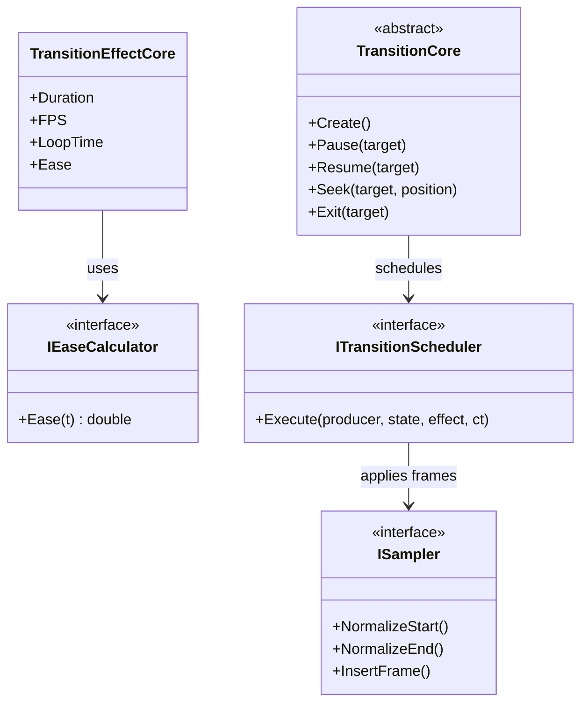

# 过渡动画中的设计模式

过渡声明属性、效果、缓动与时序；调度器随后驱动采样循环，在目标自己的调度器线程上写入插值。声明侧是带可链式时间线的流式构建器；运行侧是由策略驱动的解释器，作用于可插拔的采样器与缓动函数。

该功能分两部分分析：

- [策略与采样](00_策略与采样/index.md) —— `ISampler`、`IEaseCalculator`、进程级采样器注册表，以及效果钩子模板。
- [流式时间线](01_流式时间线/index.md) —— `Transition<T>`、`Await`/`Then`/`Repeat`、解释器循环，以及一条链共享的时间线状态。

## 两半

流式面按适配器生成——每个平台在自己的效果类型上定义 `Transition<T>`——而管线与契约在 Core。这样 Core 不含平台属性类型，也无需复制采样引擎。

源码：`Src/Adapters/VeloxDev.WPF/TransitionSystem/Transition.cs` 第 10-45 行；Core 契约在 `Src/Core/VeloxDev.Core/Interfaces/TransitionSystem/`。
