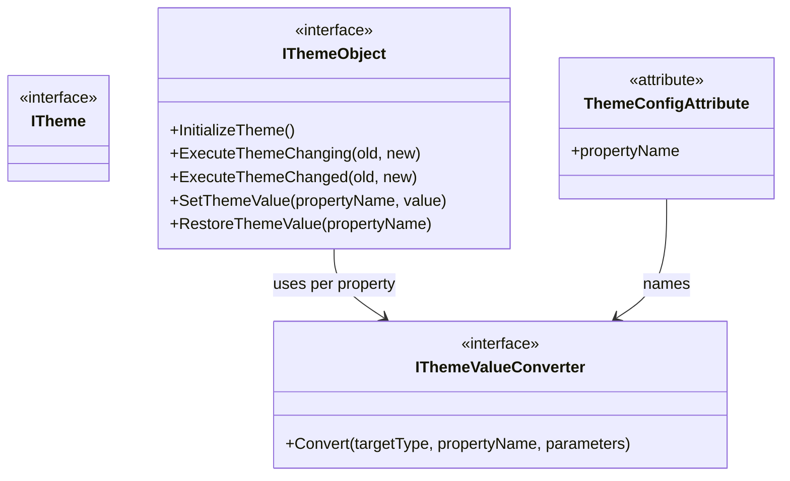
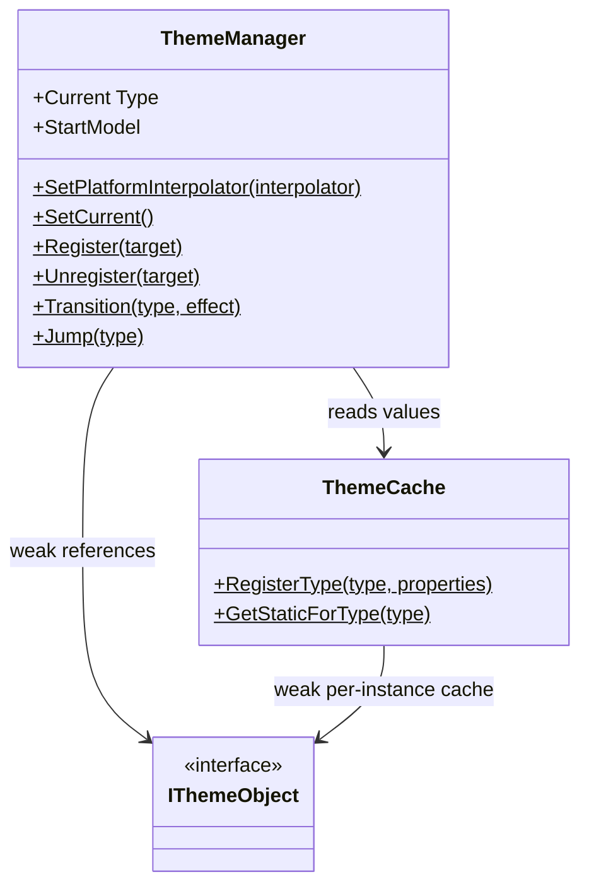

# 运行时主题中的设计模式

主题对象按属性声明：每个主题类型对应什么值、哪个转换器把存储值转成属性类型。`ThemeManager` 立即或通过共享过渡切换当前主题，弱注册表让活动对象可被触达却不被钉住。该功能是转换策略、带弱键的生命期注册表，以及生成钩子的模板方法。

## 策略：每个声明属性一个转换器

`ThemeConfigAttribute<TConverter, TTheme1, TTheme2, ...>` 指定转换器与主题类型。编译期生成器写出注册，把每个属性名映射到各主题下的值；运行期 `IThemeValueConverter.Convert` 把存储值转成属性的目标类型。

```csharp
public interface IThemeValueConverter
{
    object? Convert(Type targetType, string propertyName, object?[] parameters);
}
```

源码：`Src/Core/VeloxDev.Core/Interfaces/DynamicTheme/IThemeValueConverter.cs` 第 4-10 行。

转换器是策略接缝：画刷转换器、对象转换器或平台特定转换器都满足同一契约，因此 Core 永不引用 UI 类型。

源码：`Src/Core/VeloxDev.Core/DynamicTheme/ThemeConfigAttribute.cs` 第 7-18 行（双主题形式；该族扩展至七个主题）。



源码：`Src/Core/VeloxDev.Core/Interfaces/DynamicTheme/IThemeObject.cs` 第 6-35 行；`.../ITheme.cs` 第 4-7 行。

## 注册表：静态缓存与弱活动列表

`ThemeCache` 维护两张表。静态表以声明类型为键，并沿继承链合并，因此派生类型继承基类的主题值，除非它覆盖。活动表通过 `ConditionalWeakTable` 按实例为键，保存运行时覆盖；`ThemeManager` 还保留 `List<WeakReference<IThemeObject>>` 以便切换。

```csharp
private static readonly Dictionary<Type, Dictionary<string, PropertyEntry>> _staticCache = [];
private static readonly object _lock = new();
private static readonly ConditionalWeakTable<IThemeObject, InstanceCache> _activeCache = new();
```

源码：`Src/Core/VeloxDev.Core/DynamicTheme/ThemeCache.cs` 第 10-33 行；继承合并在第 67-95 行。



源码：`Src/Core/VeloxDev.Core/DynamicTheme/ThemeManager.cs` 第 23-93 行。

弱引用是生命期规则：注册对象不会让它存活，`Unregister` 会把它从缓存与活动列表中移除。忘记注销的宿主也不会泄漏对象。

源码：`Src/Core/VeloxDev.Core/DynamicTheme/ThemeManager.cs` 第 75-93 行。

## 模板方法：生成器写 `InitializeTheme` 与钩子

生成器读取每个携带 `ThemeConfigAttribute` 的类，确认其为 partial，并发出 `InitializeTheme`、两个 `ExecuteThemeChanging`/`ExecuteThemeChanged` 钩子，以及每属性的 `SetThemeValue`/`RestoreThemeValue` 体。开发者提供 partial 类与属性；生成代码提供无反射的注册与分派。

源码：`Src/Generators/VeloxDev.Core.Generator/Theme.cs` 第 15-114 行与第 152-244 行。

```csharp
[ThemeConfig<ObjectConverter, Dark, Light>(nameof(Background), ["#1e1e1e"], ["#ffffff"])]
[ThemeConfig<ObjectConverter, Dark, Light>(nameof(BorderBrush), ["#ffffff"], ["#1e1e1e"])]
public partial class ThemeTile : Border
{
    public ThemeTile()
    {
        Width = 26;
        Height = 26;
        Margin = new Thickness(2);
        BorderThickness = new Thickness(3);
        InitializeTheme();
    }
}
```

源码：`Examples/Theme/Avalonia/Demo/ThemeTile.cs` 第 17-28 行。

生成的体把属性表每类型注册一次进 `ThemeCache`；重复注册被忽略，因此 `InitializeTheme` 是幂等的。这使每个实例都能以当前主题启动，而无需全局初始化顺序。

源码：`Src/Generators/VeloxDev.Core.Generator/Theme.cs` 第 152-244 行；`Src/Core/VeloxDev.Core/DynamicTheme/ThemeCache.cs` 第 46-65 行。

## 观察者：切换是广播，不是轮询

`ThemeManager.Transition` 收集已注册对象，捕获旧值，对每个对象应用新主题，并在动画前后运行 changing/changed 钩子。`Jump` 不带动画地应用新值。`Current` 是唯一可读状态；不存在按对象的订阅协议，因为管理器已持有活动列表。

源码：`Src/Core/VeloxDev.Core/DynamicTheme/ThemeManager.cs` 第 112-205 行。

动画切换锚定一条共享 `ITimeSourceControl`，因此 `Pause`、`Resume` 与 `SetRate` 移动整个切换；`Seek` 与 `Exit` 作用于单个目标的运行。这复用了[流式时间线](../12_过渡动画/01_流式时间线/index.md)中分析的时间线。

源码：`Src/Core/VeloxDev.Core/DynamicTheme/ThemeManager.cs` 第 100-111 行。

## 模式小结

| 模式 | 参与者 | 设计结果 |
| --- | --- | --- |
| 策略 Strategy | `IThemeValueConverter` | Core 主题系统与 UI 框架无关 |
| 注册表 + 弱缓存 Registry | `ThemeCache`、`ThemeManager.activeThemes` | 类型默认值、实例覆盖、不泄漏 |
| 模板方法 Template Method | 生成的 `InitializeTheme`、主题钩子 | 无反射注册与分派 |
| 观察者 / 广播 Observer | `ThemeManager.Transition`、`Jump` | 一次切换更新所有活动对象 |

下一项功能的生成代理机制采用不同的拦截策略；参见[面向切面编程](../14_面向切面编程/index.md)。
