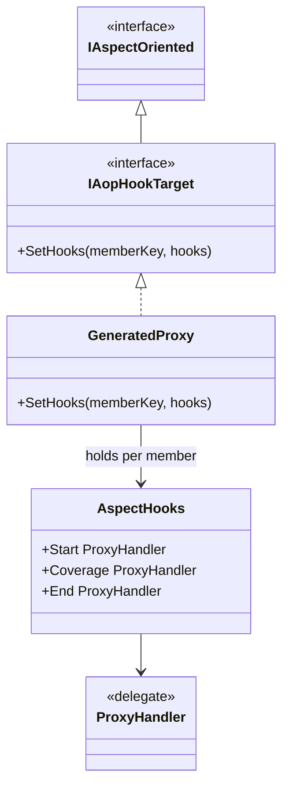
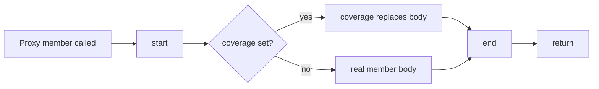
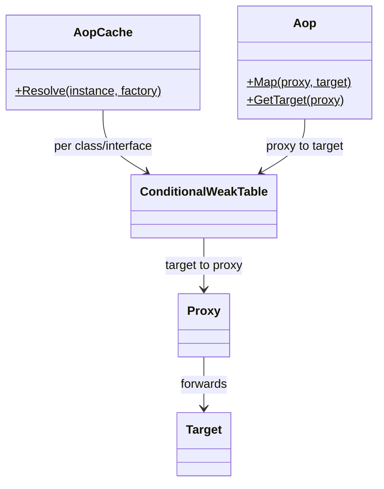

# 面向切面编程中的设计模式

标记 `[AspectOriented]` 的类会得到一个镜像其成员的生成接口，以及一个实现该接口的生成代理。切面安装在代理上，而不是对象上，每个被拦截成员最多运行三个阶段：`start`、`coverage` 与 `end`。设计上是用生成器构建的代理、阶段链，以及维持每实例代理身份的弱缓存。

## 代理：生成接口就是拦截面

`IAspectOriented` 是标记接口。生成器为每个可拦截成员发出镜像接口与代理类；代理成员在真实成员前后运行已安装的钩子。由于代理是普通生成代码，既无运行时 `DispatchProxy`，也无反射调用。

```csharp
[VeloxProperty][AspectOriented] private string _name = string.Empty;
[VeloxProperty][AspectOriented] private ObservableCollection<MemberViewModel> _members = [];

[AspectOriented]
public void Reset()
{
    Name = string.Empty;
    Members.Clear();
}
```

源码：`Examples/AOP/Avalonia/Demo/ViewModels/TeamViewModel.cs` 第 16-24 行。生成器根据这些成员发出镜像接口与代理；`AopSurface` 构建两半，`AopProxy` 发出 `Aop()` 扩展方法。

源码：`Src/Core/VeloxDev.Core/AspectOriented/AspectOrientedAttribute.cs`；`Src/Generators/VeloxDev.Core.Generator/AopSurface.cs` 第 31-114 行；`Src/Generators/VeloxDev.Core.Generator/AopProxy.cs` 第 13-32 行。



源码：`Src/Core/VeloxDev.Core/AspectOriented/AspectHooks.cs` 第 40-77 行；`Src/Core/VeloxDev.Core/Interfaces/AspectOriented/IAspectOriented.cs`。

## 职责链：start、coverage、end

`AspectHooks` 组合三个委托。`start` 在成员前运行，其返回值成为下一阶段的 `previous`；`coverage` 非空时整体替换成员，其返回值即成员结果；`end` 在成员后运行，返回值被丢弃。三个阶段总是一起安装，因此无法保留一个阶段而替换另一个。

```csharp
public delegate object? ProxyHandler(object?[]? parameters, object? previous);

public sealed class AspectHooks(ProxyHandler? start, ProxyHandler? coverage, ProxyHandler? end)
{
    public ProxyHandler? Start { get; } = start;
    public ProxyHandler? Coverage { get; } = coverage;
    public ProxyHandler? End { get; } = end;
}
```

源码：`Src/Core/VeloxDev.Core/AspectOriented/AspectHooks.cs` 第 17-50 行。



`ProxyEx.SetProxy` 是安装辅助方法。它把访问器种类与成员名转换成代理的拦截键（`get_Name`、`set_Name` 或方法名），并在目标不是代理时抛出异常，因为装在真身上的切面永远不会运行。

源码：`Src/Core/VeloxDev.Core/AspectOriented/ProxyEx.cs` 第 27-75 行。

## 缓存：每目标一个代理，弱持有

`AopCache.Resolve<TClass, TInterface>` 利用 CLR 泛型特化为每个 `(class, interface)` 对生成各自的 `ConditionalWeakTable`。表把目标实例映射到代理，因此 `Aop()` 对同一对象返回同一代理，且代理不会钉住对象。

```csharp
private static class Entry<TClass, TInterface>
{
    public static readonly ConditionalWeakTable<TClass, TInterface> Instances = [];
}

public static TInterface Resolve<TClass, TInterface>(TClass instance, Func<TClass, TInterface> factory)
    => Entry<TClass, TInterface>.Instances.GetValue(instance, k => factory(k));
```

源码：`Src/Core/VeloxDev.Core/AspectOriented/AopCache.cs` 第 13-52 行。



## 反向查找

`Aop.Map` 在第二张 `ConditionalWeakTable` 中记录代理到目标的方向，`Aop.GetTarget<TTarget>` 读回。这使只持有代理的代码能恢复原实例，例如把真实对象交给不认识代理的序列化路径。

源码：`Src/Core/VeloxDev.Core/AspectOriented/Aop.cs` 第 11-27 行。

## 模式小结

| 模式 | 参与者 | 设计结果 |
| --- | --- | --- |
| 代理 Proxy | 生成镜像接口 + 代理、`IAspectOriented` | 无需运行时代理生成器的拦截 |
| 职责链 Chain of Responsibility | `AspectHooks` start/coverage/end | 可预测的阶段顺序与替换语义 |
| 缓存 Cache | `AopCache`、`ConditionalWeakTable` | 每目标一个代理，不钉住生命期 |
| 反向映射 | `Aop.Map`、`Aop.GetTarget` | 代理到目标的恢复 |

下一项功能是循环而非拦截器；参见[帧循环](../15_帧循环/index.md)。
