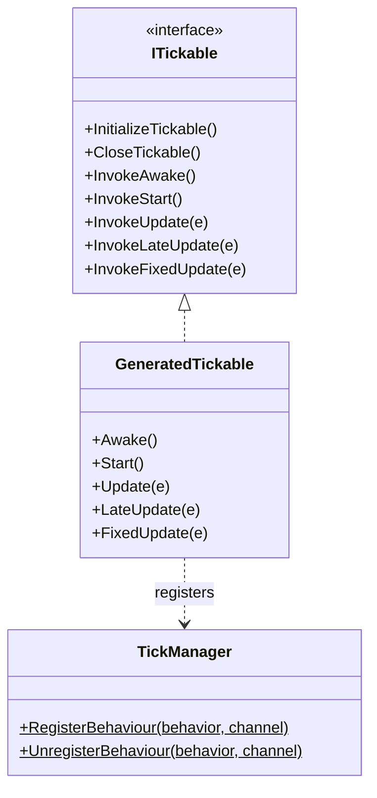
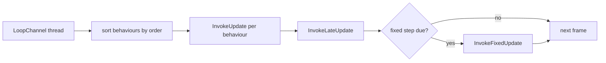

# 帧循环中的设计模式

标记 `[Tickable]` 的类声明五个生命周期方法；生成器把它变成 `ITickable`，其 `Invoke...` 方法调用这些 partial。`TickManager` 每个通道运行一条循环，按顺序驱动每个已注册行为，并暴露暂停、速率与定步控制。设计是生命周期的模板方法、帧与通道状态的事件面，以及带小对象池的每通道管理器。

## 模板方法：五个 partial 钩子

`ITickable` 固定生命周期：`Awake`、`Start`、`Update`、`LateUpdate`、`FixedUpdate`，外加注册/注销。生成器发出接口实现，每个 `Invoke...` 调用开发者可声明的对应 `partial` 方法。

```csharp
public interface ITickable
{
    void InitializeTickable();
    void CloseTickable();
    void InvokeAwake();
    void InvokeStart();
    void InvokeUpdate(FrameEventArgs e);
    void InvokeLateUpdate(FrameEventArgs e);
    void InvokeFixedUpdate(FrameEventArgs e);
}
```

源码：`Src/Core/VeloxDev.Core/Interfaces/Tickable/ITickable.cs` 第 25-46 行。

声明面是属性：`TickableAttribute(channel, fps)` 指定通道与目标帧率。生成器把它翻译成 `ITickable` 实现，并在 `InitializeTickable` 中写入注册调用。

```csharp
[Tickable(DemoChannel.Name)]
public partial class MainWindow
{
    private readonly DemoState _state = new();
}
```

源码：`Examples/Tickable/WPF/Demo/MainWindow.Hooks.cs` 第 23-26 行。该类在同一文件后续位置以 `partial void` 声明生命周期方法；属性正是让生成器围绕它们发出 `ITickable` 外壳的开关。

源码：`Src/Core/VeloxDev.Core/TimeLine/TickableAttribute.cs` 第 7-17 行；生成的注册与钩子在 `Src/Generators/VeloxDev.Core.Generator/Writers/TickWriter.cs` 第 88-125 行。



## 观察者：帧与通道状态是事件

每个 `LoopChannel` 触发 `Started`、`Paused`、`Resumed` 与 `Stopped`，静态门面另触发 `OnChannelStarted`、`OnChannelPaused`、`OnChannelResumed` 与 `OnChannelStopped`。每帧值通过 `FrameEventArgs` 到达：它从 `TimeLineEventArgs` 继承 `DeltaTime`、`TotalTime` 与 `Handled` 终止旗标，并增加 `CurrentFPS` 与 `TargetFPS`。

```csharp
public static event EventHandler<TickChannelEventArgs>? OnChannelStarted;
public static event EventHandler<TickChannelEventArgs>? OnChannelPaused;
public static event EventHandler<TickChannelEventArgs>? OnChannelResumed;
public static event EventHandler<TickChannelEventArgs>? OnChannelStopped;
```

源码：`Src/Core/VeloxDev.Core/TimeLine/TickManager.cs` 第 1041-1044 行；帧参数在 `Src/Core/VeloxDev.Core/TimeLine/FrameEventArgs.cs`。



## 管理器：一个通道、一条线程、一个配置队列

公开的 `TickManager` 是具名 `LoopChannel` 实例上的静态门面。每个通道在 `ConcurrentDictionary<int, BehaviorWrapper>` 中拥有行为，另有增删队列与配置队列；循环在安全点排空这些队列，而不是在迭代中途改动行为集。

```csharp
public static void Start(string channel = DEFAULT_CHANNEL);
public static Task StopAsync(string channel = DEFAULT_CHANNEL);
public static void Pause(string channel = DEFAULT_CHANNEL);
public static void Resume(string channel = DEFAULT_CHANNEL);
public static Task RestartAsync(string channel = DEFAULT_CHANNEL);
public static void RegisterBehaviour(ITickable behavior, string channel = DEFAULT_CHANNEL);
public static void SetTargetFPS(int fps, string channel = DEFAULT_CHANNEL);
public static void SetFixedUpdateInterval(int intervalMs, string channel = DEFAULT_CHANNEL);
```

源码：`Src/Core/VeloxDev.Core/TimeLine/TickManager.cs` 第 1063-1097 行；通道内部在第 101-186 行。

`Bus(channel)` 返回通道的 `ITimeSourceControl`，宿主可用同一时钟驱动自己的采样。

源码：`Src/Core/VeloxDev.Core/TimeLine/TickManager.cs` 第 1159 行。

## 对象池：每帧参数被复用

通道为三类高分配对象建池——`FrameEventArgs`、配置请求与行为包装器——底层是 `ConcurrentStack` 支撑的小型 `ObjectPool<T>`。循环每帧运行，复用这些对象可消除稳定的分配负载，否则会变成垃圾回收压力。

源码：`Src/Core/VeloxDev.Core/TimeLine/TickManager.cs` 第 71-99 行与第 154-156 行。

## 模式小结

| 模式 | 参与者 | 设计结果 |
| --- | --- | --- |
| 模板方法 Template Method | `ITickable`、生成的 `Invoke...`、partial 钩子 | 五个固定生命周期点 |
| 观察者 Observer | 通道事件、`FrameEventArgs` | 宿主免轮询响应 |
| 管理器 / 通道 Manager | `TickManager`、`LoopChannel` | 隔离的帧率与行为集 |
| 对象池 Object Pool | 内部 `ObjectPool<T>` | 每帧分配被复用 |

生成的生命周期声明也驱动主题与序列化；下一项功能是后者，参见[封闭世界序列化](../16_封闭世界序列化/index.md)。
