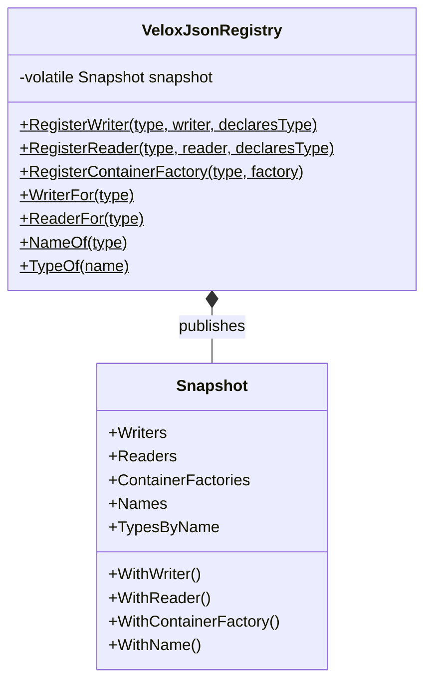
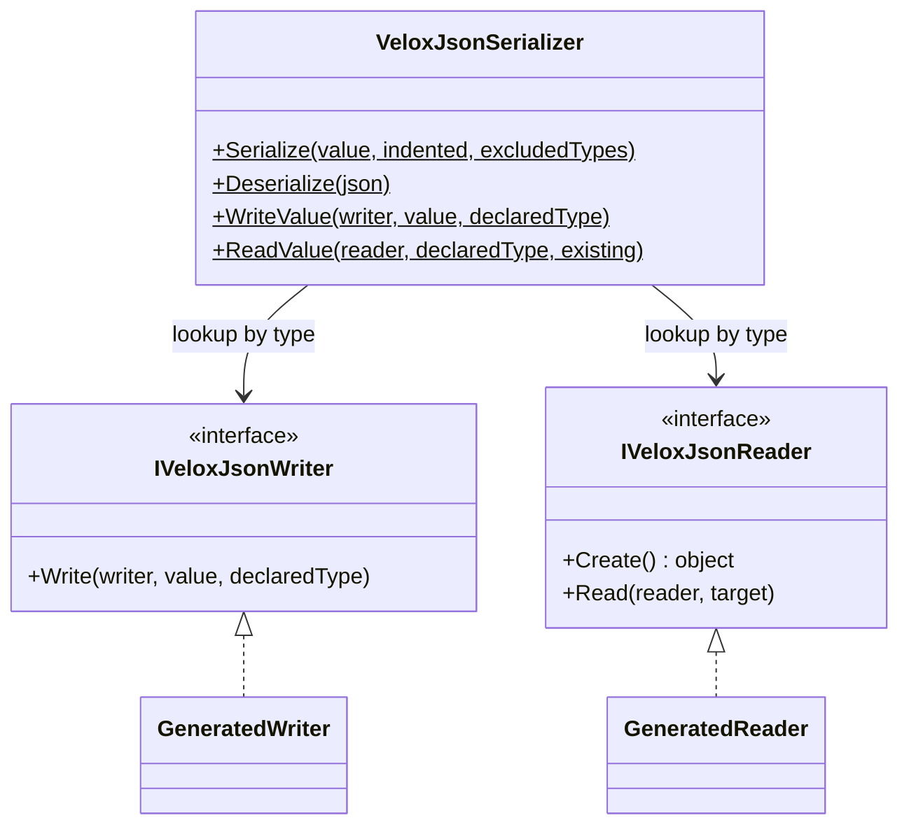
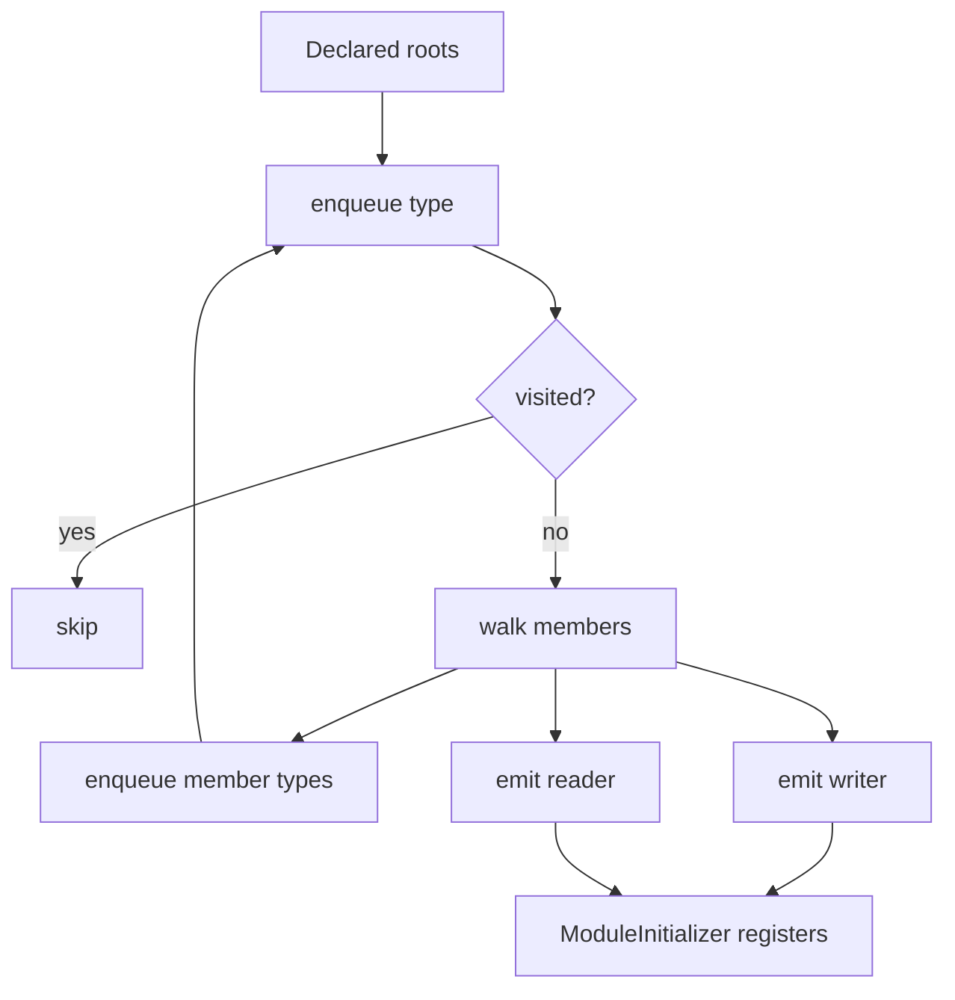

# 封闭世界序列化中的设计模式

序列化器只能写入声明程序集编译时已知的类型。生成器从声明的根出发遍历可达类型图，为每个类型发出一个读取器和一个写入器，并通过模块初始化器注册。运行期注册表把类型映射到这些生成件，`VeloxJsonSerializer` 经它分派。设计是建立在不可变快照上的注册表、按类型的策略，以及编译期闭包遍历而非运行时反射。

## 注册表：以替换发布的不可变快照

`VeloxJsonRegistry` 维护五张表——写入器、读取器、容器工厂、类型名以及反向名称到类型映射。一次注册复制一张表、沿用其余四张，构造新 `Snapshot`，再以 volatile 写发布。读取方不加锁：它要么看到整份旧快照，要么看到整份新快照。

```csharp
private static volatile Snapshot _snapshot = Snapshot.Empty;

private sealed class Snapshot
{
    internal readonly Dictionary<Type, IVeloxJsonWriter> Writers;
    internal readonly Dictionary<Type, IVeloxJsonReader> Readers;
    internal readonly Dictionary<Type, Func<object>> ContainerFactories;
    internal readonly Dictionary<Type, string> Names;
    internal readonly Dictionary<string, Type> TypesByName;
}
```

源码：`Src/Core/VeloxDev.Core/Serialization/VeloxJsonRegistry.cs` 第 98-150 行。



源码：`Src/Core/VeloxDev.Core/Serialization/VeloxJsonRegistry.cs` 第 130-278 行。

## 策略：每类型一个写入器与读取器

`IVeloxJsonWriter` 写一个类型的成员；`IVeloxJsonReader` 创建实例并把成员读进去。两者都是生成的，每个可序列化类型一个实现，代码是带字面成员名的直线序列。序列化器按声明类型查找实现并委托。

```csharp
public interface IVeloxJsonWriter
{
    void Write(VeloxJsonWriter writer, object value, Type? declaredType);
    Task WriteAsync(VeloxJsonWriter writer, object value, Type? declaredType);
}

public interface IVeloxJsonReader
{
    object Create();
    void Read(VeloxJsonReader reader, object target);
    Task ReadAsync(VeloxJsonReader reader, object target);
}
```

源码：`Src/Core/VeloxDev.Core/Serialization/VeloxJsonRegistry.cs` 第 14-67 行。



没有注册写入器或读取器的类型会以点名该类型的消息失败。这是把封闭世界表达为错误，而不是静默回退到反射。

源码：`Src/Core/VeloxDev.Core/Serialization/VeloxJsonSerializer.cs` 第 608-675 行。

## 工厂：容器构造也是生成的

成员顶层的容器由该成员的读取器就地填充。嵌套容器——树的 `LinksMap` 是 map of maps——无处可填，而仅凭 `Type` 构造泛型容器需要 `Activator`。因此生成器为它遇到的每个闭合容器组合注册一个 `Func<object>`。

```csharp
public static void RegisterContainerFactory(Type type, Func<object> factory);
public static Func<object>? ContainerFactoryFor(Type type);
```

源码：`Src/Core/VeloxDev.Core/Serialization/VeloxJsonRegistry.cs` 第 53-79 行。

## 闭包遍历：根、可达性与生成的注册

生成器从声明的根出发，沿成员发现可达类型，并为每个类型发出读取器与写入器。类型在满足以下条件时加入格式：是组件、携带 `[VeloxProperty]`，或被 `[Archivable]` 点名；随后 `[Archive]` 改变单个成员的参与方式。

```csharp
[Archivable]
public sealed class ExecutionCheckpoint
{
    public int Attempt { get; set; }
    public Dictionary<string, object?> Outputs { get; set; } = [];
    public List<string> Shape { get; set; } = [];
}
```

源码：`Src/Core/VeloxDev.Core/Serialization/Annotations/ArchivableAttribute.cs` 第 33-42 行；`Src/Core/VeloxDev.Core/Serialization/Annotations/ArchiveAttribute.cs` 第 65-84 行；选项在 `.../ArchiveOptions.cs` 第 14-58 行。

模型构建器把根入队并跟随成员类型；`TypeParameterWalk` 提供泛型成员的类型实参。生成的注册从 `[ModuleInitializer]` 运行，因此注册表在任何调用方触达之前就已完整。

源码：`Src/Generators/VeloxDev.Core.Generator/Base/VeloxJsonModel.cs` 第 283-368 行；`Src/Generators/VeloxDev.Core.Generator/Writers/VeloxJsonCodeWriter.cs` 第 499 行。



## 读取分派：先声明类型，形状作兜底

`ReadValue` 用声明类型查找读取器。声明类型是抽象类或接口时，它按写入的类型名读取；没有名称时退回序列化形状。兜底仍受同一注册表约束，因此无法构造封闭世界之外的类型。

源码：`Src/Core/VeloxDev.Core/Serialization/VeloxJsonSerializer.cs` 第 387-510 行。

## 模式小结

| 模式 | 参与者 | 设计结果 |
| --- | --- | --- |
| 注册表（不可变快照）Registry | `VeloxJsonRegistry`、`Snapshot` | 每节点路径上的无锁查找 |
| 策略 Strategy | `IVeloxJsonWriter`、`IVeloxJsonReader` | 每类型一个生成实现 |
| 工厂 Factory | 注册表中的容器工厂 | 嵌套容器无需反射构造 |
| 闭包遍历（生成器）Closure walk | `VeloxJsonModelBuilder`、`[Archivable]` 根 | 可写类型集在编译期已知 |

本页面组覆盖的 Core 功能集至此结束。这里分析的归档模型也是运行时检查点存储写出的对象。
