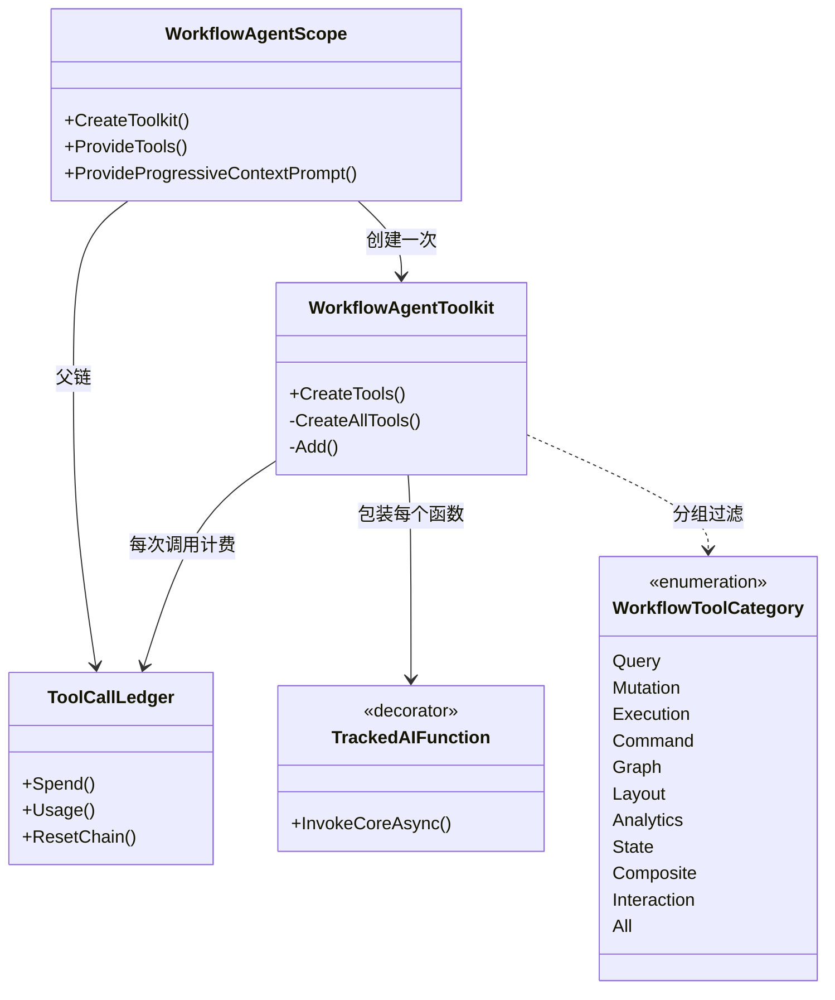

# 工作流智能体工具

`VeloxDev.AI.Workflow.WorkflowAgentScope` 是每棵工作流树对宿主暴露的门面，把工具构建、上下文渲染与调用记账收在一个对象背后。`WorkflowAgentToolkit` 负责组装可调用的 `AITool` 列表，而每个工具在触达树之前都要经过 `TrackedAIFunction`。

## 类型拓扑



> 来源：`Src/Core/VeloxDev.Core.Extension/Agent/Workflow/WorkflowAgentScope.cs:23`、`Src/Core/VeloxDev.Core.Extension/Agent/Workflow/Functions/WorkflowAgentToolkit.cs:28`、`Src/Core/VeloxDev.Core.Extension/Agent/Workflow/Functions/WorkflowToolCategory.cs:12`。

## 模式运用

| 模式 | 位置 | 证据 |
|---|---|---|
| 门面 | `WorkflowAgentScope` | `CreateToolkit` 惰性持有唯一工具集（`WorkflowAgentScope.cs:1555`）；`ProvideTools` 转调（`:1586`） |
| 工厂 | `WorkflowAgentToolkit` | `CreateTools`/`CreateAllTools` 产出工具列表（`WorkflowAgentToolkit.cs:78`、`:88`） |
| 组合 | 类别分组 | `Add(category, params AITool[])` 在标志命中时追加一组（`WorkflowAgentToolkit.cs:95`） |
| 装饰器 / 代理 | `TrackedAIFunction` | `DelegatingAIFunction` 包装器拦截调用再委托（`TrackedAIFunction.cs:31`、`:110`） |
| 策略 | 权限判定与交互处理器 | 注入的委托由工具集消费（`WorkflowAgentToolkit.cs:301`、`:312`） |
| 观察者 | `ToolCalled` | 作用域触发 `IAgentToolCallNotifier.ToolCalled`（`WorkflowAgentScope.cs:1006`） |

### 分组是组合，不是构建器注册表

类别分组的唯一过滤条件就是标志位测试：

```csharp
// Src/Core/VeloxDev.Core.Extension/Agent/Workflow/Functions/WorkflowAgentToolkit.cs:95-99
void Add(WorkflowToolCategory category, params AITool[] items)
{
    if ((categories & category) == category)
        tools.AddRange(items);
}
```

`Query`、`State`、`Mutation`、`Execution`、`Command`、`Graph`、`Layout`、`Analytics` 各自贡献一组；`Composite` 仅预留、没有工具；`Interaction` 只在宿主安装了选择或确认处理器时加入（`WorkflowAgentToolkit.cs:102-235`）。自定义工具最后合并（`:237-240`）。

### 调用记账沿链上溯

`ToolCallLedger` 记录 `total`、`read`、`write` 三个计数，`Spend` 会递归到 `Outer`，因此子智能体的调用也计入整棵树（`ToolCallLedger.cs:57-68`）。Bypass 模式的调用不计数（`WorkflowAgentToolkit.cs:478`），但 token 上限仍会在计数上限之后检查（`:389-411`）。

## 设计要点

- 工具集只创建一次后复用：`_toolkit ??= new WorkflowAgentToolkit(this, ParentLedger)`（`WorkflowAgentScope.cs:1555`）。宿主从不自行拼装列表。
- `ProvideTools(categories)` 是过滤入口（`WorkflowAgentScope.cs:1594`）；`CreateTools` 会剔除被禁用的名字，但始终保留 `ResetToolCallLimit`（`WorkflowAgentToolkit.cs:78-81`）。
- 作用域是通知枢纽：被拒绝和失败的调用以管道事件呈现，成功调用还会触发 `ToolCalled`（`WorkflowAgentScope.cs:1006-1011`），从而让宿主 UI 与智能体事件流一致而不互相耦合。
