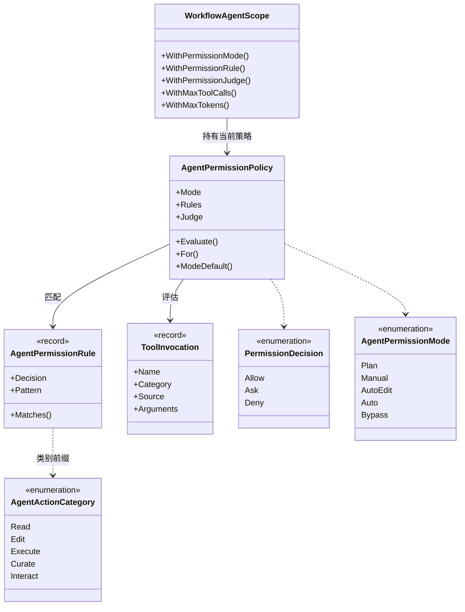

# 智能体安全与预算

`VeloxDev.AI.Safety` 决定一次工具调用能否执行，`WorkflowAgentScope` 的预检闸门则限定它能执行多少。决策是一个值（`PermissionDecision`），策略可整体替换，预算在工具主体运行之前就被拦截。

## 类型拓扑



> 来源：`Src/Core/VeloxDev.Core.Extension/Agent/Safety/AgentPermissionPolicy.cs:31`、`AgentPermissionRule.cs:39`、`ToolInvocation.cs:23`、`PermissionDecision.cs:4`、`AgentPermissionMode.cs:32`、`AgentActionCategory.cs:20`、`Agent/Workflow/WorkflowAgentScope.cs:23`。

## 模式运用

| 模式 | 位置 | 证据 |
|---|---|---|
| 策略对象 | `AgentPermissionPolicy` | 一个不可变对象把模式、规则与裁决器收在 `Evaluate` 后面（`AgentPermissionPolicy.cs:31`、`:100`） |
| 策略 | 可注入裁决器 | `Func<ToolInvocation, PermissionDecision>` 仅在 `Auto` 下使用（`AgentPermissionPolicy.cs:110-121`） |
| 状态 | 权限模式 | 调用时实时读取；`EnterPlan`/`ExitPlan` 保存并恢复（`WorkflowAgentScope.cs:787-806`） |
| 流式构建器 | `With*` 闸门 | 每个闸门修改作用域并返回 `this`（`WorkflowAgentScope.cs:176`、`:838`、`:866`） |
| 值对象 | 规则与调用 | 两者都是密封 record（`AgentPermissionRule.cs:39`、`ToolInvocation.cs:23`） |

### 按优先级裁决，而非规则链

评估是一条固定优先级的管道：Deny 最先且无条件，Plan 拒编辑无条件生效，然后 Ask、Allow、裁决器，最后落到模式默认值：

```csharp
// Src/Core/VeloxDev.Core.Extension/Agent/Safety/AgentPermissionPolicy.cs:100-124
public PermissionDecision Evaluate(ToolInvocation invocation)
{
    if (Has(PermissionDecision.Deny, invocation)) return PermissionDecision.Deny;
    if (Mode == AgentPermissionMode.Plan && ModeDefault(Mode, invocation.Category) == PermissionDecision.Deny)
        return PermissionDecision.Deny;
    if (Has(PermissionDecision.Ask, invocation)) return PermissionDecision.Ask;
    if (Has(PermissionDecision.Allow, invocation)) return PermissionDecision.Allow;

    if (Mode == AgentPermissionMode.Auto && Judge is { } judge)
    {
        try { return judge(invocation); }
        catch (Exception) { return PermissionDecision.Deny; }
    }

    return ModeDefault(Mode, invocation.Category);
}
```

规则按 `Decision` 分桶，而非按声明顺序遍历；裁决器抛异常时一律拒绝（fail-closed）。

### 预算挂在装饰器上

`TrackedAIFunction` 先构造 `ToolInvocation`，请 `ToolPipeline` 判断是否拒绝，只有通过后才调用内层函数（`TrackedAIFunction.cs:74-83`）。管道的 `Refuse` 委托接到 `CheckInvocation`，其顺序为：重置工具豁免、单工具开关、权限 Deny、会话总上限、自身总量、读/写上限、最后 token 上限（`WorkflowAgentToolkit.cs:352-414`）。结果另由 `CapResult` 截断（`TrackedAIFunction.cs:135-158`）。

## 设计要点

- 模式矩阵就是全部策略：`Plan` 只允许读/交互；`Manual` 编辑需询问；`AutoEdit` 允许编辑；`Auto` 只对 `Curate` 询问；`Bypass` 全放行（`AgentPermissionPolicy.cs:130-143`）。
- Bypass 跳过三项调用计数预算及其记账，但 Deny 规则（`:104`）和 token 上限（`WorkflowAgentToolkit.cs:410-411`）仍然生效。
- `ResetToolCallLimit` 是受控逃生口：先询问用户，批准后才清零账本链与 token 用量（`WorkflowAgentToolkit.cs:500-531`）。
