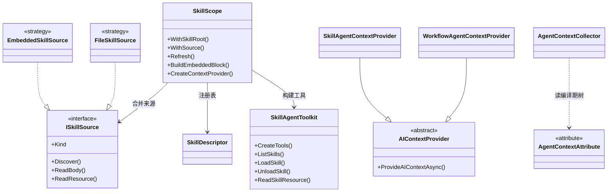

# 智能体上下文与技能

上下文通过 `AIContextProvider` 实现触达模型，技能则通过可插拔的来源抽象进入上下文。`SkillScope` 合并来源，`WorkflowAgentScope` 渲染渐进式提示并持有提供器集合。

## 类型拓扑



> 来源：`Src/Core/VeloxDev.Core.Extension/Agent/Skills/ISkillSource.cs:17`、`EmbeddedSkillSource.cs:24`、`FileSkillSource.cs:23`、`SkillScope.cs:31`、`SkillAgentToolkit.cs:32`、`SkillAgentContextProvider.cs:24`、`Agent/Workflow/WorkflowAgentContextProvider.cs:27`、`Src/Core/VeloxDev.Core/AI/AgentContextAttribute.cs:5`、`Agent/Workflow/AgentContextCollector.cs:25`。

## 模式运用

| 模式 | 位置 | 证据 |
|---|---|---|
| 策略 | `ISkillSource` | 内嵌与文件来源可互换；`Refresh` 多态调用 `Discover`（`SkillScope.cs:168-197`） |
| 提供器 + 模板方法 | `AIContextProvider` 子类 | 基类固定 `ProvideAIContextAsync`，子类实现 `BuildContext`（`SkillAgentContextProvider.cs:69`、`:78`） |
| 组合 | 多来源合并 | `Refresh` 以“首个来源拥有该名”合并（`SkillScope.cs:191-195`） |
| 注册表 / 缓存 | 技能归属与渲染 | `_owningSource` 映射加 `Version` 门控（`SkillScope.cs:459-468`） |
| 工厂 | 提供器与工具构建 | `CreateContextProvider`（`SkillScope.cs:107`）、`CreateTools`（`SkillAgentToolkit.cs:68`） |

### 来源隔离

某个来源抛异常会变成一条带错误信息的描述项，而不是中断发现；同名项按归属去重：

```csharp
// Src/Core/VeloxDev.Core.Extension/Agent/Skills/SkillScope.cs:168-196
try
{
    discovered = source.Discover();
}
catch (Exception ex)
{
    found.Add(new SkillDescriptor { Name = source.Kind + "-source", Source = source.Kind,
        Error = $"Skill source '{source.GetType().Name}' failed to discover: {ex.Message}" });
    continue;
}

foreach (var descriptor in discovered)
{
    if (owners.TryGetValue(descriptor.Name, out var owner) && !ReferenceEquals(owner, source))
        continue;
    owners[descriptor.Name] = source;
    found.Add(descriptor);
}
```

### 内嵌与文件发现

`EmbeddedSkillSource` 枚举程序集清单资源 `Resources.{system}.{language}.Skills.` 下的技能并解析可选 frontmatter（`EmbeddedSkillSource.cs:50-111`；`AgentEmbeddedResources.cs:167-195`）。`FileSkillSource` 扫描 `<root>/SKILL.md` 及向下最多一层，并在读取资源前做路径包含校验（`FileSkillSource.cs:52-124`、`:149-164`）。`WithSkillRoot` 把相对路径按 `AppContext.BaseDirectory` 解析（`SkillScope.cs:129-138`）。

## 设计要点

- 上下文注解不在运行时反射。`AgentContextCollector` 转调 `AgentContextReader`，后者按 `FullName` 查询预编译的 `AIContextDirectory` 树；源码注释明确说明此处不反射元数据（`AgentContextCollector.cs:12-18`；`Src/Core/VeloxDev.Core/AI/AgentContextReader.cs:60-100`）。
- `ProvideProgressiveContextPrompt` 只产出骨架：行为约束、参考、已注册类型名、`GetComponentContext` 要求与内嵌技能；每轮增量来自 `BuildDynamicInstructions`（`WorkflowAgentScope.cs:1309-1431`、`:2151`）。
- 当内嵌技能已冻结进提示，`SkillAgentContextProvider` 改为提供撤回块而非语料，避免重复注入（`SkillAgentContextProvider.cs:111-113`；`WorkflowAgentScope.cs:2448-2451`）。
