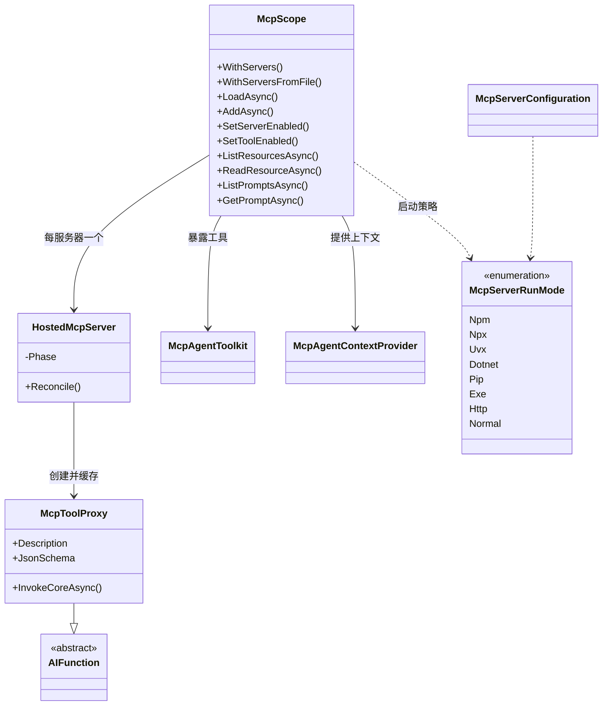

# MCP集成

`VeloxDev.AI.MCP` 托管 Model Context Protocol 服务器，并把它们的工具、资源与提示暴露给智能体。`McpScope` 是门面兼注册表；每个启动的服务器是一个 `HostedMcpServer`；每个远端工具是一个实现本地 `AIFunction` 契约的稳定 `McpToolProxy`。

## 类型拓扑



> 来源：`Src/Core/VeloxDev.Core.Extension/Agent/MCP/McpScope.cs:38`、`HostedMcpServer.cs:35`、`McpToolProxy.cs:24`、`McpAgentToolkit.cs:29`、`McpAgentContextProvider.cs:27`、`McpServerRunMode.cs:8`。

## 模式运用

| 模式 | 位置 | 证据 |
|---|---|---|
| 门面 | `McpScope` | 加载、添加、状态、资源、提示都经一个对象转发到私有宿主映射（`McpScope.cs:144`、`:778-838`） |
| 代理 / 适配器 | `McpToolProxy` | 把动态 MCP 工具适配为 `AIFunction`，转发描述、模式与调用（`McpToolProxy.cs:30-49`） |
| 注册表 | 服务器与工具映射 | `_hosts` 字典加已注册服务器列表（`McpScope.cs:144`、`:328`） |
| 构建器 | 流式 `With*` | `WithServers`、`WithServersFromFile`、`WithConnectionTimeout` 返回作用域（`McpScope.cs:61`、`:341`、`:816`） |
| 中介者 | 连接委托 | 作用域把 `Connector` 绑进宿主，而非直接调用（`HostedMcpServer.cs:39`；`McpScope.cs:993`） |
| 策略 | 启动模式 | 一个 switch 为每种运行模式选择进程构建器（`McpScope.cs:1303-1312`） |
| 模板方法 | 提供器重写 | `AIContextProvider.ProvideAIContextAsync` 转到 `BuildContext`（`McpAgentContextProvider.cs:69-78`） |

### 运行模式即启动策略

```csharp
// Src/Core/VeloxDev.Core.Extension/Agent/MCP/McpScope.cs:1303-1312
var (cmd, args) = config.RunMode switch
{
    McpServerRunMode.Normal => BuildNormalArgs(config),
    McpServerRunMode.Npx    => BuildNpxArgs(config),
    McpServerRunMode.Uvx    => BuildUvxArgs(config),
    McpServerRunMode.Dotnet => BuildDotnetArgs(config, mcpRoot),
    McpServerRunMode.Pip    => BuildPipArgs(config, mcpRoot),
    McpServerRunMode.Exe    => BuildExeArgs(config, mcpRoot),
    _                       => BuildNpmArgs(config, mcpRoot),
};
```

`Npm` 与 `Pip` 先把包装进运行时目录再启动；`Npx`、`Uvx`、`Dotnet`、`Exe` 直接执行解析出的命令；`Http` 走传输通道而非进程（`McpScope.cs:1153-1231`、`:1336`、`:1479-1578`）。

### 代理保持身份稳定

`HostedMcpServer.Reconcile` 按名字复用已有的 `McpToolProxy`，只发布存活集合，因此重连后智能体看到的工具身份保持不变（`HostedMcpServer.cs:363-370`）。

## 设计要点

- `WithServers` 不重连在线宿主；它更新配置并递增版本号，下一次调用才会重建受影响的服务器（`McpScope.cs:341-359`）。
- `McpAgentContextProvider` 仅在作用域版本变化时重建工具集，并包装每个已加载工具，使调用记账与权限检查同样生效（`McpAgentContextProvider.cs:78-121`）。其指令带有一行明确的“不可信来源”声明（`:142`）。
- 资源与提示访问是委托方法而非独立子系统：各自通过 `RequireHost` 解析宿主（`McpScope.cs:966-982`）。
