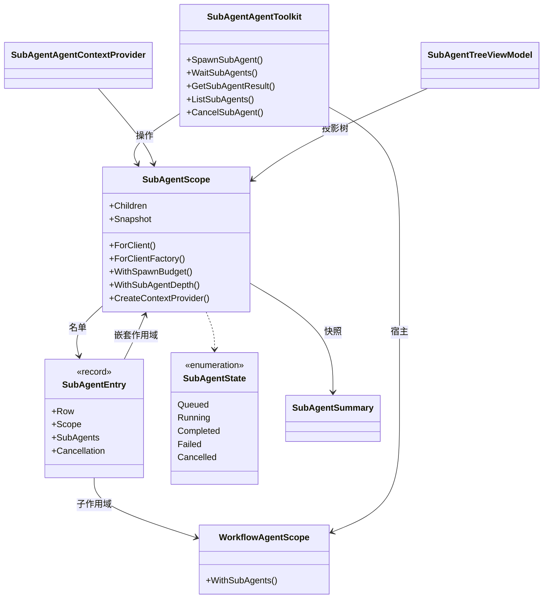

# 子智能体

`VeloxDev.AI.SubAgents.SubAgentScope` 让智能体把工作委派给子智能体：子智能体共享父树，但只持有严格更小的预算。作用域持有一份 `SubAgentEntry` 名单，`SubAgentAgentToolkit` 是这份名单之上的工具面。

## 类型拓扑



> 来源：`Src/Core/VeloxDev.Core.Extension/Agent/SubAgents/SubAgentScope.cs:130`、`:1060`、`SubAgentAgentToolkit.cs:30`、`SubAgentAgentContextProvider.cs:24`、`SubAgentStatus.cs:14`、`:40`、`SubAgentTreeViewModel.cs:278`。

## 模式运用

| 模式 | 位置 | 证据 |
|---|---|---|
| 门面 | `SubAgentScope` | 工厂、预算、名单与操作收在一个对象后（`SubAgentScope.cs:130-246`） |
| 组合 | 名单树 | `SubAgentEntry` 持有子项；`SubAgentTreeViewModel` 递归投影（`SubAgentScope.cs:1060`；`SubAgentTreeViewModel.cs:405-447`） |
| 中介者 | 工具集 | 把模型的工具调用翻译为 `TrySpawn`、`List`、`Cancel`（`SubAgentAgentToolkit.cs:84-231`） |
| 策略 | 客户端工厂 | 可注入的智能体工厂，让子项使用不同模型或客户端（`SubAgentScope.cs:132`、`:185`、`:204`） |
| 构建器 | 流式预算 | `WithSpawnBudget`、`WithSubAgentDepth`、`WithSynchronizationContext`（`SubAgentScope.cs:276-340`） |
| 观察者 | `Changed` | 名单变化通知树视图模型（`SubAgentScope.cs:261`；`SubAgentTreeViewModel.cs:485`） |

### 授予严格递减

子项永远不会拿到父级剩余额度的全部：

```csharp
// Src/Core/VeloxDev.Core.Extension/Agent/SubAgents/SubAgentScope.cs:459-470
var parentLedger = parent.CreateToolkit().Ledger;
var remaining = RemainingAllowance(parent, parentLedger);
var granted = Math.Min(request.MaxToolCalls ?? remaining, remaining - 1);
if (granted < 1)
{
    refusal = "No tool-call allowance remains for a sub-agent...";
    return null;
}
if (request.MaxToolCalls is { } askedBudget && askedBudget > granted)
    dropped.Add($"maxToolCalls: asked for {askedBudget}, granted {granted}...");
```

授予值通过 `child.WithMaxToolCalls(granted)` 应用，子项的 `ParentLedger` 指向父账本，因此花费计入整棵树（`SubAgentScope.cs:544-548`、`:601`）。

### 能力是求交，不是复制

父级先计算可用面 —— 工具集、技能名、子智能体名与 MCP 工具 —— 再按自身开关过滤，然后与请求求交（`SubAgentScope.cs:479-522`）。省略列表表示全部继承；显式列表若超出父级配额，会记为 dropped（`:511-522`）。

## 设计要点

- 深度是硬闸门：`CanSpawn => Depth < MaxDepth`，子项在 `Depth + 1` 处构造（`SubAgentScope.cs:331`、`:544`）。
- 技能、MCP 服务器、节点执行、通用命令与自动标脏都会先对照父级的可授予名单，再决定是否下放（`SubAgentScope.cs:684-851`）。
- 上下文提供器只在 `SubAgentScope.Version` 变化时重建指令与工具并缓存（`SubAgentAgentContextProvider.cs:77-99`）。
