# 智能体仪表盘与转录

`VeloxDev.AI.Pipelines` 把原始智能体更新转成有类型的 `AgentEvent` 流供各阶段消费；`VeloxDev.AI.Dashboard` 把实时作用域投影成成员行；`VeloxDev.AI.Media` 让附件沿同一条流传递。`AgentPipelineAgent` 是把整套管道挂到任意 `AIAgent` 上的装饰器。

## 类型拓扑

```mermaid
classDiagram
    class AgentEvent {
        <<abstract>>
    }
    class AgentTurnStarted
    class AgentTurnCompleted
    class AgentTextDelta
    class AgentReasoningDelta
    class AgentToolCallStarted
    class AgentToolCallCompleted
    class AgentUsageReported
    class AgentTurnFaulted
    class AgentMediaReceived
    class IAgentPipelineStage {
        <<interface>>
        +OnEventAsync()
    }
    class AgentPipeline {
        +Use()
        +PublishAsync()
    }
    class TextPipeline
    class ToolPipeline
    class AgentPipelineAgent {
        +RunCoreAsync()
        +RunCoreStreamingAsync()
    }
    class DelegatingAIAgent {
        <<abstract>>
    }
    class AgentMemberViewModel {
        <<abstract>>
    }
    class ToolMemberViewModel
    class SkillMemberViewModel
    class McpToolMemberViewModel
    class McpServerMemberViewModel
    class AgentTranscript {
        +ToMarkdown()
    }
    class AgentMedia
    class IAgentMediaTranscoder {
        <<interface>>
        +TranscodeAsync()
    }
    AgentTurnStarted --|> AgentEvent
    AgentTurnCompleted --|> AgentEvent
    AgentTextDelta --|> AgentEvent
    AgentReasoningDelta --|> AgentEvent
    AgentToolCallStarted --|> AgentEvent
    AgentToolCallCompleted --|> AgentEvent
    AgentUsageReported --|> AgentEvent
    AgentTurnFaulted --|> AgentEvent
    AgentMediaReceived --|> AgentEvent
    TextPipeline ..|> IAgentPipelineStage
    ToolPipeline ..|> IAgentPipelineStage
    AgentPipeline --> IAgentPipelineStage : 有序链
    AgentPipelineAgent --|> DelegatingAIAgent
    AgentPipelineAgent --> AgentPipeline : 发布到
    ToolMemberViewModel --|> AgentMemberViewModel
    SkillMemberViewModel --|> AgentMemberViewModel
    McpToolMemberViewModel --|> AgentMemberViewModel
    McpServerMemberViewModel --|> AgentMemberViewModel
    AgentMedia ..|> IAgentMediaContent
```



> 来源：`Src/Core/VeloxDev.Core.Extension/Agent/Pipelines/AgentEvent.cs:21-177`、`AgentPipeline.cs:16-46`、`TextPipeline.cs:42`、`ToolPipeline.cs:23`、`AgentPipelineAgent.cs:33`、`Dashboard/AgentMemberViewModel.cs:18`、`Dashboard/ToolMemberViewModel.cs:11`、`Dashboard/SkillMemberViewModel.cs:11`、`Dashboard/McpMemberViewModel.cs:14`、`:54`、`AgentTranscript.cs:230`、`Media/AgentMedia.cs:31`、`Media/IAgentMediaTranscoder.cs:87`。

## 模式运用

| 模式 | 位置 | 证据 |
|---|---|---|
| 观察者 | 事件流 | `AgentPipeline.PublishAsync` 发布 `AgentEvent` 子类（`AgentPipeline.cs:84`）；仪表盘订阅作用域变化（`AgentDashboardViewModel.cs:62-63`） |
| 管道 / 职责链 | `IAgentPipelineStage` | 每个阶段收到 `next` 委托并转发（`AgentPipeline.cs:22`、`:98-101`） |
| 装饰器 | `AgentPipelineAgent` | 包装内层 `AIAgent`，原样透传其更新（`AgentPipelineAgent.cs:33`、`:119-120`） |
| 组合 | 成员行 | `AgentMemberViewModel` 基类加具体行；MCP 服务器行持有工具行（`McpMemberViewModel.cs:65`；`AgentDashboardViewModel.cs:131-141`） |
| 模板方法 | 管道重写 | `RunCoreAsync`/`RunCoreStreamingAsync` 固定事件边界（`AgentPipelineAgent.cs:38`、`:77`） |
| 适配器 | 媒体转码 | `DelegateAgentMediaTranscoder` 把 lambda 适配为 `IAgentMediaTranscoder`（`IAgentMediaTranscoder.cs:101-120`） |

### 原始内容转成有类型事件

```csharp
// Src/Core/VeloxDev.Core.Extension/Agent/Pipelines/AgentPipelineAgent.cs:143-162
switch (content)
{
    case TextReasoningContent reasoning when !string.IsNullOrEmpty(reasoning.Text):
        await PublishAsync(new AgentReasoningDelta(reasoning.Text), cancellationToken).ConfigureAwait(false);
        break;
    case TextContent text when !string.IsNullOrEmpty(text.Text):
        await PublishAsync(new AgentTextDelta(text.Text), cancellationToken).ConfigureAwait(false);
        break;
    case UsageContent usage when usage.Details is { } details:
        await PublishAsync(new AgentUsageReported(details), cancellationToken).ConfigureAwait(false);
        break;
    case DataContent:
    case UriContent:
        if (AgentAttachment.TryFromContent(content, out var attachment))
            await PublishAsync(new AgentMediaReceived(attachment, content), cancellationToken).ConfigureAwait(false);
        break;
}
```

### 阶段解释，转录记录

`TextPipeline` 合并文本与推理增量，并在轮次边界冲刷；写入经 `PipelineDispatch` 保持有序（`TextPipeline.cs:79-132`；`PipelineDispatch.cs:20-43`）。`ToolPipeline` 记录已完成的工具调用（`ToolPipeline.cs:84-96`）。`AgentTranscript` 只在角色与当前开放项不同时才新建条目，因此一次流式轮次在转录中读作一条（`AgentTranscript.cs:402-415`）。

## 设计要点

- 失败按阶段隔离：`AgentPipeline.InvokeAsync` 捕获阶段异常并触发 `StageFailed`，不打断整条链（`AgentPipeline.cs:103-106`）。
- 成员层级是统一的：`AllMembers()` 通过一个接口遍历服务器行、工具行与技能行（`AgentDashboardViewModel.cs:131-141`）。
- `AgentMedia` 持有字节并嗅探/校验容器；`AgentMediaReference` 是仅 URL 的轻量对应物；`AgentAttachment` 是展示记录。只有 `AgentMedia` 会走 `IAgentMediaTranscoder`（`AgentMedia.cs:31`、`:272-323`；`AgentMediaReference.cs:19`；`AgentAttachment.cs:15`）。
