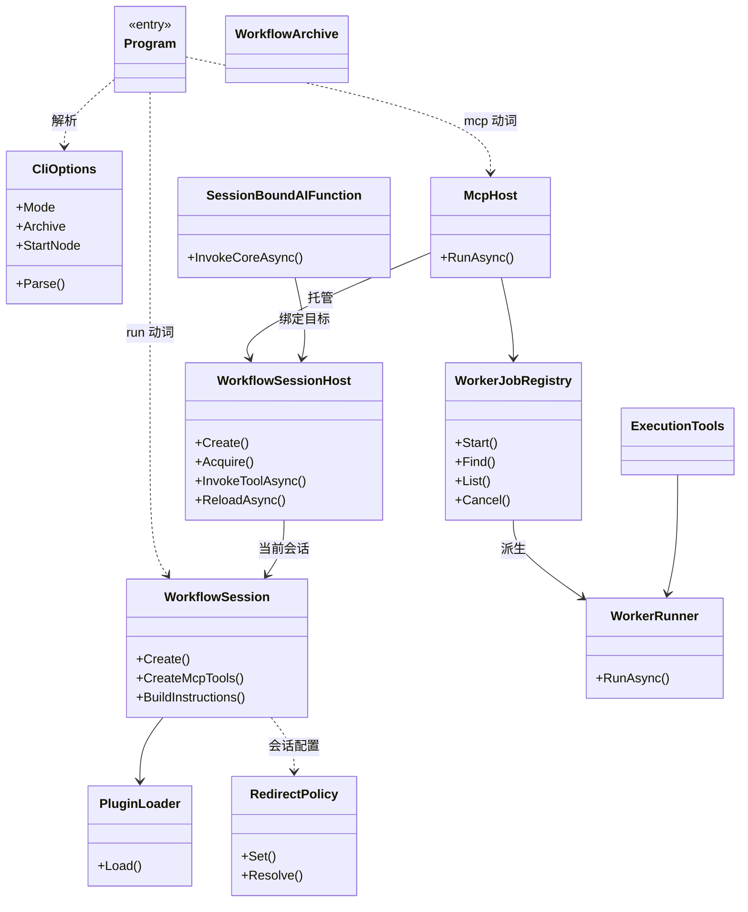

# 无头CLI

`VeloxDev.Cli` 是一个双动词可执行程序：`run` 执行一份工作流归档后退出，`mcp` 把工作流会话作为 MCP stdio 服务器托管。围绕这两个动词，它组合了会话重载、归档解析、插件加载、工作进程隔离与运行日志。

## 类型拓扑



> 来源：`Src/Cli/VeloxDev.Cli/CliOptions.cs:4`、`Program.cs:12`、`WorkflowSession.cs:21`、`WorkflowSessionHost.cs:31`、`WorkflowArchive.cs:20`、`PluginLoader.cs:30`、`ExecutionTools.cs:13`、`WorkerRunner.cs:17`、`WorkerJobRegistry.cs:85`、`RedirectPolicy.cs:16`、`SessionBoundAIFunction.cs:10`、`McpHost.cs:12`。

## 模式运用

| 模式 | 位置 | 证据 |
|---|---|---|
| 命令 | 动词分发 | 对 `mcp`/`run` 做闭集校验（`CliOptions.cs:102-104`）；不同处理器（`Program.cs:22-25`） |
| 门面 | `WorkflowSession` / `WorkflowSessionHost` | 一个对象隐藏归档、作用域、工具集、插件、重定向、检查点与日志（`WorkflowSession.cs:91-144`）；宿主隐藏租约/重载/审计（`WorkflowSessionHost.cs:107-254`） |
| 工厂 | 静态 `Create` 与加载器 | 私有构造加静态工厂（`WorkflowSession.cs:147`、`WorkflowSessionHost.cs:68`）；`PluginLoader.Load` 返回程序集（`PluginLoader.cs:122`） |
| 注册表 | 任务 | `WorkerJobRegistry` 持有任务字典与生命周期（`WorkerJobRegistry.cs:88-140`） |
| 策略 | 重定向策略 | 可替换的 `Resolve` 注入会话配置（`RedirectPolicy.cs:48`；`WorkflowSession.cs:244`） |
| 适配器 | 会话绑定 | `SessionBoundAIFunction` 保持一套模式，转发到当前会话（`SessionBoundAIFunction.cs:21-23`） |

### 两个动词，一个宿主

```csharp
// Src/Cli/VeloxDev.Cli/Program.cs:14-25
var options = CliOptions.Parse(args);
if (options.ShowHelp) { /* print usage */ }
if (options.Mode == "run")
    return await RunOnceAsync(options);

await McpHost.RunAsync(options);
```

`CliOptions` 默认 `mcp` 并拒绝其他任何动词，因此该兜底分支是安全的（`CliOptions.cs:69`、`:103-104`）。`--archive` 两个动词都必需；`--start` 仅 `run` 必需（`CliOptions.cs:206-210`）。

### 换会话而不重注册工具

每个 MCP 工具都是 `SessionBoundAIFunction`：模式在启动时捕获，但调用时通过 `InvokeToolAsync` 解析宿主的当前会话（`McpHost.cs:39`；`WorkflowSessionHost.cs:138-145`）。重载会先退休已租出的会话而不是直接释放，待租约解除后再切换 `_current`（`WorkflowSessionHost.cs:284-296`）。

## 设计要点

- 插件程序集从每进程的暂存副本加载进默认 `AssemblyLoadContext`，加载器显式运行每个模块初始化器，使生成的注册生效（`PluginLoader.cs:157-168`、`:240-262`）。
- 工作进程隔离采用文件交接而非共享内存：父进程把树序列化为快照，启动 `dotnet <cli> run --archive ... --output-tree ...`，再读回状态文件与 stdout/stderr（`WorkerRunner.cs:32-80`、`:181-190`）。子进程刻意不继承 MCP 的 stdin 流（`:63-69`）。
- `McpHost` 把日志强制到 stderr 以保持 stdout 干净，并在 MCP 构建器上注册工具、资源与提示（`McpHost.cs:16-49`）。
