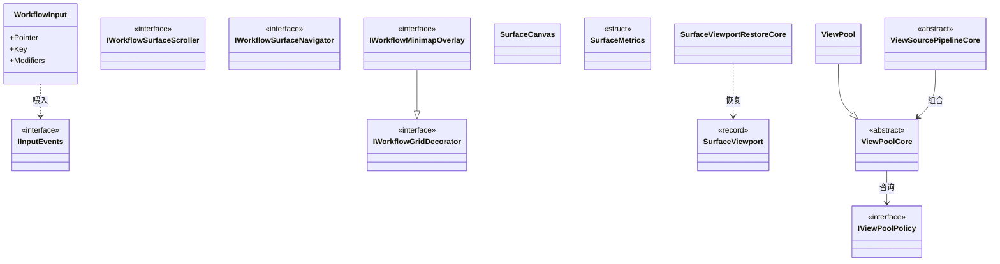

# 平台适配器契约

七个 GUI 适配器不重新实现工作流机制，它们闭合 `VeloxDev.Core` 声明的共享契约。本页描述该契约：`WorkflowInput` 归一化指针/键盘状态，`Surface*` 类型承载视口几何，`ViewPool`/`ViewSourcePipelineCore` 固定各平台特化的托管管道。

## 类型拓扑

> 来源：`Src/Core/VeloxDev.Core/WorkflowSystem/GUI/Events/WorkflowInput.cs:31`、`GUI/Events/Input/IInputEvents.cs:19`、`GUI/Events/IWorkflowSurfaceScroller.cs:38`、`GUI/Events/IWorkflowSurfaceNavigator.cs:23`、`Interfaces/WorkflowSystem/Surface/IWorkflowGridDecorator.cs:12`、`Interfaces/WorkflowSystem/Surface/IWorkflowMinimapOverlay.cs:15`、`GUI/Surface/SurfaceViewport.cs:11`、`SurfaceMetrics.cs:24`、`SurfaceViewportRestoreCore.cs:24`、`ViewHosting/ViewPool.cs:29`、`:463`、`ViewSourcePipelineCore.cs:24`、`Interfaces/WorkflowSystem/ViewHosting/IViewPoolPolicy.cs:11`。

## 模式运用

| 模式 | 位置 | 证据 |
|---|---|---|
| 端口 / 适配器边界 | Core 接口 | 各适配器实现同一组接口而非分叉行为（`IInputEvents.cs:19`；`IWorkflowGridDecorator.cs:12`） |
| 模板方法 | `ViewPoolCore`、`ViewSourcePipelineCore` | 抽象基类固定批量/管道循环；密封 `ViewPool` 收尾（`ViewPool.cs:29`、`:463`；`ViewSourcePipelineCore.cs:24`） |
| 策略 | `IViewPoolPolicy` | 池选择是注入的策略（`IViewPoolPolicy.cs:11`） |
| 组合 | 层策略 | 视图层由管道组合（`Interfaces/WorkflowSystem/ViewHosting/IViewLayerPolicy.cs:12`） |
| 观察者 | `WorkflowEventRelay` | Core 中继把组件事件转发给宿主接收器（`GUI/Events/WorkflowEventRelay.cs:18`） |
| 值对象 | 几何 | `SurfaceViewport` 是 record，`SurfaceMetrics` 是只读 struct（`SurfaceViewport.cs:11`；`SurfaceMetrics.cs:24`） |

### 七个角色

每个适配器都在同一组契约上提供同一套角色：surface 宿主、画布变换、事件接收器、节点拖拽、插槽连线、插槽布局、视图池、小地图覆盖层、网格装饰器、过渡系统与动态主题。六个适配器通过 `ViewSourcePipelineCore` 派生源管道 —— 除 Razor 外全部如此，Razor 依赖 Core 加 JS 模块（例如 `Src/Adapters/VeloxDev.WPF/WorkflowSystem/ViewHosting/ViewSourcePipeline.cs:10` 与 `Src/Adapters/VeloxDev.WinForms/WorkflowSystem/ViewHosting/ViewSourcePipeline.cs:14`） —— 七个适配器的小地图都实现 `IWorkflowMinimapOverlay`（`IWorkflowMinimapOverlay.cs:15`）。

### 一致性证据

无头测试套件位于 `Src/Test/Headless`，覆盖 WPF、Avalonia、WinForms、Razor、Jalium。WinUI 与 MAUI 有 demo 与基准测试，但没有无窗口套件。契约通过 `VeloxDev.AdapterTestKit` 验证，测试不导入平台 UI 类型。

## 设计要点

- `IWorkflowMinimapOverlay` 继承 `IWorkflowGridDecorator`，小地图可复用网格绘制契约，无需第二套抽象（`IWorkflowMinimapOverlay.cs:15`）。
- 几何以值传递：视口 record 由 `SurfaceViewportRestoreCore` 恢复，相机状态不进入适配器控件树（`SurfaceViewport.cs:11`；`SurfaceViewportRestoreCore.cs:24`）。
- 适配器在 Debug 下用 `ProjectReference`、Release 下用 `PackageReference` 引用 Core，使契约页与发布产物描述同一表面（例如 `Src/Adapters/VeloxDev.WPF/VeloxDev.WPF.csproj:28-29`）。
