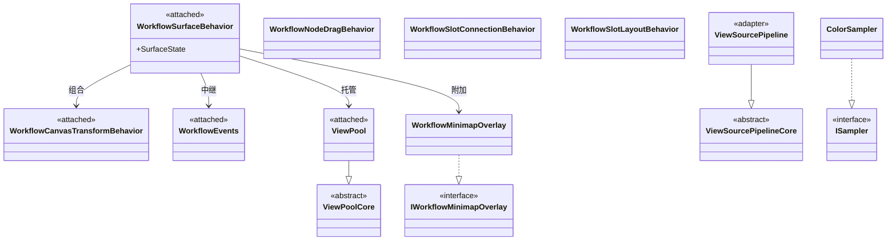

# WPF适配器

`VeloxDev.WPF` 用 WPF 附加属性闭合 Core 适配器契约。每个行为都是静态 `DependencyObject` 类，挂到宿主视觉树的命名部件上；重活留在 `VeloxDev.Core`，WPF 项目提供视觉宿主、采样器与主题转换器。

## 类型拓扑

> 来源：`Src/Adapters/VeloxDev.WPF/WorkflowSystem/AttachedBehaviors/WorkflowSurfaceBehavior.cs:16`、`WorkflowCanvasTransformBehavior.cs:10`、`WorkflowEvents.cs:33`、`WorkflowNodeDragBehavior.cs:11`、`WorkflowSlotConnectionBehavior.cs:8`、`WorkflowSlotLayoutBehavior.cs:30`、`ViewPool.cs:18`、`WorkflowMinimapOverlay.cs:22`；`ViewHosting/ViewSourcePipeline.cs:10`；`TransitionSystem/Samplers/ColorSampler.cs:5`；`Src/Core/VeloxDev.Core/Interfaces/TransitionSystem/ISampler.cs:11`。

## 模式运用

| 模式 | 位置 | 证据 |
|---|---|---|
| 适配器 | `ViewSourcePipeline` | 派生 Core 管道并提供 WPF 层（`ViewSourcePipeline.cs:10`） |
| 代理 | `WorkflowEvents` | 附加接收器经 `WorkflowEventRelay.Attach` 转发组件事件（`WorkflowEvents.cs:111`） |
| 组合 | 视图层 | `ViewLayerPolicy : IViewLayerPolicy<IWorkflowComponent>` 与 `ViewLinkLayer` 组合（`ViewLayerPolicy.cs:6`；`ViewLinkLayer.cs:8`） |
| 策略 | 采样器 | `ColorSampler`、`PointSampler`、`RectSampler` 实现 `ISampler`（`Samplers/ColorSampler.cs:5`） |
| 门面 | surface 行为 | 一个附加类暴露滚动、画布、网格、小地图、恢复与池（`WorkflowSurfaceBehavior.cs:16`、`:20`） |
| 模板方法 | 池核心 | `ViewPool` 闭合 `ViewPoolCore`（`ViewPool.cs:18`） |

### 滚动与恢复是两个端口

WPF 是明确把两个 surface 契约拆成私有宿主对象的适配器：`WpfSurfaceScrollHost : ISurfaceScrollHost` 与 `WpfViewportRestoreHost : ISurfaceViewportRestoreHost`，由 surface 行为构造，并由 `SurfaceViewportRestoreCore` 支撑（`WorkflowSurfaceBehavior.cs:893`、`:943`、`:354`）。滚动物理与相机恢复因此可独立替换，而对外仍只有一组附加属性。

### 附加属性作为组合根

`DependencyProperty.RegisterAttached` 出现在 `ViewPool`、`WorkflowEvents` 与 `WorkflowCanvasTransformBehavior` 上（`ViewPool.cs:21`；`WorkflowEvents.cs:36`；`WorkflowCanvasTransformBehavior.cs:12`）。宿主 XAML 把它们挂到命名元素上，适配器代码不构造视觉树。

## 设计要点

- surface 状态聚合为 `SurfaceState`，一次属性变更不会扩散成一串无关通知（`WorkflowSurfaceBehavior.cs:20`）。
- 过渡复用共享 `TransitionInterpreter` 加 WPF 专用采样器；主题转换位于 `DynamicTheme/ThemeValueConverters.cs:8`。
- `Src/Test/Headless` 中的无头套件可在无可见窗口下覆盖该适配器。
