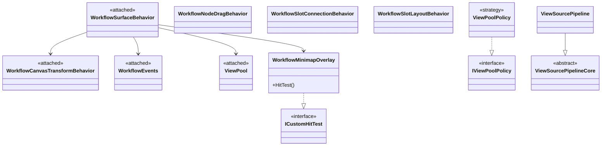

# Avalonia适配器

`VeloxDev.Avalonia` 用 `AvaloniaProperty` 而非 `DependencyProperty` 复现 WPF 的角色集，并用 Avalonia 的 `ICustomHitTest` 取代 WPF 的命中测试管线。Core 契约不变，变的只是属性系统与输入系统。

## 类型拓扑



> 来源：`Src/Adapters/VeloxDev.Avalonia/WorkflowSystem/AttachedBehaviors/WorkflowSurfaceBehavior.cs:22`、`WorkflowCanvasTransformBehavior.cs:11`、`WorkflowEvents.cs:34`、`WorkflowNodeDragBehavior.cs:13`、`WorkflowSlotConnectionBehavior.cs:12`、`WorkflowSlotLayoutBehavior.cs:30`、`ViewPool.cs:19`、`WorkflowMinimapOverlay.cs:29`；`WorkflowSystem/ViewHosting/ViewPoolPolicy.cs:4`；`Src/Core/VeloxDev.Core/Interfaces/WorkflowSystem/ViewHosting/IViewPoolPolicy.cs:11`。

## 模式运用

| 模式 | 位置 | 证据 |
|---|---|---|
| 适配器 | 附加行为 | `AvaloniaProperty.RegisterAttached` 把 Core 行为绑到 Avalonia 对象（`WorkflowEvents.cs:38`；`WorkflowSurfaceBehavior.cs:66`；`ViewPool.cs:29`） |
| 代理 | `WorkflowEvents` | 事件接收器经 Core 中继转发（`WorkflowEvents.cs:34`） |
| 组合 | 视图层 | 源管道组合层策略 |
| 策略 | 池策略 | `ViewPoolPolicy : IViewPoolPolicy`（`ViewPoolPolicy.cs:4`） |
| 模板方法 | 管道核心 | `ViewSourcePipeline` 派生 `ViewSourcePipelineCore` |
| 门面 | surface | 一个附加 surface 暴露滚动、变换、网格、小地图与池（`WorkflowSurfaceBehavior.cs:22`） |

### 小地图命中测试是控件职责

与 WPF 不同，Avalonia 小地图实现 `ICustomHitTest`，把命中判定委托给共享小地图管道：

```csharp
// Src/Adapters/VeloxDev.Avalonia/WorkflowSystem/AttachedBehaviors/WorkflowMinimapOverlay.cs:245
bool ICustomHitTest.HitTest(Point point)
```

这样指针路由留在平台控件，判定依据仍来自 `MinimapPipelineCore`。

### 属性系统而非继承

所有附加行为类都是密封且无状态的；状态存放在附加属性或每控件的伴随对象中。surface 行为派生 `AvaloniaObject` 而非某个控件，因此可挂到任意宿主而不改视觉层级（`WorkflowSurfaceBehavior.cs:22`）。

## 设计要点

- 过渡复用共享解释器；Avalonia 贡献 `BoxShadowsSampler`、`GridLengthSampler`、`RelativePointSampler` 等采样器。
- 主题转换位于 `DynamicTheme/ThemeValueConverters.cs`，对象转换是 Avalonia 特有部分。
- `Src/Test/Headless` 中的无头套件覆盖该适配器。
