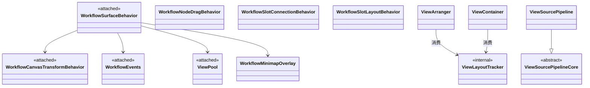

# WinUI适配器

`VeloxDev.WinUI` 在 `DependencyObject` 附加属性上闭合 Core 契约，并额外提供一个布局跟踪器，让实测视图边界跟上 WinUI 的延迟布局周期。它有 demo，但没有无头一致性套件。

## 类型拓扑

> 来源：`Src/Adapters/VeloxDev.WinUI/WorkflowSystem/AttachedBehaviors/WorkflowSurfaceBehavior.cs:19`、`WorkflowCanvasTransformBehavior.cs:10`、`WorkflowEvents.cs:33`、`WorkflowNodeDragBehavior.cs:13`、`WorkflowSlotConnectionBehavior.cs:8`、`WorkflowSlotLayoutBehavior.cs:30`、`ViewPool.cs:18`、`WorkflowMinimapOverlay.cs:24`；`ViewHosting/ViewLayoutTracker.cs:13`；`ViewHosting/ViewArranger.cs:11`。

## 模式运用

| 模式 | 位置 | 证据 |
|---|---|---|
| 适配器 | 附加行为 | 附加依赖属性把 Core 机制绑到 WinUI 元素（`WorkflowSurfaceBehavior.cs:75`；`ViewPool.cs:21`；`WorkflowEvents.cs:36`） |
| 代理 | `WorkflowEvents` | 事件接收器经 Core 中继转发（`WorkflowEvents.cs:33`） |
| 组合 | 视图层 | 源管道在 Core 管道上组合层 |
| 策略 | 池策略 | 适配器提供自己的 `IViewPoolPolicy` |
| 模板方法 | 管道核心 | `ViewSourcePipeline` 派生 `ViewSourcePipelineCore` |
| 门面 | surface | 一个附加 surface 暴露变换、网格、小地图与池（`WorkflowSurfaceBehavior.cs:19`） |

### 延迟布局需要跟踪器

WinUI 异步测量，因此适配器维护内部 `ViewLayoutTracker`（`ViewLayoutTracker.cs:13`），供 `ViewArranger` 与 `ViewContainer` 放置视图时查询（`ViewArranger.cs:11-14`）。必须等待布局的工作以 `DispatcherQueuePriority.Low` 投递（例如 `WorkflowSurfaceBehavior.cs:916`），从而在视觉树稳定期间保持输入响应。

### 附加属性面

与其它 XAML 适配器相同的三个核心附加点 —— surface、事件与视图池 —— 都注册为 WinUI 附加属性，宿主页面按命名部件接线，而不是构造行为对象（`ViewPool.cs:21`；`WorkflowEvents.cs:36`；`WorkflowSurfaceBehavior.cs:75`）。

## 设计要点

- 过渡复用共享解释器与 WinUI 采样器，包括 `ProjectionSampler` 与 `GridLengthSampler`。
- 主题转换位于 `DynamicTheme/ThemeValueConverters.cs`。
- 该适配器没有无窗口套件；可用证据是 demo 与基准测试项目。
