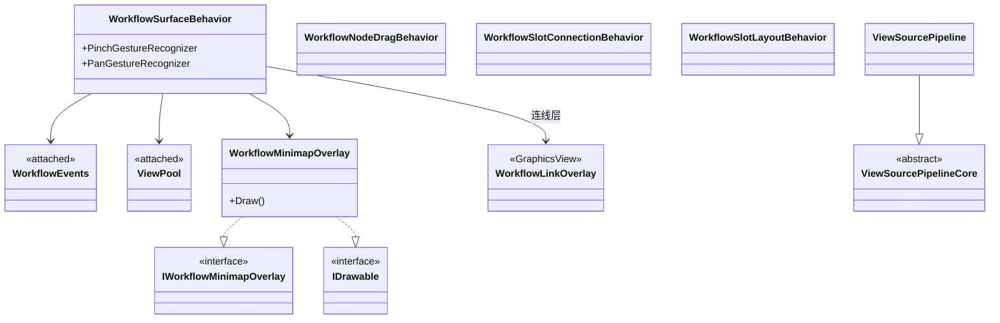

# MAUI适配器

`VeloxDev.MAUI` 把 Core 契约适配到 .NET MAUI：surface 手势交给原生识别器，连线绘制在独立的视口大小 `GraphicsView` 上。它有 demo，但没有无头一致性套件。

## 类型拓扑

> 来源：`Src/Adapters/VeloxDev.MAUI/WorkflowSystem/AttachedBehaviors/WorkflowSurfaceBehavior.cs:9`、`WorkflowEvents.cs:31`、`WorkflowNodeDragBehavior.cs:12`、`WorkflowSlotConnectionBehavior.cs:12`、`WorkflowSlotLayoutBehavior.cs:26`、`ViewPool.cs:16`、`WorkflowMinimapOverlay.cs:27`、`WorkflowLinkOverlay.cs:54`。

## 模式运用

| 模式 | 位置 | 证据 |
|---|---|---|
| 适配器 | 可绑定行为 | `BindableProperty.CreateAttached` 把 Core 行为绑到 MAUI 元素（`WorkflowEvents.cs:34`；`ViewPool.cs:19`） |
| 代理 | `WorkflowEvents` | 事件接收器经 Core 中继转发（`WorkflowEvents.cs:31`） |
| 组合 | 连线层 | 连线绘制在 surface 之上的独立覆盖层（`WorkflowLinkOverlay.cs:54`） |
| 策略 | 池策略 | 适配器提供自己的 `IViewPoolPolicy` |
| 模板方法 | 管道核心 | `ViewSourcePipeline` 派生 `ViewSourcePipelineCore` |
| 门面 | surface | 一个行为托管指针、变换、网格、小地图与池（`WorkflowSurfaceBehavior.cs:9`） |

### 原生识别器驱动 surface

surface 行为不自行解释原始指针事件，而是创建平台手势识别器：`PanGestureRecognizer` 与 `PinchGestureRecognizer` 挂到宿主视图（`WorkflowSurfaceBehavior.cs:783`、`:872`）。把这些识别器更新映射到 `WorkflowInput`，Core 状态机因此保持平台无关。

### 连线独占一层

`WorkflowLinkOverlay : GraphicsView` 按视口尺寸绘制连线曲线并通过 `IDrawable` 输出（`WorkflowLinkOverlay.cs:54`）。把连线层分离出来，避免每条连线都塞进节点宿主，也与 Core 的层策略一致。

## 设计要点

- 小地图是一个同时实现 `IDrawable` 与 `IWorkflowMinimapOverlay` 的 `Grid`，因此与其它适配器共用 `MinimapPipelineCore` 渲染（`WorkflowMinimapOverlay.cs:27`）。
- 过渡复用共享解释器与 MAUI 采样器，如 `PointFSampler`、`RectFSampler`、`ShadowSampler`。
- 该适配器没有无窗口套件；可用证据是 demo 与基准测试项目。
