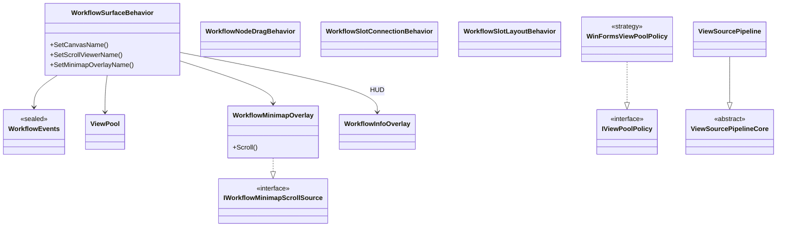

# WinForms适配器

`VeloxDev.WinForms` 是声明式属性系统用得最少的适配器。除附加属性外，它直接暴露静态命名部件 setter，并用 `ConditionalWeakTable` 保存每控件状态，因此一个 WinForms 窗体可以完全在设计器或后台代码里接线。

## 类型拓扑

> 来源：`Src/Adapters/VeloxDev.WinForms/WorkflowSystem/AttachedBehaviors/WorkflowSurfaceBehavior.cs:32`、`WorkflowEvents.cs:31`、`WorkflowNodeDragBehavior.cs:19`、`WorkflowSlotConnectionBehavior.cs:16`、`WorkflowSlotLayoutBehavior.cs:22`、`ViewPool.cs:26`、`WorkflowMinimapOverlay.cs:28`、`WorkflowInfoOverlay.cs:22`；`Platform/IWorkflowMinimapScrollSource.cs:16`；`ViewHosting/ViewSourcePipeline.cs:14`、`:71`。

## 模式运用

| 模式 | 位置 | 证据 |
|---|---|---|
| 适配器 | 静态命名部件 setter | `SetCanvasName`、`SetScrollViewerName`、`SetMinimapOverlayName` 把窗体绑到共享引擎（`WorkflowSurfaceBehavior.cs:151-173`） |
| 注册表 / 状态表 | 每控件状态 | `ConditionalWeakTable` 保存伴随状态而不扩展控件（`WorkflowSurfaceBehavior.cs:34`） |
| 策略 | 池策略 | `WinFormsViewPoolPolicy : IViewPoolPolicy`（`ViewSourcePipeline.cs:71`） |
| 组合 | 覆盖层 | 信息覆盖层与小地图覆盖层叠在 surface 之上 |
| 模板方法 | 管道核心 | `ViewSourcePipeline` 派生 `ViewSourcePipelineCore`（`ViewSourcePipeline.cs:14`） |
| 门面 | surface | 一个静态类掌管指针、变换、网格、小地图与池的接线（`WorkflowSurfaceBehavior.cs:32`） |

### 小地图同时是滚动源

WinForms 合并了其它适配器分开的两个契约：小地图同时实现 `IWorkflowMinimapOverlay` 与 `IWorkflowMinimapScrollSource`，surface 把它当作滚动输入宿主消费（`WorkflowMinimapOverlay.cs:28`；`WorkflowSurfaceBehavior.cs:556`）。拖动小地图即可滚动工作流，无需独立滚动条契约。

### 命名部件，而非遍历视觉树

宿主把控件名传给 setter，行为稍后解析。因此该适配器可在设计器中配置，状态也按控件而非按行为实例存放（`WorkflowSurfaceBehavior.cs:151-173`、`:34`）。

## 设计要点

- `EaselAnimationBootstrap` 以 `[ModuleInitializer]` 运行，使 Easel 动画桥在任何窗体使用过渡之前就安装好（`XamlAnimation/EaselVisualAnimator.cs:329-333`）。
- 主题转换使用 `DynamicTheme/ThemeValueConverters.cs` 中的 System.Drawing 转换器。
- `Src/Test/Headless` 中的无头套件覆盖该适配器。
