# Razor适配器

`VeloxDev.Razor` 是浏览器适配器。XAML 适配器用附加属性，Razor 用 Blazor 组件：每个角色都是一个 `ComponentBase` 分部类，渲染自己的层并通过 `IJSRuntime` 与 JavaScript 模块驱动共享 Core 引擎。

## 类型拓扑

```mermaid
classDiagram
    class ComponentBase {
        <<blazor>>
    }
    class WorkflowSurfaceBehavior {
        <<component>>
    }
    class ViewPool {
        <<component>>
    }
    class WorkflowNodeDragBehavior {
        <<component>>
    }
    class WorkflowSlotConnectionBehavior {
        <<component>>
    }
    class WorkflowSlotLayoutBehavior {
        <<component>>
    }
    class WorkflowMinimapOverlay {
        <<component>>
    }
    class WorkflowGridDecorator {
        <<component>>
    }
    class WorkflowCanvasTransformBehavior {
        <<static>>
    }
    class WorkflowEvents {
        <<static>>
    }
    class WorkflowGeometryScope {
        +AsyncLocal
    }
    class WorkflowPresentation
    class WorkflowRuntimeIds
    class IWorkflowMinimapOverlay {
        <<interface>>
    }
    WorkflowSurfaceBehavior --|> ComponentBase
    ViewPool --|> ComponentBase
    WorkflowNodeDragBehavior --|> ComponentBase
    WorkflowSlotConnectionBehavior --|> ComponentBase
    WorkflowSlotLayoutBehavior --|> ComponentBase
    WorkflowMinimapOverlay --|> ComponentBase
    WorkflowGridDecorator --|> ComponentBase
    WorkflowSurfaceBehavior --> WorkflowCanvasTransformBehavior
    WorkflowSurfaceBehavior --> WorkflowEvents
    WorkflowSurfaceBehavior --> WorkflowGeometryScope
    WorkflowSurfaceBehavior --> WorkflowPresentation
    WorkflowSurfaceBehavior --> WorkflowRuntimeIds
    WorkflowMinimapOverlay ..|> IWorkflowMinimapOverlay
```



> 来源：`Src/Adapters/VeloxDev.Razor/WorkflowSystem/AttachedBehaviors/WorkflowSurfaceBehavior.razor.cs:22`、`ViewPool.razor.cs:21`、`WorkflowNodeDragBehavior.razor.cs:17`、`WorkflowSlotConnectionBehavior.razor.cs:14`、`WorkflowSlotLayoutBehavior.razor.cs:25`、`WorkflowMinimapOverlay.razor.cs:31`、`WorkflowGridDecorator.razor.cs:14`、`WorkflowCanvasTransformBehavior.cs:11`、`WorkflowEvents.cs:22`、`WorkflowGeometryScope.cs:21`、`WorkflowPresentation.cs:15`、`WorkflowRuntimeIds.cs:15`。

## 模式运用

| 模式 | 位置 | 证据 |
|---|---|---|
| 适配器 | Blazor 组件 | 每个角色都是共享 Core 引擎之上的组件而非重写（`WorkflowSurfaceBehavior.razor.cs:22`） |
| 代理 | 静态接收器 | `WorkflowEvents` 把组件事件转发给宿主处理器（`WorkflowEvents.cs:22`） |
| 组合 | 组件层 | surface、网格、连线与小地图层在渲染树中组合 |
| 策略 | JS 模块 | 交互机制委托给 `veloxdev.workflow.js`（`WorkflowSurfaceBehavior.razor.cs:749`） |
| 模板方法 | 组件生命周期 | `ComponentBase` 固定生命周期；分部类提供工作流行为 |
| 门面 | surface 组件 | 一个组件托管变换、事件、几何、呈现与 id |

### JS 互操作承载浏览器机制

surface 在初始化时导入包的 JavaScript 模块：

```csharp
// Src/Adapters/VeloxDev.Razor/WorkflowSystem/AttachedBehaviors/WorkflowSurfaceBehavior.razor.cs:749
_module = await JS.InvokeAsync<IJSObjectReference>("import", "./_content/VeloxDev.Razor/veloxdev.workflow.js");
```

指针捕获、滚轮处理与画布绘制在该模块中；C# 侧保留 Core 状态机与组件模型。

### 按电路隔离状态

`WorkflowGeometryScope` 用 `AsyncLocal` 保存几何，两个 Blazor 电路不会看到彼此的缩放或平移状态（`WorkflowGeometryScope.cs:21`）。`WorkflowRuntimeIds` 提供稳定的 DOM id 供互操作查找（`WorkflowRuntimeIds.cs:15`），`WorkflowPresentation` 集中调色板与 CSS 值（`WorkflowPresentation.cs:15`）。

## 设计要点

- 该适配器没有 `ViewSourcePipeline` 类；浏览器管道依赖 Core 托管加 JS 模块。
- 过渡复用共享解释器，并用 `StringSampler` 产出适合 CSS 的值。
- `Src/Test/Headless` 中的无头套件覆盖该适配器。
