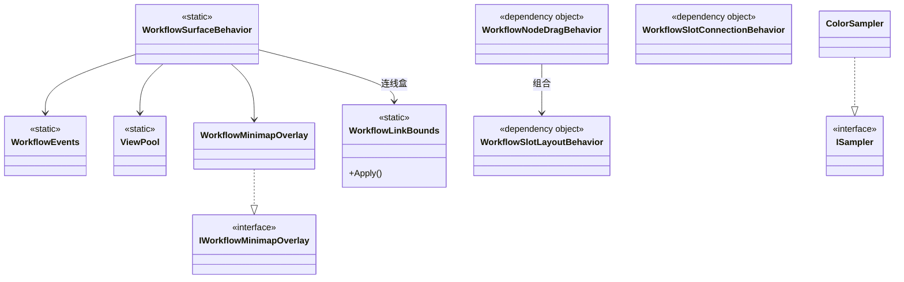

# Jalium适配器

`VeloxDev.Jalium` 混用两种行为风格：把配置挂到宿主的静态类，以及承载拖拽、连线与布局的实例 `DependencyObject` 行为。它最有特色的是静态连线几何助手：把每条连线视图的布局盒移到曲线之上。

## 类型拓扑

> 来源：`Src/Adapters/VeloxDev.Jalium/WorkflowSystem/AttachedBehaviors/WorkflowSurfaceBehavior.cs:40`、`WorkflowEvents.cs:32`、`ViewPool.cs:19`、`WorkflowLinkBounds.cs:29`、`WorkflowNodeDragBehavior.cs:29`、`WorkflowSlotConnectionBehavior.cs:33`、`WorkflowSlotLayoutBehavior.cs:43`、`WorkflowMinimapOverlay.cs:22`；`TransitionSystem/Samplers/ColorSampler.cs:5`。

## 模式运用

| 模式 | 位置 | 证据 |
|---|---|---|
| 适配器 | 静态 + 实例行为 | 静态类挂配置；实例 `DependencyObject` 行为处理交互（`WorkflowSurfaceBehavior.cs:40`；`WorkflowNodeDragBehavior.cs:29`） |
| 代理 | `WorkflowEvents` | 静态事件接收器转发给宿主处理器（`WorkflowEvents.cs:32`） |
| 组合 | 行为层 | 拖拽、连线与布局行为叠在 surface 之上 |
| 策略 | 采样器 | Jalium 采样器实现 `ISampler`（`ColorSampler.cs:5`） |
| 模板方法 | Core 池/管道 | 适配器闭合共享核心类 |
| 门面 | surface | 静态 surface 托管事件、池、小地图与连线边界 |

### 连线几何只有一个归属

Jalium 没有单独的画布变换行为。连线摆放集中在静态 `WorkflowLinkBounds.Apply`：它把视图布局盒贴合到曲线，并返回绘制原点（`WorkflowLinkBounds.cs:29`、`:47`）。单一归属保证所有连线的命中测试与渲染一致。

### 静态与实例是刻意区分

surface、事件与池是静态的，因为它们是按名称解析的配置面；拖拽、连线与布局是实例 `DependencyObject` 行为，因为它们要在指针手势期间携带逐元素状态（`WorkflowNodeDragBehavior.cs:29`；`WorkflowSlotConnectionBehavior.cs:33`；`WorkflowSlotLayoutBehavior.cs:43`）。

## 设计要点

- 该适配器没有 `DynamicTheme` 转换器集；主题值转换不在其表面内，而过渡仍然具备。
- 过渡复用共享解释器与 Jalium 采样器，如 `PointSampler`、`RectSampler`、`Transform3DSampler`。
- `Src/Test/Headless` 中的无头套件覆盖该适配器。
