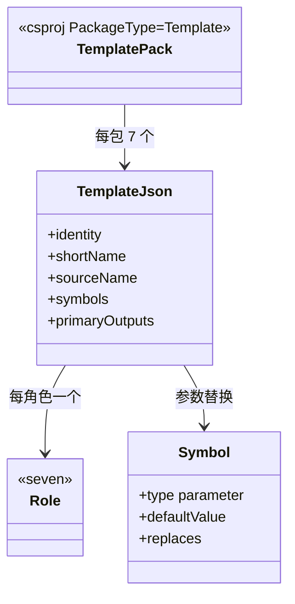

# 工作流条目模板

`Src/Templates` 提供七个 `dotnet new` 条目模板包，每个 GUI 适配器一个。每个包暴露相同的七个角色，因此使用者可以生成树、节点、插槽、连线、选择器、装饰器或小地图条目，并直接针对该平台的适配器。

## 类型拓扑

> 来源：`Src/Templates/VeloxDev.Avalonia.Templates/working/content/workflow-grid-decorator/.template.config/template.json:2-6`、`:14`、`:24-30`、`:44-48`；包工程 `Src/Templates/VeloxDev.WPF.Templates/working/VeloxDev.WPF.Templates.csproj`。

## 模式运用

| 模式 | 位置 | 证据 |
|---|---|---|
| 模板方法（打包层） | 共享包形态 | 所有包使用 `PackageType=Template` 与 `tags.type=item`；49 份清单共享同一契约 |
| 参数替换 | `symbols` | 每个符号都是 `"type": "parameter"` 并带 `replaces` 标记（`template.json:24-30`） |
| 命名生成 | `sourceName` | 所有模板都设 `"sourceName": "TemplateClass"`，`dotnet new` 据此重命名文件与标识符（`template.json:15`） |
| 按平台策略 | 七个包 | 相同角色网格，平台决定标记语言（`wpf`、`ava`、`winui`、`maui`、`winforms`、`razor`、`jalium`） |

### 7x7 网格

短名网格完整且精确：前缀 `wpf`、`ava`、`winui`、`maui`、`winforms`、`razor`、`jalium` 与后缀 `-v-tree`、`-v-node`、`-v-slot`、`-v-link`、`-v-selector`、`-v-decorator`、`-v-minimap` 组合（49 份清单，无缺失或错配）。身份采用真实角色名 —— `VeloxDev.<Platform>.WorkflowTreeView`、`WorkflowNodeView`、`WorkflowSlotView`、`WorkflowLinkView`、`WorkflowTemplateSelector`、`WorkflowGridDecorator`、`WorkflowMinimapOverlay` —— 而不是单一的 `Workflow` 加角色名。

### 每个角色生成什么

| 角色 | WPF / WinUI / MAUI / WinForms | Avalonia | Jalium | Razor |
|---|---|---|---|---|
| tree、node、slot、link | `.xaml` + `.xaml.cs` | `.axaml` + `.axaml.cs` | `.jalxaml` + `.jalxaml.cs` | `.razor` + `.razor.cs` |
| selector、decorator、minimap | `.cs` | `.cs` | `.cs` | `.razor` + `.razor.cs` |

角色目录为 `workflow-tree-view`、`workflow-node-view`、`workflow-slot-view`、`workflow-link-view`、`workflow-template-selector`、`workflow-grid-decorator`、`workflow-minimap-overlay`。

## 设计要点

- WinForms 包虽是 WinForms 适配器，却以 XAML 为先：标记角色继承 `Easel.Visuals.Controls.UserControl` 并引用 `VeloxDev.WinForms` 程序集。其选择器默认名为 `CustomTemplateSelector`，与其它包的 `TemplateSelector` 不同。
- 每份清单都是纯条目模板：49 份的 `tags.type` 全为 `item`，所有符号都是 `parameter`，没有任何包定义 `postActions` 或项目模板。
- 生成产物没有自动化测试；证据是模板清单加上镜像生成角色的 `* Trimmed` demo。
