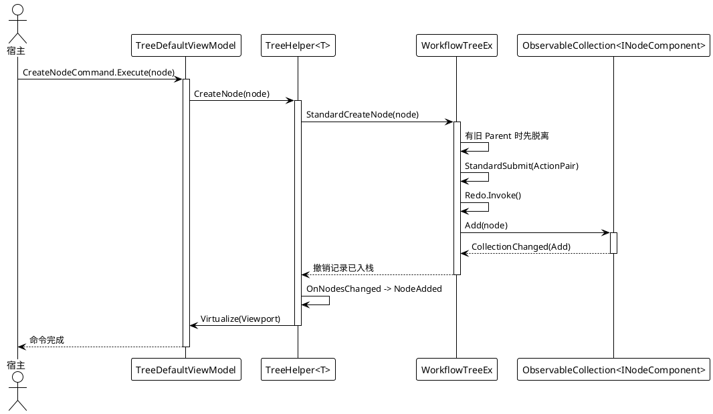

# 工作流图模型

一棵树拥有节点，一个节点拥有插槽，一条连线把发送端插槽接到接收端插槽。构造不是独立子系统：每个组件持有一个 helper，由 helper 把模型变更变成树上的一次可撤销动作。

## 实体构造

`TreeDefaultViewModel` 在构造函数里绑定默认 helper，`InitializeWorkflow` 是 helper 挂到模型上的唯一入口。

```csharp
public TreeDefaultViewModel() { InitializeWorkflow(); }
// ...
public void InitializeWorkflow()
{
    Helper.Install(this);
}
```

> 来源：`Src/Core/VeloxDev.Core/WorkflowSystem/Templates/ViewModels/TreeDefaultViewModel.cs` 第 28、98-101 行。

`TreeHelper<T>.Install` 接上集合观察者，按需启动 tick 通道，并启用虚拟化所需的空间索引。

```csharp
public virtual void Install(ITreeComponent tree)
{
    Component = tree as T;
    commands = tree.GetStandardCommands();
    VisibleItems = [];
    tree.Nodes.CollectionChanged += OnNodesChanged;
    tree.Links.CollectionChanged += OnLinksChanged;
```

> 来源：`Src/Core/VeloxDev.Core/WorkflowSystem/Templates/Helpers/TreeHelper.cs` 第 172-178 行。

## 正常流程：创建节点



`StandardCreateNode` 先把节点从旧树脱离，再把新增提交为 redo/undo 对；真正设置 `Parent` 并追加到 `Nodes` 的是 redo。

```csharp
public static void StandardCreateNode(this ITreeComponent component, INodeComponent node)
{
    var oldParent = node.Parent;
    var newParent = component;
    if (node.Parent is not null)
    {
        node.GetHelper().Delete();
    }
    component.StandardSubmit(new ActionPair(
        () => CreateNodeRedo(component, node, newParent),
        () => CreateNodeUndo(component, node, oldParent)));
}
```

> 来源：`Src/Core/VeloxDev.Core/WorkflowSystem/StandardEx/WorkflowTreeEx.cs` 第 28-41 行。

redo 体是触发 `Nodes.CollectionChanged`、进而触发 `NodeAdded` 的可观察变更：

```csharp
private static void CreateNodeRedo(ITreeComponent component, INodeComponent node, ITreeComponent newParent)
{
    node.Parent = newParent;
    component.Nodes.Add(node);
}
```

> 来源：`Src/Core/VeloxDev.Core/WorkflowSystem/StandardEx/WorkflowTreeEx.cs` 第 394-398 行。

## 几何读写

节点 getter 会按画布缩放折叠世界坐标，因此需要存储值时必须再展开。helper 在快照或移动节点时遵循这条规则。

```csharp
public static Anchor GetWorldAnchor(this INodeComponent component)
{
    if (component is null) throw new ArgumentNullException(nameof(component));
    return component.Anchor.Expand(component.Parent?.Layout?.Scale);
}
```

> 来源：`Src/Core/VeloxDev.Core/WorkflowSystem/StandardEx/WorkflowNodeEx.cs` 第 66-70 行。

## 错误与生命周期路径

- helper 未安装组件时 `CreateNode` 是空操作（`TreeHelper<T>.CreateNode` 转发到 `Component?.StandardCreateNode`）。
- 未开启虚拟化时 `Install` 在创建空间索引前返回；开启时调用 `EnableMap` 与 `InitializeTickable`。
- 非零视口到达时若从未启用空间索引，`Component?.Virtualize(Viewport)` 会抛 `ArgumentNullException`。默认零视口在检查之前就返回，因此未开启虚拟化的 helper 仍可转发节点新增通知。
- `SetHelper` 先卸载旧 helper、换字段、再安装新 helper，因此一棵树不会同时带两个已安装 helper。

> 来源：`Src/Core/VeloxDev.Core/WorkflowSystem/Templates/Helpers/TreeHelper.cs` 第 172-193、232-238 行；`Src/Core/VeloxDev.Core/WorkflowSystem/GUI/Virtualization/WorkflowSpatialEx.cs` 第 115-126 行；`Src/Core/VeloxDev.Core/WorkflowSystem/Templates/ViewModels/TreeDefaultViewModel.cs` 第 103-109 行。
